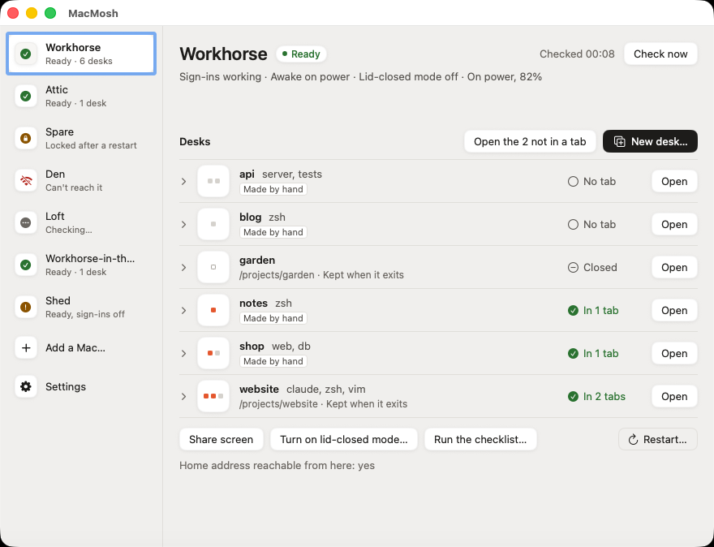
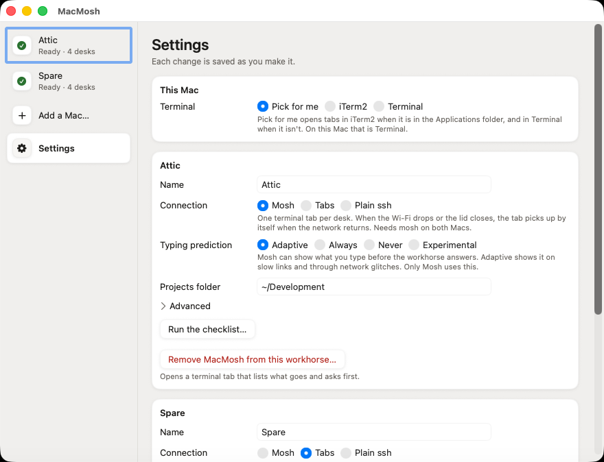

# MacMosh

MacMosh turns a spare Mac into a remote machine that stays on, stays reachable, and runs long jobs. You drive it from your daily Mac using a menu-bar icon instead of memorised commands.

> [!NOTE]
> MacMosh is a working preview that its author uses every day. The first signed release is being prepared. Until it is out, the only way to run it is to [build it from source](#build-it-from-source).

<picture>
  <source media="(prefers-color-scheme: dark)" srcset="docs/images/window-dark.png">
  <source media="(prefers-color-scheme: light)" srcset="docs/images/window-light.png">
  
</picture>

The pictures show made-up sample data. The menu under the M in the menu bar shows the same states and desks.

## Words used here

- **The remote Mac** is the spare Mac that stays on and runs your work. MacMosh's own menus call it the workhorse.
- **The daily Mac** is the Mac you sit at. MacMosh runs here.
- **A desk** is one named terminal session on the remote Mac that keeps running when you disconnect. Each desk opens in a terminal tab (in Apple's Terminal, a window).

## What it does

- **Desks that keep running.** [mosh](https://mosh.org) (a replacement for ssh, the usual way to type commands on another Mac, that survives Wi-Fi drops and a closed lid) carries the connection. [tmux](https://github.com/tmux/tmux/wiki) (a program on the remote Mac that keeps each desk alive while nobody is connected) keeps the work going. A desk can come back by itself after the remote Mac restarts and someone logs in.
- **The remote Mac's state in plain words**, in the menu and the window: `Ready`, `Ready, sign-ins off`, `Waiting for login`, `Locked after a restart`, `Can't verify it` or `Can't reach it`, and, while a Mac is being set up, states such as `Not paired` and `Needs setting up`.
- **Getting back in after a restart, on your home network.** With FileVault (macOS disk encryption) on, a restarted Mac waits at a locked disk. The `Unlock disk…` button opens a terminal tab where you type the Mac's password into ssh; MacMosh never sees it. Then `Log in…` opens Screen Sharing at the login window. Away from home, a restarted remote Mac is out of reach until someone logs in at it. A guide for unlocking it from anywhere is planned.
- **Lid-closed mode** for a remote Mac that is a laptop. It changes a power setting Apple doesn't document. The setting was tested by hand on one MacBook Pro: with the lid closed, on power and with no display, it stayed awake and reachable for 43 minutes. The menu button itself was not part of that test. Read [docs/lid-closed.md](docs/lid-closed.md) before you depend on it.
- **Adding a Mac, and a checklist that sets it up.** `Add a Mac…` pairs the daily Mac with the remote Mac. `Finish setting up…` installs what the remote Mac needs, and `Run the checklist…` checks both Macs again at any time. The steps are under [First use](#first-use).
- **Three ways to connect**, chosen per remote Mac in Settings under Connection.

<picture>
  <source media="(prefers-color-scheme: dark)" srcset="docs/images/settings-dark.png">
  <source media="(prefers-color-scheme: light)" srcset="docs/images/settings-light.png">
  
</picture>

### Which connection do I use?

The lines are shortened from the ones the app shows under Connection.

| Connection | What you get, and what happens when the Wi-Fi drops or the lid closes | Needs |
|---|---|---|
| **Mosh** (the default) | One terminal tab per desk. The tab picks up by itself when the network returns. | mosh on both Macs |
| **Tabs** | Every window of a desk as a real tab in iTerm2 (an optional terminal app). The tabs close; your work keeps running, and reconnecting brings the tabs back. | iTerm2. In Terminal, Mosh is used instead. |
| **Plain ssh** | One terminal tab per desk. The tab ends; your work keeps running. | Nothing extra |

In Apple's Terminal, each tab opens as a window. Use Mosh unless you have a reason not to. Use Plain ssh if mosh is blocked, for example by the remote Mac's firewall.

## What you need

- **Two Macs**: the daily Mac and the remote Mac.
- **The daily Mac**: macOS 15 or later.
- **The remote Mac**: macOS 15 or later on Apple silicon. Unlocking its disk over ssh after a restart also needs macOS 26 or later; on an older macOS, MacMosh says so and you unlock it at the Mac.
- **[Homebrew](https://brew.sh)**, the package manager mosh and tmux come from. MacMosh uses it to install mosh on both Macs and tmux on the remote Mac. On the daily Mac you install Homebrew yourself; for the remote Mac, the checklist names a command that runs Homebrew's installer.
- **A terminal**: [iTerm2](https://iterm2.com) is optional; Apple's Terminal works.
- **[Tailscale](https://tailscale.com)** (a private network between your own devices) is optional: it lets you reach the remote Mac away from home. At home, MacMosh uses the home network.

## Install

A signed download is on its way: the first release is being prepared. When it is out, the download goes here, and that is how to install MacMosh.

Until then, you can build it from source.

## Build it from source

You need a Mac with Xcode and [Homebrew](https://brew.sh). The package asks for Swift 6 or later; CI builds it on macOS 15 and macOS 26.

1. **Install the two tools the checks use.** Run `brew install tmux shellcheck`. tmux runs in the tests; shellcheck checks the shell scripts.
2. **Clone the repository.** Run `git clone https://github.com/shariqh/macmosh.git`. Git makes a folder called `macmosh`.
3. **Go into it.** Run `cd macmosh`.
4. **Run the checks.** Run `scripts/check.sh`. It builds, runs the tests and checks the scripts, and stops at the first failure. It takes a while. The last line is `check.sh: all checks passed`.
5. **Build the app.** Run `scripts/build-app.sh --adhoc`. It signs the app ad hoc (with no developer certificate). The last line is `build-app.sh: built dist/MacMosh.app (ad hoc)`.
6. **Move it and open it.** Move `dist/MacMosh.app` to your Applications folder, so the command inside it is `/Applications/MacMosh.app/Contents/Helpers/macmosh`, as [docs/lid-closed.md](docs/lid-closed.md) expects. Open it. No window opens: look for the M in the menu bar. Its menu says `No workhorses yet` and offers `Add a Mac…`. `Open MacMosh` opens the window.

## First use

1. **At the remote Mac**, open System Settings > General > Sharing and turn on Remote Login and Screen Sharing.
2. **On the daily Mac**, choose `Add a Mac…` in the menu. A terminal tab opens.
3. **In the tab**, type the remote Mac's address and its user name. Compare the key fingerprint with the one at the remote Mac, type `yes`, then type the remote Mac's password into ssh. The tab says `Paired.`
4. **Choose `Finish setting up…`** while the remote Mac shows `Needs setting up`. Its tab installs mosh and tmux with Homebrew and puts MacMosh's small script and its login agent on the remote Mac.
5. **Run any `Fix: run macmosh …` line** the tab prints, using the full path `/Applications/MacMosh.app/Contents/Helpers/macmosh`. These fixes need a password, such as keeping the remote Mac awake on power: the command shows what it runs, and you type the password into ssh.
6. **When the remote Mac shows `Ready`**, `New desk…` makes your first desk.

macOS asks once per terminal app, the first time MacMosh opens a tab there, and once the first time MacMosh reaches the remote Mac on your home network. Choose Allow.

### If something's off

- **`check.sh` stops at a `shellcheck` line**: shellcheck isn't installed. Run `brew install shellcheck`.
- **macOS asks for the permissions again**: `build-app.sh` warns that this happens after every rebuild. Choose Allow again.
- **A desk won't open with mosh** and the checklist says the firewall is on: switch that Mac to Plain ssh in Settings, or allow mosh-server in the firewall's options at the remote Mac.

## How it is built

MacMosh is built in the open: every change is a pull request, and most have their own GitHub issue. An AI coding agent does the building under the author's direction. [docs/build-log.md](docs/build-log.md) is the author's build diary. The design is [docs/superpowers/specs/2026-11-18-macmosh-v1-design.md](docs/superpowers/specs/2026-11-18-macmosh-v1-design.md).

## Licence

MIT. See [LICENSE](LICENSE).

Mac and macOS are trademarks of Apple Inc., registered in the U.S. and other countries and regions.

MacMosh is an independent project, not affiliated with Apple or with the mosh project.
