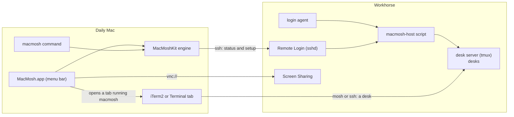

# MacMosh v1 design

Status: approved by Shariq on 2026-11-19. Written: 2026-11-18. Repo: `shariqh/macmosh`.

Changed by Shariq later on 2026-11-19: no SwiftBar prototype. The first menu is a native menu-bar item, with no third-party tool to install (section 13).

## 1. The short version

MacMosh is a menu-bar app for the Mac you sit at. It sets up a spare Mac as a **workhorse** (a Mac that stays on and runs your work), shows whether the workhorse is ready, and gives you buttons for the things that took commands before: open a terminal that survives a dropped connection, share the screen, restart, and get back in after a restart.

It packages what Shariq and an agent built by hand over two days (dev-setup #45), so someone with one or two spare Macs can do it in minutes.

What gets built, in order:

1. **Checks on the real Macs** for the facts no document settles (section 9).
2. **The engine and a command** (`macmosh`), written in Swift, plus one small script that lives on the workhorse.
3. **A first native menu-bar item**, with the status and the buttons, so Shariq can try them for a few days.
4. **The rest of the native app**: Add a Mac, Settings and notifications.
5. **A signed download and a Homebrew install.**

Nothing in MacMosh ever types, stores or sees a password. Where a password is needed, MacMosh opens a terminal tab or Apple's Screen Sharing window and you type it there.

## 2. Words used

| Word | Meaning |
|---|---|
| **Workhorse** | The spare Mac that stays on. |
| **Daily Mac** | The Mac you sit at. MacMosh runs here. |
| **Desk** | One named terminal session on the workhorse that keeps running when you disconnect. Usually one desk per project. Each desk shows as one terminal tab. |
| **mosh** | A replacement for the ssh terminal connection that survives Wi-Fi drops and a closed lid. |
| **tmux** | The program on the workhorse that keeps each desk alive while nobody is connected. |
| **Tailscale** | A private network between your own devices, so the daily Mac can reach the workhorse from anywhere. |
| **Home address** | The workhorse's address on your home network (for example `192.168.1.20`). With the usual Tailscale app, it is the only address that works before someone logs in. |
| **FileVault** | macOS disk encryption. After a restart the disk stays locked until someone types the Mac's password. |
| **Remote Login** | The macOS switch that turns on ssh. |
| **Screen Sharing** | The macOS switch, and the built-in app, for seeing and controlling another Mac's screen. |
| **Login agent** | A small job macOS starts each time you log in (a LaunchAgent). |
| **Keychain** | Where macOS keeps saved logins. Tools such as `gh` and Claude Code read their sign-ins from it. |

## 3. Why

- Setting up the workhorse by hand took two days and left a cheat sheet of commands to remember. Shariq: "We had to do A LOT and now I have a lot of steps I have to remember."
- He wants buttons, and something other people can use: "a way to use 'buttons' to manage everything so we never have to use these commands, and also we can distribute to others (probably as open source)."
- It is not an AI tool. "What we've set up doesn't have to lend to AI at all, right? Just accessing any Mac as a workhorse."
- A blog post and a YouTube video about building it will follow, so `docs/build-log.md` is kept from the first step.

Existing tools cover parts of the job (checked 2026-11-18 [29]):

| Tool | What it does | What it leaves out |
|---|---|---|
| VibeTunnel | Puts a Mac's terminals in a browser | Preparing the Mac, restart recovery |
| SwitchBored | A menu bar listing machines, with one-click SSH, tmux and VNC | mosh, preparing the workhorse, restart recovery |

Nothing found prepares the workhorse and gets you back in after a restart. That is the gap MacMosh fills.

## 4. Goals, non-goals, anti-goals

### Goals for v1

1. **Add a Mac.** A guided setup pairs the daily Mac with a workhorse and checks everything, with a fix or an instruction for each failed check.
2. **Prepare the workhorse.** Desks that keep sign-ins working, a Mac that stays awake on power, and a recorded home address.
3. **Status in the menu bar.** Ready, waiting for login, locked after a restart, or unreachable, with the reason.
4. **Buttons.** Open a desk, make a new desk, share the screen, restart.
5. **Restart recovery at home, out of the box.** Unlock the disk and log in from the daily Mac. Doing this from away is an optional add-on.
6. **A "keep running with the lid closed" setting**, tested on the MacBook Pro on 2026-11-22 (section 8.5).
7. **Something to try early:** the native menu-bar item with the status and the buttons comes first, then the rest of the app.
8. **An install people can trust:** signed and notarized by Apple, with a Homebrew command.
9. **A build log** good enough to write the blog post and the video from.

### Non-goals for v1

- Managing many Macs at once (bulk actions, fleets). The app handles a short list, one or two.
- A phone app.
- AI features. Agent Inbox or Claude Code add-ons can come later.
- Linux or Windows, on either side.
- A terminal of its own. MacMosh opens tabs in iTerm2 or Apple's Terminal.
- File transfer and port forwarding.
- Setting up Tailscale or a relay for you. MacMosh checks and explains; you make the changes.
- The Mac App Store. Its sandbox gets in the way of an app that runs `ssh`, mosh and Homebrew tools.
- Automatic updates inside the app. v1 updates through Homebrew or a new download.

### Anti-goals: failures even if it works

- **Handling a password.** FileVault, login and `sudo` passwords are typed by you into ssh, `sudo` or Screen Sharing, never into MacMosh.
- **Exposing the workhorse.** No port forwarded on the router, no public tunnel, no new listening service. The ways in stay ssh and Screen Sharing, over Tailscale or the home network.
- **Changing security settings quietly.** MacMosh never changes FileVault, Remote Login, Screen Sharing or the firewall. It changes power settings only after showing you the exact command, and you type the password.
- **Breaking what you have.** It never edits `~/.ssh/config`, `~/.ssh/known_hosts`, your shell files or `~/.tmux.conf`, and it never touches tmux sessions it didn't create.
- **Phoning home.** No telemetry, no account, no cloud service.
- **Leaving a mess.** Everything it installs on a workhorse can be listed and removed with one button.
- **Trademark trouble.** "Mac" is never shown more prominently than "Mosh" (same size, colour and typeface), no Apple logo or drawing of Apple hardware appears in the icon or the docs, and the name is never a pun on an Apple name [25].

## 5. What v1 looks like

### 5.1 The menu

```
◉  (menu-bar icon: its badge shows the state of the workhorse that most needs you)

MacBook Pro · Ready
   Desks
      website           2 windows
         New window in website
         Rename website…
         Remove website…
      notes             1 window, permanent
         New window in notes
         Rename notes…
         Remove notes…
      journal (closed)
         Rename journal…
         Remove journal…
      New desk…
   Share screen
   Restart…
   Sign-ins working · Awake on power · Lid-closed mode off · On power, 82%
────────────
Add a Mac…
Settings…
Quit MacMosh
```

The same workhorse in its other states:

```
MacBook Pro · Waiting for login          MacBook Pro · Locked after a restart
   Log in…  (opens Screen Sharing)          Unlock disk…  (you type the Mac's password)

MacBook Pro · Can't reach it
   Last seen 14:02. Tailscale is off on this Mac.      ← the most likely reason, in plain words
```

The icon shows state by shape as well as colour, so it reads in a monochrome menu bar.

A desk's line opens it. An ordinary desk is gone from the menu once its last window is closed. A permanent desk stays: while it is open its line says `permanent`, and once its last window is closed its line says `(closed)`, and one click opens it again in its folder (section 7.3).

Under each desk, open or closed, `Rename <name>…` and `Remove <name>…` each open a terminal tab that asks first. Rename asks for the new name; the desk keeps its windows and what runs in them. Remove names the desk and the windows that will close, and asks once; only `yes` removes it, and then its windows close too, with whatever runs in them. An open desk also has `New window in <name>` above them.

**Changed 2026-11-23:** the menu drawn above is the v1 menu. It is being rebuilt with one row per desk and a submenu under it, a line per window that brings its tab forward, and the workhorse's rarer lines under its own row (issues #107 and #105). That menu is described in `docs/superpowers/specs/2026-11-23-menu-submenus-design.md`.

### 5.2 The states

| State | What it means | How MacMosh knows | What you can do |
|---|---|---|---|
| **Ready** | Logged in, desks available, sign-ins working | ssh works, someone is logged in at the Mac, the desk server is running and can read the keychain | Open desks, share screen, restart |
| **Ready, sign-ins off** | Desks work, but tools that keep logins in the keychain look signed out | As above, but the keychain check fails. "Sign-ins working" means only this: desks can use the keychain | "Fix…" explains the likely cause and offers to restart the desk server. It lists the desks that would close and asks first; it never restarts by itself |
| **Waiting for login** | The Mac is on and unlocked, but nobody has logged in | ssh works with MacMosh's key at the home address, and no one is logged in at the screen | Log in with Screen Sharing |
| **Locked** | Restarted, disk still locked | The home address answers on the ssh port but offers password sign-in only (keys can't work before the unlock [11]). Section 7.6 has the detail | Unlock disk |
| **Can't verify it** | Something answers at the workhorse's address with a different key | ssh reports a host-key mismatch | Stop. Don't type a password. Check or unlock at the Mac |
| **Can't reach it** | Off, asleep, no network, or locked while you are away | Nothing answers | Read the likely reason |

MacMosh works out the state itself each time it checks. It never assumes what comes after an unlock, because Apple's documents don't say (section 8.3).

One more line the menu can show, for a minute after a login: **`Waiting for the desk server`**. Someone has just logged in at a workhorse whose login agent is installed, and the desk server isn't running yet. The check still finds the desk server down, so the menu shows this in place of "Desk server is off" and its fix, for up to 60 seconds (section 13, call 26).

### 5.3 Add a Mac, step by step

Part A happens at the workhorse, by hand, once. The app shows these steps with a picture of each switch:

1. Turn on **Remote Login**: System Settings > General > Sharing [13].
2. Turn on **Screen Sharing** in the same place. It has to be switched on here: the command-line way stopped working in macOS 12.1 [14].
3. Optional, for reaching it from anywhere: install **Tailscale** and sign in.
4. Note the user name and the computer name the Sharing pane shows. This is what you give the app as the main address if the workhorse isn't in your Tailscale list. You never type the home address: the app reads it from the workhorse.

Part B happens on the daily Mac, in the app:

1. **Choose the workhorse.** Pick it from the list of your Tailscale devices, or type an address.
2. **Check it's the right Mac.** The app shows the workhorse's key fingerprint and the one command to compare it at the workhorse.
3. **Pair.** A terminal tab opens and asks for the workhorse's password once. This installs MacMosh's own ssh key there. The app creates that key the first time you add a Mac.
4. **Prepare.** The app runs the checks in section 7.5 and fixes what it can. Anything that needs the Mac's password opens a terminal tab with the command already typed.
5. **Make the first desk** and open it.
6. Recommended: **practise a restart** now, so you know recovery works before you need it.

If a step fails, the app says what it tried, what came back, and the one thing to do next.

### 5.4 Opening a desk: which connection do I use?

| Mode | What you get | When the Wi-Fi drops or the lid closes | Needs |
|---|---|---|---|
| **Mosh** (the default) | One terminal tab per desk | The tab picks up by itself when the network returns | mosh on both Macs |
| **Tabs** (optional) | Every tmux window as a real iTerm2 tab | The tabs close. Your work keeps running, and reconnecting brings the tabs back | iTerm2 |
| **Plain ssh** (fallback) | One terminal tab per desk | The tab ends. Your work keeps running | Nothing extra |

Shariq chose mosh as the default on 2026-11-18: "mosh should be the default so we can provide the most reliability." Tabs mode can't run over mosh: iTerm2's author says tmux integration "can't accept random dropouts" and mosh drops output by design, and the matching mosh issue is still open [5].

In Tabs mode, `macmosh connect` itself keeps trying: when ssh drops, it reconnects in the same tab every few seconds until the workhorse answers, and iTerm2 rebuilds the tabs (section 9, item 4 tests this). In Plain ssh mode it does not retry.

Inside a desk, tmux gives you several windows (for example two agents in one project). The app lists a desk's windows and can add one. Scrolling back happens in tmux, with the mouse wheel, because mosh carries only the visible screen.

### 5.5 After a restart: which button do I use?

| Situation | What you press | What happens |
|---|---|---|
| You want to restart it | **Restart…** | A terminal tab runs the restart that skips the disk unlock (`fdesetup authrestart` [11]). You type the Mac's password. The Mac comes back to the login window. |
| It restarted on its own (crash, power cut, update) | **Unlock disk…** | A terminal tab connects to the home address. You type the Mac's password. The disk unlocks and the connection closes, as Apple describes [11]. |
| It is at the login window | **Log in…** | Screen Sharing opens at the home address. You log in as if you were at the Mac. |
| You have logged in | Nothing | Tailscale, the desk server and your startup desks come up by themselves. The state turns to Ready. |

All of this works on the home network with no extra hardware. From away, the home address is out of reach unless you set up the add-on in section 7.9.

Restart recovery over ssh needs a workhorse with Apple silicon and macOS 26 or later [10]. On an older or Intel Mac the app says so, and you unlock at the Mac.

### 5.6 Lid closed: which option do I use?

| Option | Cost | State of knowledge |
|---|---|---|
| Leave the lid open | Free | Works. The Mac never sleeps on power once prepared. |
| **"Keep running with the lid closed" switch** | Free | Tested on the MacBook Pro on 2026-11-22 (section 8.5): with the lid closed, on power and with no display, it stayed awake and reachable for 43 minutes, and the setting was still on after a restart. It sets a macOS power setting that Apple doesn't document [15]. Reports disagree on whether it works on Apple silicon [16]. |
| A dummy display plug | About $10 | Imitates an external display, which is what Apple's own lid-closed use needs, along with power [17]. Apple says nothing about dummy plugs, and we have not tested one. |

The switch warns that the Mac must stay plugged in (the setting also blocks sleep on battery, so a closed Mac would run until the battery is empty [16]) and that a closed Mac runs hotter.

## 6. Approaches considered

1. **One engine, two faces (chosen).** A Swift library holds all the logic. A `macmosh` command sits on top of it, and the native menu-bar app is a thin face over the same library. The workhorse gets one small shell script and a login agent, installed over ssh. No app runs on the workhorse.
   - For: nothing is written twice, the logic has tests from day one, and the first menu exercises the real engine.
   - Against: the first clickable menu takes a little longer than a shell script would.
2. **A throwaway shell prototype, then a separate native app.** The quickest first demo.
   - Against: every behaviour gets written and debugged twice, and what the prototype proves about quoting and parsing doesn't carry over to Swift.
3. **An app on both Macs.** A second copy runs on the workhorse, reports status and makes changes there with Apple's own password prompts.
   - For: nicer pairing, and a native prompt for power settings.
   - Against: twice the interface, a new service listening on the workhorse or a channel to poll, and more for a user to trust on the machine that holds their work. It can come later: the engine already runs each check either locally or over ssh.

Ruled out earlier, in the brainstorm: a cross-platform app (heavier, less native in the menu bar), and a SwiftBar plugin as the final product (every user would have to install SwiftBar first). The first plan still used SwiftBar, a free third-party menu-bar tool, for a throwaway prototype. On 2026-11-19 Shariq ruled that out too: "i don't want third party dependency can we not make a native menu bar item instead". So the menu is native from the start.

## 7. How it's built

### 7.1 The pieces



| Piece | What it is | Where it runs |
|---|---|---|
| **MacMoshKit** | A Swift package with no interface: the list of workhorses, the status checks, the setup checklist, the command lines, the terminal launchers | Daily Mac |
| **`macmosh`** | A command built on MacMoshKit. The menu calls it, tests drive it, and every terminal tab MacMosh opens runs one of its subcommands | Daily Mac |
| **MacMosh.app** | The native menu-bar app (SwiftUI `MenuBarExtra`, no Dock icon [21]) | Daily Mac |
| **`macmosh-host`** | One readable shell script. It starts the desk server, reports status, and attaches to desks | Workhorse |
| **Login agent** | Runs `macmosh-host start` each time someone logs in | Workhorse |

### 7.2 Every terminal tab runs `macmosh`

When the menu opens a terminal tab, the tab runs a `macmosh` subcommand, never a long ssh or mosh line built by the menu. The subcommand prints one or two plain sentences about what is happening, then hands over to ssh or mosh.

| Subcommand | What it does in the tab |
|---|---|
| `macmosh connect <workhorse> <desk>` | Names the tab after the desk, then starts mosh (or ssh, or Tabs mode) into the desk |
| `macmosh pair <user@address>` | Shows the workhorse's key fingerprint, then installs MacMosh's ssh key there (you type the password once) |
| `macmosh unlock <workhorse>` | Connects to the home address so you can type the password that unlocks the disk |
| `macmosh restart <workhorse>` | Lists the desks that will close, then runs `sudo fdesetup authrestart` over ssh |
| `macmosh power <workhorse> …` | Shows the exact `pmset` command, then runs it with `sudo` over ssh |

This keeps the quoting, the paths and the error messages in tested Swift code, and it gives the command and the app the same behaviour. If a command fails, the tab stays open with the reason and waits for a key.

Other subcommands are not interactive: `status`, `desks`, `add`, `prepare`, each with `--json` where a program reads the output.

### 7.3 Desks and the desk server

- A desk is a tmux session. All of MacMosh's desks live in **one tmux server of their own**, on a socket named `macmosh` (`tmux -L macmosh` [3]). Your own tmux sessions on the default socket are never touched.
- **Only the login agent starts that server.** A tmux server started from the login session can read the keychain; one started from an ssh connection can't. This was the largest gotcha of the hand-built setup, and it is why `gh` and Claude Code looked signed out over ssh [30]. A separate socket means an ssh user who types `tmux` can never start the wrong kind of server for the desks.
- `macmosh-host attach <desk>` never starts the server itself. If the server is down it asks macOS to run the login agent again (section 9, item 1 tests that this works over ssh), and if nobody is logged in it says so and stops.
- **The check for sign-ins** is `security show-keychain-info` on the login keychain, run inside the desk server. In a session that can use the keychain it prints the keychain's settings; over plain ssh it prints "User interaction is not allowed." It reads no secret. Verified on both Macs on 2026-11-18.
- **Friendly defaults.** The desk server starts with mouse scrolling on and a long scrollback, because mosh itself has no scrollback [1]. Your own `~/.tmux.conf` is loaded afterwards, so your settings win, except two that desks depend on: the server stays up with no desk open (`exit-empty off`), and a desk stays open when its last terminal leaves (`destroy-unattached off`).
- **Desk definitions live on the workhorse**, one line per desk: name, folder, an optional startup command, whether to reopen it after a restart, and whether it is permanent. They survive restarts and work from any daily Mac.
- **Every new desk comes back after a restart**, unless it was made with `macmosh desk new … --no-reopen`. `New desk…` in the menu asks nothing about it.
- **After a restart**, the login agent recreates the desks marked "reopen" and types each one's startup command into a normal shell. If the program later quits, the desk stays open at a prompt. A permanent desk that was closed is opened again too, when it is marked reopen. Starting the server never removes a definition: a server that was down says nothing about why. A definition that is not reopened stays as it is; the menu doesn't show it if it is not permanent, `desk new` with its name replaces it, and connecting to it by name makes the desk again.
- **A desk is removed when its last shell exits**: typing `exit` in its last window, or closing that window, removes its definition, and its name can be used again. A desk made with `macmosh desk new … --permanent` stays instead: the menu shows it as closed, and opening it makes it again in its folder with its startup command.
- **An exit is told apart from the desk server going away.** A restart, a shutdown, `restart-server` and a server that is killed all close every desk at once, and none of them may remove a definition, or nothing would come back. The desk server runs a hook when a desk closes. A minute later the hook asks the workhorse script to remove the definition, and the script does so only when the same desk server (the same process) still answers, somebody is logged in at the screen, and the desk has not been opened again. The minute is waited inside the desk server, so a restart or a logout that ends the server within it keeps the definition. That matters at a restart or logout from the Apple menu: macOS first quits the apps, which can take many seconds, and only then ends the desk server, so a desk whose program waited on one of those apps can close in between. The cost: after a real exit, the leftover line stays (hidden by the menu) for up to a minute, and a desk exited less than a minute before a restart comes back once. tmux 3.8 runs no such hook at all while its server shuts down (seen with `kill-server`, SIGTERM, SIGINT and SIGKILL on a throwaway socket on 2026-11-22), and an interactive zsh survives the SIGTERM a shutdown sends, so its desk ends only with the server. When anything is unclear the definition stays: a leftover definition is never shown in the menu, and `desk new` with its name replaces it.
- **A desk server started by an older script gets the hook without a restart**, because the script's `start`, `status` (the check every 30 seconds), `attach`, `desk-new` and `window-new` set it again each time, and turn `destroy-unattached` off again with it. `desk-remove` does not. Restarting the server would close every desk.
- **A desk can keep a command running**: the script restarts it when it exits, with a pause between tries. This replaces the hand-written `rc-servers` loop from the hand-built setup. It is the last v1 item and the first to cut.
- **New desk** asks for a name, a folder and a command to start in it (Enter for none). The app lists the folders inside a "projects folder" you choose once per workhorse (for example `~/Development`), so most new desks are two clicks. The command is stored with the desk and typed into it each time the desk is made, as `macmosh desk new … --command` does; given there, it isn't asked for.
- **A desk can be renamed** with `macmosh desk rename <workhorse> <desk> [<new name>]` or the menu's `Rename <name>…`, open or closed. The workhorse renames its tmux session and the first field of its definition, under the desk list's lock, so the desk keeps its windows, what runs in them, its folder, its startup command and whether it comes back, is kept running or is permanent. A rename closes no session, so the exit path never runs for it. The new name is refused when an open desk or a permanent one has it; a leftover line with that name is replaced, as `desk new` replaces it. With no desk server (after a restart, before the login), every line is a desk waiting to reopen, so any line takes the name. A desk that has just exited is no desk to rename. The script finds a desk's session by its exact name, never through tmux's `=name` target, which also matches an attached terminal's name. Tabs that are open on the desk keep working; their titles may still say the old name. The daily Mac keeps nothing by a desk's name except an open tab: a Tabs-mode tab tries the old name again after a drop, and then says the desk may have been renamed.
- **A desk can be removed from the menu**: `Remove <name>…` runs `macmosh desk remove <workhorse> <desk> --ask`, which says what will close and asks once. On `yes` it removes the definition and closes the desk's windows, as `--kill` does. Without `--ask`, `desk remove` forgets the desk and leaves its shell running unless `--kill` is given.
- **A desk can be open in several tabs, each showing its own window** (issue #105, decided 2026-11-23). In the code and these documents each such tab has a **view**: a small tmux session of its own in the same session group as the desk's session. tmux's manual says "Sessions in the same group share the same set of windows" and "The current and previous window and any session options remain independent", so a tab can show window 2 while the tab beside it stays on window 1, and a new window made for one tab doesn't take over the other. The word "view" never appears on screen. The workhorse script (0.7.0) makes them; the app starts using them in the next change.
  - `macmosh-host attach --window @<id> <desk>` opens a tab on that window of the desk, and `attach --new-window <desk>` adds a window and opens a tab on it. The new window is added with `-d`, so no other tab moves, and it starts in the desk's folder. A window that has closed is refused with `That window has closed.` Plain `attach <desk>` and `window-new <desk>`, which today's app runs, behave exactly as before: the tab is a client of the desk's own session, and `window-new` makes the new window the desk session's current one. `--cc` (Tabs mode) takes neither option, because iTerm2 already shows every window as a tab there.
  - **A view is never a desk.** Its name is `<desk>+<number>` (the number is the attach's process id), and `+` is not allowed in a desk name, so the status report, the exit path, reopening at start, `desk new`, `desk rename`, `desk remove`, `window new` and `attach` never take it for one. It also carries a tmux option, `@macmosh-view`, holding its desk's session id, which a rename does not change; the report finds a desk's views by it. tmux's own rename (prefix and `$`) renames the session a tab shows, which is its view, so a view can end up with a desk's name. The script therefore never takes a session with that option for a desk when it looks a desk up by name, and it records each view's id on the desk server (`@macmosh-view-<n>`), so when a view closes the exit path ignores it, whatever name it had then. The option and the record are set by the view's id, never by a command with no target: tmux applies such a command to the session of the pane it is run from, so a tab opened from a shell inside another desk would have tagged that desk.
  - **A view goes away with its tab.** It is set to close when its last client leaves (`destroy-unattached on`, on the view only; the server-wide setting stays off). The setting is applied just after the tab attaches, because tmux 3.8 destroys a view at once when it is set before a client is there. A view whose tab never arrived (the attach failed, or the connection broke in that moment) is removed by the next status check once it is a minute old and still has no client. While the desk's own session is there, removing a view closes no window. If the desk's own session was killed by hand (tmux's `kill-session`, or `x` in its session list, or `desk remove --kill` of the script before 0.7.0, which knows nothing of views), the views keep its windows running while their tabs are open; when the last tab closes, its view closes too and takes the windows with it, as the kill closed them before views existed. That needs no status check, so it also holds after the script is put back to 0.6.0. Over mosh, a tab closed while the network was down keeps its view until mosh gives up (up to a week), as a stale tab already does today.
  - **The removal rule is unchanged.** When a desk's last shell exits, tmux closes every session of the group, and the exit hook runs once for the desk's name and once for each view's name; the view names are ignored and the desk's definition is removed as before. Closing a view never removes a desk, and a view can't keep a desk alive after its last shell exits, because the windows are the desk's. A restart or a stopped desk server ends the views with everything else, and only desks come back. `desk remove --kill` closes the desk's views first, then the desk.
  - **Every desk is made in a session group of its own**, named `macmosh+g` and the number of its session id (`macmosh+g7`). tmux 3.8 keeps a group's first name for good, and a new session asked to join a name that a group already has joins that group. A group named after a desk would therefore catch a later desk given the same name after a rename, and that desk's tab would show the other desk's windows. No desk can be called `macmosh+g7`, so this can't happen, and the desk's own session is never renamed. A view joins the group through the desk's session id, never a name: tmux reads a name as a session's before a group's, so after a rename a group's name can be another desk's, and joining by it would pull that desk into the group and mix the two desks' windows. Given an id, tmux joins that session's own group. On tmux before 3.3, which can't say the next session id, the group's name is made from the script's process id, the time and a count instead. A desk made by an older script has no group until its first view makes one, which takes the desk's name; if a group of that name already exists (an older desk with views was renamed away from it), the new tab is refused with a message until the desk server restarts.
  - **The status report says which windows have a tab.** The `desk` line's attached count now counts every tab on the desk, its views' too. After a desk's `window` lines come a `windowinfo` line for each window (desk, index, window id such as `@3`, `1` when the desk's own session shows it, the number of tabs showing it) and a `view` line for each view (desk, the view's name, the window it shows now, its tabs, its label). The other records are unchanged, and an older app skips the two new ones.
  - **A view can carry a label, so the daily Mac can tell its tabs apart** (issue #111, script 0.8.0). A view's name holds a process number on the workhorse, which the daily Mac never sees, so it can't match one of its terminal tabs to a `view` line by it. Instead the tab's `macmosh connect` makes up a short word and passes `attach --label <word>`; the word is stored on the view (tmux option `@macmosh-label`, set by the view's id with its tag) and comes back as the last field of its `view` line, empty for a view with none. That line gives the window the view shows now, so the label follows the person when they switch windows inside the tab. With `--window` or `--new-window` the label goes on that view; with neither, the tab gets a view on the window the desk shows at that moment (a closed permanent desk is made first, as plain `attach` does). Plain `attach <desk>` with no option still attaches to the desk's own session.
  - **A view's bar shows its desk's name** (issue #130, 2026-11-23, script 0.9.0). tmux's bar at the bottom of a tab shows the session's name, so a tab on a view read `[website+35099]` where a plain tab reads `[website]`. A view now carries its desk's name in the tmux option `@macmosh-desk`, set with its tag and changed by `desk rename`, and gets a `status-left` of its own that reads that option wherever the server's bar names the session (`#S` or `#{session_name}`). With tmux's own bar it reads `[website]`; a bar you set yourself keeps everything but the name; one that never names the session is left alone. Nothing server-wide changes, and tmux's own session list still shows the views by their names.
  - Two tabs on the same window share one size: tmux's `window-size` is `latest` by default, so the window takes the size of the tab used most recently. Tabs on different windows each keep their own size.

- Desk names use letters, digits, `-` and `_`.

### 7.4 Checking status

- One ssh call per check: `macmosh-host status`. It reports the script's version, the macOS version and chip, who is logged in at the screen, whether the desk server is up, the sign-in check, FileVault's status, the power settings that matter, power source and battery, the current home address, and each desk with its windows.
- The app checks every 30 seconds while the workhorse is reachable, less often while it is not, and at once when you open the menu.
- A workhorse that has just stopped answering gets a second look five seconds later, and the menu keeps what it showed until then. A Mac that has just woken has no network for a moment, and on the first run that put "Can't reach it" in the menu for half a minute about a workhorse that was fine.
- **A minute's wait after a login.** The app remembers, for this run only, what the check before found. A check that finds someone logged in, the desk server down and the login agent installed, after one that found nobody logged in, a locked screen, nothing answering or no check at all, shows `Waiting for the desk server` for less than 60 seconds, and then `Desk server is off`. The result of the check is the same; only the menu changes (call 26, issue #88).
- The order of a check: the main address first (the Tailscale name), then the home address. The result maps to the states in 5.2.
- Tailscale itself is asked only for hints: is Tailscale running on this Mac, and does it think the workhorse is online? The Tailscale command needs `TAILSCALE_BE_CLI=1` when an app runs it, and its `Online` field means "connected to Tailscale's servers", not "reachable" [22].
- **The reason shown under "Can't reach it"** is the first of these that applies: Tailscale is off on the daily Mac; the daily Mac has no network; another VPN is running on the daily Mac; Tailscale says the workhorse is offline, and you are away from home (it may have restarted: the home address is out of reach from here); nothing answers at either address (it is off, asleep or disconnected).
- **Notifications** when the state changes: locked after a restart, waiting for login, back to ready, and "the workhorse is on battery".
- Nothing runs on the workhorse between checks. There is no MacMosh daemon.

### 7.5 The setup checklist

Each check has one of four kinds of fix: **auto** (MacMosh does it, after telling you), **password tab** (a terminal tab with the command typed; you type the password), **at the workhorse** (a switch only you can flip), or **info** (nothing to fix).

On the daily Mac:

| Check | Fix |
|---|---|
| mosh is installed | Auto: `brew install mosh`. If Homebrew is missing: instructions |
| A terminal is chosen (iTerm2 if installed, otherwise Terminal) | Info |
| MacMosh's own ssh key exists | Auto: create `~/.ssh/macmosh_ed25519` |
| MacMosh may open terminal tabs | macOS asks once per terminal app (Automation permission [6][21]) |
| MacMosh may reach the home network | macOS asks once (Local Network permission, macOS 15 and later [20]) |
| Tailscale is connected | Info, with a link. Optional |

On the workhorse:

| Check | Fix |
|---|---|
| Remote Login is on | At the workhorse |
| Screen Sharing is on | At the workhorse |
| MacMosh's ssh key is accepted | Password tab: `macmosh pair` |
| macOS version and chip | Info. Decides whether restart recovery over ssh is offered |
| Homebrew, mosh and tmux are installed | Auto for mosh and tmux. Homebrew's own installer runs in a password tab |
| `macmosh-host` and the login agent are installed and current | Auto. The files are copied over ssh into the user's home folder; running it again is safe, and the version line in the script decides whether to replace it |
| The desk server is running and sign-ins work | Auto. If it can't be started over ssh: log out and in once |
| The Mac stays awake on power (`pmset -c sleep 0`) and wakes for network access [15] | Password tab |
| It restarts after a power cut (desktop Macs: `pmset autorestart 1` [15]) | Password tab |
| FileVault's status | Info. MacMosh never changes it |
| The home address is recorded | Auto, refreshed on every status check |
| The macOS firewall | Info. If it is on, mosh may be blocked; the app says so and links to the steps (section 9, item 8) |
| Desks can open protected folders (Full Disk Access for tmux) | At the workhorse. Optional |

The checklist can be run again at any time from Settings.

### 7.6 Addresses and host keys

- Each workhorse has a **main address** (what you chose in Add a Mac, normally its Tailscale name) and a **home address** (its home-network IP, read from the status report and kept up to date).
- MacMosh keeps the workhorse's ssh host key in its own file and checks **both** addresses against that one key, with strict checking on. If the key doesn't match, ssh refuses, and the app tells you to stop and unlock at the Mac. This matters most at the unlock step, where you type the disk password.
- **MacMosh has its own ssh key:** `~/.ssh/macmosh_ed25519`, an `ed25519` key with no passphrase, readable only by you, used for nothing else. Status checks run in the background with nobody there to type a passphrase, so a key that needs one would make every check fail. A key of its own can also be revoked without touching your other keys, and "Remove MacMosh" can delete exactly that one line from the workhorse. The key is as safe as your daily Mac's login and disk encryption, and the security section says so. An advanced setting lets you name a different key; if that key isn't usable, the app says "your ssh key is locked", which is a different message from "Locked".
- **Telling Locked apart.** The first choice of signal is the list of sign-in methods the workhorse offers: before the unlock it can't offer keys at all [11]. The fallback signal is "this key worked before and is refused now". In sitting 2 the menu showed Locked at the disk-unlock screen, so one of the two worked, but the sign-in methods each address offered there were not recorded, so which signal fired is not known (section 9, item 6). The app never shows Locked just because a key is missing or unusable on the daily Mac.
- MacMosh uses the system `ssh` and your ssh settings. It adds options on the command line and leaves `~/.ssh/config` and `~/.ssh/known_hosts` alone.
- A reserved address on the router makes the home address stable across restarts. The app explains how, and that the Mac's "Private Wi-Fi Address" setting must be Fixed or Off for a reservation to hold [27]. This is advice, not a requirement: in most homes the address survives a restart anyway.
- The home address can only be refreshed while the workhorse is up. If the router hands out a different address during a restart, the last known one stops answering. MacMosh then tries the workhorse's local network name (`name.local`), which it also records. Whether that name answers before the disk is unlocked is not known (section 9, item 6). Sitting 2 did not record it, so it is still not known. If neither answers, the state is "Can't reach it", the hint says the address may have changed, and the fix is to unlock at the Mac and reserve the address.
- If the key offered at the workhorse's address ever differs from the pinned one, including at the locked screen, the state is "Can't verify it" and no unlock button is offered. One report says the key can differ before the unlock; it did not on the MacBook Pro (section 8.3). In sitting 2 the menu never said `Can't verify it` at any state, so no address the app checked showed a key other than the pinned one. The host key at each address in each state was not recorded, so that is what was seen at the menu level only (section 9, item 6). If a locked screen ever turns out to use a second key, the design changes to pin that key during "practise a restart", at the Mac, never by trusting it over the network.

### 7.7 Opening terminal tabs

- **iTerm2:** AppleScript, `create tab with default profile command "…"`. It works today, but iTerm2's docs say AppleScript "is no longer receiving improvements" [6]. iTerm2's URL scheme always shows a confirm dialog and its Python API is off by default [7], so neither is a better fit.
- **Terminal:** AppleScript, `do script` [8]. It opens a new window, not a tab: `do script` can run in a tab or window that already exists, and has nothing that asks for a new tab (sitting 1, and Terminal's scripting dictionary on macOS 27.3).
- **Terminal's `do script`, as printed on GitHub's runners** (added 2026-11-23, from the menu trial): on macOS 15 (Terminal 2.14) and macOS 26 (Terminal 2.15) the dictionary gives `do script` as "Runs a UNIX shell script or command.", its parameter `in` as "The tab in which to execute the command" (a tab or a window), and its result as "The tab the command was executed in." Nothing in that entry asks for a new tab, so in Terminal each tab MacMosh opens stays a new window. The trial printed only that entry. This corrects the line above: what it says is true of `do script` itself, but the same macOS 27.3 dictionary also lists a separate command, `do script in new tab` (issue #105), which nobody has run yet. Sitting 1 tried a different form, `do script … in new tab`, and got a syntax error (-2741). The same applies to call 20's "Terminal's scripting has no way to ask for a tab" (`docs/superpowers/specs/2026-11-23-menu-submenus-design.md`, section 8.5).
- Both sit behind one small interface, so a launcher can be replaced without touching the rest.
- If you deny the Automation permission, the app falls back to opening a small `.command` file with the terminal, and shows how to grant the permission. Sitting 1 showed that this way asks for no permission in either terminal.
- Sitting 1 tested all of this on 2026-11-20. In iTerm2 the tab opens and takes the desk's name. The results are in `docs/sittings/sitting-1-results.md`.

### 7.8 Restart recovery

The flow is section 5.5. The rules behind it:

- **Unlock** uses password sign-in at the home address, the only thing that works before the disk is unlocked [11]. The tab says, before the prompt: you are typing into ssh, MacMosh can't see it, and the connection will close by itself when the unlock works.
- **Log in** opens `vnc://` at the home address in Apple's Screen Sharing app.
- **Restart** uses `sudo fdesetup authrestart` when the Mac supports it (`fdesetup supportsauthrestart`), and tells you first which desks will close. Sitting 2 did not try this path; it ran the full restart.
- **Practise a restart** (from Add a Mac or Settings) does a full restart, so the unlock step is exercised too.
- FileVault stays whatever the user set. Apple disables automatic login while FileVault is on [12], so a restart always needs someone to log in.

### 7.9 The optional add-on: unlock from anywhere

Before login, the workhorse's own Tailscale isn't running: Tailscale's recommended Mac app doesn't run before login [22]. Reaching the home address from away needs another always-on device at home that passes traffic along (a Tailscale "subnet router").

v1 does not set this up. It ships:

- **A guide** (`docs/unlock-from-anywhere.md`) with numbered steps: pick an always-on device (Tailscale documents Macs, Apple TVs and Linux boxes as subnet routers [22]), advertise the workhorse's home address as a route, approve the route, and allow it in the access rules [22].
- **A light** in the app: "home address reachable from here: yes or no", tested the same way at home and away. Macs accept Tailscale routes by default [22], so once the relay exists the buttons in 5.5 work from anywhere without changes.

### 7.10 Lid closed

- The switch runs `sudo pmset -a disablesleep 1` (off: `0`) in a password tab and then re-reads the setting.
- The setting is read from plain `pmset -g`, which shows it as a `SleepDisabled` line once it has been turned on. `pmset -g custom` never lists it (section 8.5).
- It is offered only for laptop workhorses. The test in section 9 passed, so it is not labelled experimental.
- The app links to a MacMosh guide (`docs/lid-closed.md`). It never links to a shop: Amazon's Associates rules say a member may not use an affiliate link, "or otherwise link to an Amazon Site, on or in connection with" a desktop app [26]. An affiliate link, if Shariq wants one, lives on his own site next to a clear disclosure [26], and the guide may link to that page.

### 7.11 What MacMosh puts on a workhorse

Everything is in the user's home folder. Nothing needs root, and nothing listens on the network.

| File | Purpose |
|---|---|
| `~/.macmosh/macmosh-host` | The script |
| `~/.macmosh/tmux.conf` | The two friendly defaults, then your own tmux settings |
| `~/.macmosh/desks.tsv` | Desk definitions |
| `~/.macmosh/host.log` | What the script did, with times |
| `~/Library/LaunchAgents/io.github.shariqh.macmosh.host.plist` | The login agent |
| One line in `~/.ssh/authorized_keys` | MacMosh's key, added by `ssh-copy-id` during pairing |

"Remove MacMosh from this workhorse" deletes the first five, removes MacMosh's line from `authorized_keys`, and lists any power setting it changed so you can put it back. Desks that are open keep running until you close them.

### 7.12 What the daily Mac needs

| Thing | Version | Why |
|---|---|---|
| macOS | 15 or later | Homebrew's supported floor, which is where mosh comes from [23]. Built and tested on macOS 27 |
| Homebrew with mosh | mosh 1.4.0, the current release [1] | The default connection |
| iTerm2 or Terminal | Any current version | Where desks open |
| Tailscale | Optional | Reaching the workhorse from anywhere |

The workhorse needs macOS 15 or later on Apple silicon for the Homebrew tools [23]. Restart recovery over ssh also needs macOS 26 or later [10]. A workhorse on macOS 15 can still be added and used: the app hides the unlock button and says to unlock at the Mac after a restart. Intel Macs may work but are not tested.

### 7.13 Next to the hand-built setup

Shariq's MacBook Pro already has the hand-built version: a login agent, a tmux server on the default socket with live sessions, the `rc-servers` loop, and `rmosh` on the Air. MacMosh runs beside it and takes nothing over.

- MacMosh's desks are in their own tmux server, so the existing sessions are never touched, moved or closed.
- The old login agent, `rc-servers` and `rmosh` keep working. They belong to dev-setup; MacMosh's build never edits or removes them.
- Moving over is one desk at a time, when Shariq chooses: finish or pause the work in an old session, then open the same project as a MacMosh desk.
- Retiring the old pieces is a later, separate decision in dev-setup.

### 7.14 Testing without touching live work

- `macmosh-host` takes its folder and its tmux socket name from two environment variables. Tests run it in a temporary folder with a throwaway socket, on the build machine and in CI. They never touch `~/.macmosh`, the `macmosh` socket or the default tmux socket.
- The engine's tests use recorded command output, not a live workhorse.
- Anything on the real Macs (installing the script and login agent, the tests in section 9, a restart) happens only in a sitting Shariq has agreed to. A restart ends every session on the MacBook Pro, including the build agent's own if it runs there, so the plan saves its state first and says how to resume.

## 8. Facts this rests on

Each fact is marked: **Vendor** (the vendor's own current documentation), **Seen** (observed on Shariq's Macs), or **Reports** (other people's write-ups, not vendor docs). Checked 2026-11-18.

### 8.1 The terminal stack

- **Vendor.** mosh 1.4.0 (October 2022) is still the latest release; the project has commits from 2026 [1]. It uses UDP ports 60000 to 61000 by default, needs a UTF-8 locale on both ends, and "connections stay up across sleeps and changes in the client's IP address" [1].
- **Vendor.** mosh syncs only the visible screen, so it has no scrollback of its own; its FAQ points to tmux [1].
- **Vendor.** A mosh server whose client never returns waits forever unless `MOSH_SERVER_NETWORK_TMOUT` is set; the manual suggests a week [2]. MacMosh sets one week, so abandoned connections clean themselves up. The desk itself is not affected.
- **Vendor.** One variable decides how a program reads characters: `LC_ALL` if it is set and not empty, otherwise `LC_CTYPE`, otherwise `LANG` [31]. mosh hands these variables to the workhorse, where the mosh server uses them only when its own environment has no UTF-8 locale [2]. So when the variable that decides isn't UTF-8, `macmosh connect` sets that one variable to `en_US.UTF-8` for mosh, and `LANG` when none of the three is set.
- **Seen.** macOS 27.3 follows that order: with `LC_ALL=C` and `LANG=en_US.UTF-8`, `locale charmap` answers `US-ASCII`; with an empty `LC_ALL` and the same `LANG` it answers `UTF-8` (2026-11-20, on the MacBook Pro).
- **Vendor.** tmux 3.8 (September 2026) is current. `new-session -A` attaches if the session exists, `-L` runs an independent server on a named socket, a server exits when its last session ends unless `exit-empty` is off, and a `=` prefix matches a session name exactly [3].
- **Vendor.** iTerm2's tmux integration is started with `tmux -CC` and documented for ssh [4]. It does not work over mosh; issue 5924 was closed as unsupported and mosh issue 1078 is still open [5].
- **Vendor.** iTerm2's current stable release is 3.7.8 (released 2026-11-18). Its AppleScript commands still ship but are frozen [6].
- **Seen.** mosh into tmux on the workhorse survived the Air sleeping for five minutes and Wi-Fi being switched off and on (2026-11-16/17) [30].
- **Seen.** A command run straight over ssh on a Mac gets a bare `PATH` without Homebrew, so mosh must be told where its server is (`--server`) [30].

### 8.2 Sign-ins and the login session

- **Vendor.** macOS gives a GUI login and an ssh login separate sessions with separate security contexts, and a login agent runs in the GUI session by default [18]. The note is an old, archived one; the two **Seen** lines below confirm the behaviour today.
- **Seen.** Over plain ssh, `gh` and Claude Code look signed out (error -25308, "User interaction is not allowed"). In a tmux server started by a login agent they are signed in, even when the window is opened over ssh [30].
- **Seen.** MacMosh's own login agent, installed and started over ssh, starts a desk server that passes the keychain check, and `gh` is signed in inside it. Starting the server again from an ssh `attach` gives the same result (sitting 1, 2026-11-20).
- **Seen.** The login agent in the hand-built setup uses `RunAtLoad` and `LimitLoadToSessionType: Aqua`, and the tmux server it starts keeps running after the agent's script ends [30].
- **Vendor.** Programs under a tmux server started by a login agent do not get a terminal app's Full Disk Access; macOS decides by the "responsible" program, which is not the terminal [19]. **Seen:** reading `~/Desktop` from such a desk raised a privacy prompt on the workhorse's screen [30].

### 8.3 FileVault and restarts

- **Vendor.** "On a Mac with Apple silicon and with macOS 26 or later, FileVault can be unlocked over ssh after a restart if Remote Login is turned on and a network connection is available." [10]
- **Vendor.** Before the unlock, only password sign-in works, because ssh's settings and `authorized_keys` are on the locked volume. After the unlock, "macOS will disconnect SSH briefly while it completes mounting the data volume," and then ssh is fully available [11].
- **Vendor.** `fdesetup authrestart` "restarts the system, bypassing the initial unlock" [11]. "When FileVault is turned on, automatic login is disabled." [12]
- **Not documented.** Apple doesn't say where the Mac ends up after an ssh unlock or an authrestart. **Seen** on the MacBook Pro (macOS 27.3 beta, 2026-11-16/17): it stops at the login window; the unlock worked over Wi-Fi; ssh showed no host-key warning; and Screen Sharing could log in at the login window [30].
- **Seen** with MacMosh (sitting 2, 2026-11-22, macOS 27.3): after `sudo shutdown -r now`, the menu said `Locked after a restart` 25 seconds after the workhorse started. The unlock over ssh worked on Wi-Fi, and the workhorse then stopped at the login window. MacMosh's checks saw no key other than the pinned one. Screen Sharing logged in at the login window, and the login agent then made the desk marked "reopen" again. This run used `macmosh restart workhorse --full`, so the `Restart…` path that skips the unlock (`fdesetup authrestart`) was not tried. At the login window the workhorse's report said nobody was logged in; the raw value `stat -f %Su /dev/console` printed there (`root`, `loginwindow` or something else) was not recorded. Shariq said afterwards that the lid was open during this restart. Not recorded: which sign-in methods each address offered before the unlock, and whether the `.local` name answered there.
- **Reports** conflicted on Wi-Fi before the unlock (some say Ethernet only, one says Wi-Fi works from macOS 26.5). On macOS 27.3 the unlock over ssh worked on Wi-Fi (sitting 2; the workhorse's default route is its Wi-Fi interface). One report says the host key can differ before the unlock; the menu never showed `Can't verify it`, but the key at each address in each state was not recorded. MacMosh still works out the state by checking, and treats a key mismatch as a reason to stop.
- **Seen.** Until someone logs in, Tailscale is not running and the Mac is off the tailnet [30].

### 8.4 Sharing switches

- **Vendor.** Remote Login and Screen Sharing are under System Settings > General > Sharing [13].
- **Vendor.** "In macOS 12.1 or later, Screen Sharing can't be enabled by the kickstart command-line tool," and `systemsetup -setremotelogin` needs Full Disk Access [14]. So both switches are flipped by hand.

### 8.5 Staying awake

- **Vendor.** `pmset` settings: `sleep` (0 disables), `womp` ("Wake for network access"), `autorestart` ("automatic restart on power loss"); `-c` applies to wall power, `-a` to all; changing any needs root [15].
- **Vendor, by absence.** `disablesleep` is not in the `pmset` manual on macOS 27.3, although the program accepts it [15].
- **Reports.** Four of five write-ups say `pmset -a disablesleep 1` keeps an Apple-silicon MacBook running with the lid closed and no display, on macOS 26; one says it no longer does. They disagree on whether the screen stays lit and whether the setting survives a restart [16].
- **Seen** (sitting 2, 2026-11-22, macOS 27.3, on power, no display): with `sudo pmset -a disablesleep 1`, the MacBook Pro stayed awake and reachable for 43 minutes with the lid closed. When the lid was opened the screen was lit and the Mac was "not much warmer", and `pmset -g therm` had recorded no warning. The setting shows as `SleepDisabled 1` in `pmset -g` and not at all in `pmset -g custom`. It was still on after a restart.
- **Vendor.** `caffeinate -s` only applies on AC power, and its manual says nothing about the lid [15].
- **Vendor.** Apple's lid-closed use needs an external display: "After you connect a display to your MacBook Pro, you can close the lid and continue to use it with connected accessories." For that case Apple also says to "make sure that the Mac is connected to power" and using an external keyboard and mouse [17]. Apple says nothing about dummy plugs.

### 8.6 The app's own permissions

- **Vendor.** `MenuBarExtra` needs macOS 13 or later [21].
- **Seen.** The content of a menu-style `MenuBarExtra` runs its `onAppear` once, when the app starts, and not when the menu is opened (the first run on the daily Mac, macOS 27.2.1, 2026-11-20). Apple's page says nothing about it either way [21].
- **Vendor.** AppKit posts `NSMenu.didBeginTrackingNotification` "when menu tracking begins". The page names the main menu bar and popup buttons as the notification's object and says nothing about a menu-bar item's menu [32].
- **Seen.** The notification is posted when a menu-bar item's menu opens: CI clicks MacMosh's icon on macOS 15 and macOS 26 and the app hears it (2026-11-20). MacMosh uses it to check again when its menu opens.
- **Vendor.** Sending Apple events to another app needs a usage message and, under the hardened runtime, the Apple Events entitlement; macOS asks the user once per target app [21].
- **Vendor.** From macOS 15, an app needs the Local Network permission to connect to an address on the local network, and a helper it starts (such as `ssh`) counts as the app. Addresses reached through a VPN such as Tailscale don't count as local. A command in a terminal tab is covered by the terminal, not by MacMosh: tools run from Apple's Terminal are allowed automatically [20].

### 8.7 Tailscale

- **Vendor.** Of the three Mac variants, only the open-source `tailscaled` runs before login; the recommended Standalone app and the App Store app do not [22].
- **Vendor.** Macs accept subnet routes by default; Linux does not [22].
- **Vendor.** A route needs approval and an access rule; with two routers on one route, the one that joined the tailnet first is used and the other takes over if it goes offline [22].
- **Vendor.** Tailscale's own ssh server is not available in the Standalone Mac app, so MacMosh uses the Mac's Remote Login [22].
- **Vendor.** "In most cases, you can't use Tailscale alongside other VPNs without a workaround." [22] **Seen:** a VPN client's background service broke mosh's reconnects on every Wi-Fi change [30]. The app's "can't reach it" hints mention other VPNs.

## 9. To test on the real Macs first

These are the things no document settles. Each needs Shariq's go-ahead, and several need him to type a password or flip a switch. They are grouped so he is needed for two short sittings. On 2026-11-19 he agreed to the install on the MacBook Pro and to sitting 1. Sitting 2 waits until he says.

**Sitting 1, from the Air (about 35 minutes, no restart):**

| # | Question | Pass looks like |
|---|---|---|
| 1 | Can a login agent be installed and started on the workhorse over ssh, and does the desk server it starts pass the sign-in check? | `security show-keychain-info` succeeds inside the new server |
| 2 | Which way of opening a tab works best in iTerm2 3.7 and in Terminal, and what do the permission prompts look like? | A tab opens, runs `macmosh connect`, and is named after the desk |
| 3 | Does mosh accept the pinned-key options through `--ssh`, and the one-week timeout through `--server`? | A desk opens with both in place |
| 4 | Does Tabs mode reconnect by itself with a retry loop? | Wi-Fi off and on, and the iTerm2 tabs come back |

**Sitting 1 ran on 2026-11-20 and all four passed.** The results are in `docs/sittings/sitting-1-results.md`. One finding changed this design: Terminal opens a desk in a new window, not a tab (section 7.7).

**The first time Shariq runs the menu-bar app** (it needs the app itself, so it is not part of sitting 1):

| # | Question | Pass looks like |
|---|---|---|
| 5 | What does macOS ask when the menu first reaches the home address? | One Local Network prompt naming MacMosh, and status works after Allow |

**The first run was on 2026-11-20.** macOS showed no Local Network prompt, though every check after the pairing made an ssh call to the home address, and status worked throughout. The rest of what it showed is in `docs/first-run-notes.md`.

**Sitting 2, a restart and the lid (about 45 minutes). On 2026-11-20 Shariq said to prepare it and that he picks the time. He does the restart and changes the sleep setting himself; nobody else does. The runbook is `docs/sittings/sitting-2.md`:**

| # | Question | Pass looks like |
|---|---|---|
| 6 | What does each check see at the FileVault screen, at the login window, and after login? Is the host key the same at all three? Does the `.local` name answer at the FileVault screen? | The three states in 5.2 can be told apart, and the key matches |
| 7 | Does `sudo pmset -a disablesleep 1` keep the MacBook Pro reachable with the lid closed, on power, with no display? Does the screen stay lit, how hot does it get in 15 minutes, and does the setting survive a restart? | The desk stays reachable for 15 minutes with the lid closed |

**Sitting 2 ran on 2026-11-22 and both passed.** The results are in `docs/sittings/sitting-2-results.md`. Part of question 6 was not recorded, because the recorder had stopped before the restart: what each address offered at the FileVault screen (sign-in methods and host key), whether the `.local` name answers there, and the raw console user at the login window. Also not tried: the menu's `Restart…` (it skips the unlock), a restart with the lid closed, and a desk with a startup command coming back. The pass condition of question 6, that the three states can be told apart, was met; "and the key matches" is known only from the menu never saying `Can't verify it`. Two findings were filed as issues, and both are settled. The menu said `Desk server is off` for half a minute after the login (#88); it now waits for up to a minute first (section 13, call 26). A desk made from the menu couldn't be marked to come back after a restart (#89); Shariq settled that on 2026-11-22: every new desk now comes back, and a desk is removed when its last shell exits unless it is permanent (sections 7.3 and 13).

**Later, when there is something to test with:**

| # | Question |
|---|---|
| 8 | With the macOS firewall on, is mosh blocked, and do `socketfilterfw --add` and `--unblockapp` fix it? The firewall is off on both Macs today, and turning it on is Shariq's call. |
| 9 | Does a dummy display plug keep the MacBook Pro awake with the lid closed? Needs the plug. |

Results go in the build log. A failed test changes the design before code depends on it.

## 10. Security and privacy

- **Transport:** the system's OpenSSH, and mosh, over Tailscale or the home network. MacMosh adds no network service on either Mac.
- **Sign-in:** MacMosh's own ssh key for everything routine. It has no passphrase, so anyone who can use your daily Mac's account can open a shell on the workhorse; the daily Mac's login and FileVault are what protect it. Passwords only where macOS requires one, typed by you into ssh, `sudo` or Screen Sharing.
- **Host identity:** one pinned key per workhorse, checked on both addresses, strict checking always on.
- **Root:** MacMosh never runs as root on either Mac. The only root commands are the `pmset` and `fdesetup authrestart` lines you run yourself in a password tab.
- **Stored on the daily Mac:** the list of workhorses (names, addresses, user names, settings) and their host keys, in `~/Library/Application Support/MacMosh/`, and MacMosh's ssh key in `~/.ssh/`. No passwords.
- **Written to the daily Mac's system log:** what the app's menu did, under the subsystem `io.github.shariqh.macmosh`: the app starting, the menu opening, a check changing what the menu shows, and each click with what it came to (for example `menu action done: tab connect: tab opened`). Fixed words and numbers only. No workhorse name, address, user name or desk name, and none of the sentences the menu shows. Added on 2026-11-20, after the first run could not be read from outside.
- **Network calls the app makes:** ssh to your workhorses, and the local `tailscale` command. Nothing else. No update check in v1.
- **Open source:** the script that runs on the workhorse is plain shell, so anyone can read what it does.

## 11. Distribution, naming and legal

- **Licence:** MIT.
- **Signing:** a Developer ID certificate, the hardened runtime, notarization and stapling, which is what Apple requires for an app that opens without a warning [24]. Without it, macOS 15 and later make the user go to System Settings > Privacy & Security > Open Anyway [24]. MacMosh is signed with the Developer ID certificate already in the keychain on the MacBook Pro, which belongs to Shariq's company account (his decision, section 13). That avoids a second Apple Developer membership at $99 a year; Apple waives the fee only for nonprofits, schools and governments [24].
- **Releases** are built, signed and notarized on Shariq's Mac by a script, so the certificate never leaves it. CI only builds and runs tests.
- **The app is signed with that certificate from its first development build.** macOS ties the Automation and Local Network permissions to the signature, so a build signed differently each time would keep asking again. The engine and the command don't need the certificate, so phases 0 and 1 don't need it. The menu-bar app does, from its first build in phase 2.
- **Phase 4 needs the repo public.** A release download and a Homebrew tap only work from public repositories. Shariq chose to make the repo public once this design is approved (section 13). Creating the tap and publishing a release are each asked of him first.
- **Downloads:** a GitHub release.
- **Homebrew:** a cask in Shariq's own tap (`brew install --cask shariqh/tap/macmosh`). A personal tap has no popularity threshold; the main cask repository asks for 90 forks, 90 watchers or 225 stars when the author submits their own app [23]. Since Homebrew 6.0, a third-party tap has to be trusted before Homebrew will load it (`brew trust`), so the README gives the exact commands, checked at release time [23]. The cask depends on the mosh formula [23].
- **Other people's software:** MacMosh runs mosh (GPL-3) and tmux (ISC) as separate programs that Homebrew installs. It doesn't include them.
- **The name:** MacMosh. Apple allows "Mac" joined to another word for a Mac-compatible product, provided "Mac" is not more prominent than the rest "in size, color, or typeface" [25]. The name is never a pun on an Apple name: Apple bars any "variation, phonetic equivalent, foreign language equivalent, takeoff, or abbreviation," and gives "Jackintosh" as an example [25].
- **Credit lines** in the README and the app's About box: "Mac and macOS are trademarks of Apple Inc., registered in the U.S. and other countries and regions." [25] Also: MacMosh is an independent project, not affiliated with Apple or with the mosh project.
- **"Mosh" in the name** says what MacMosh is built on. mosh is someone else's open-source project; if its maintainers ever object, the name gets another look.
- **Icon:** no Apple logo and no drawing of a Mac [25].
- **Affiliate links:** never in the app (section 7.10).
- **Bundle identifier:** `io.github.shariqh.macmosh`. It stays the same whichever certificate signs the app.

## 12. Build order

Each phase ends with something Shariq tries on his own Macs. The implementation plan breaks these into PR-sized tasks.

| Phase | What | Ends with |
|---|---|---|
| 0 | The tests in section 9: sitting 1 now, sitting 2 when Shariq says | Results in the build log; the design updated if a test failed |
| 1 | MacMoshKit, the `macmosh` command and `macmosh-host`, with tests | `macmosh status` and `macmosh connect` working from the Air |
| 2 | The first native menu-bar item: a signed app with the status and every button | Shariq uses it in place of `rmosh` and the cheat sheet for a few days, then says what to change |
| 3 | The rest of the native app: Add a Mac, Settings, notifications, the icon and the wording | Shariq runs his day from the app |
| 4 | Signing, notarization, the release script, the Homebrew tap, the README and guides | A fresh install from the README works on the Air |
| 5 | Launch material from the build log | An outline for the post and the video |

How the plan handles the tests in phase 0:

- The whole of v1 is planned now, as one issue per PR-sized task.
- Phase 1 work that depends on no test (the list of workhorses, reading the status report, the command's skeleton, the script's tests) starts alongside phase 0.
- Each task that depends on a test names it and says what to do if the test failed: stop and bring the choice to Shariq, not work around it.
- Sitting 2 had no date when this plan was written, so the two things it tests were handled differently:
  - **Restart recovery** (the Locked and Waiting for login states, Unlock disk, Log in) was built from Apple's documentation [10][11] and what the hand-built setup saw on a real restart [30]. Sitting 2 ran on 2026-11-22 and proved it with a full restart: Shariq unlocked the disk and logged in from the menu on the daily Mac, and the menu said `Ready` after it (section 9). The `Restart…` button, which skips the unlock, was not tried.
  - **The lid-closed switch** was not built until test 7 had run, because reports disagree on whether `disablesleep` works at all (section 8.5). The test passed, and the switch is Task 25. The lid-closed guide, with Apple's own options, didn't wait.
- Phases 3 to 5 are filed as issues now and checked again after Shariq's review of the first menu-bar item, because that review is meant to change them.

v1 is done when Shariq runs his day from the native app, has recovered from a real restart using only its buttons, and a fresh setup following only the README works.

## 13. Decisions

### Shariq's decisions

| Decision | When |
|---|---|
| A separate open-source project, not an Agent Inbox add-on, and not AI-specific | 2026-11-17 |
| v1 is for one person with one or two spare Macs | 2026-11-17 |
| A menu-bar icon is a must | 2026-11-17 |
| Restart recovery works at home out of the box; from away is optional | 2026-11-17 |
| A native Mac app, with something to try first. (The first plan made that a SwiftBar-style prototype; see 2026-11-19 below) | 2026-11-17 |
| A lid-closed setting, tested with `pmset` first; a dummy plug offered, with an affiliate link | 2026-11-17 |
| The name MacMosh, MIT licence, repo `shariqh/macmosh` | 2026-11-18 |
| mosh is the default connection | 2026-11-18 |
| The repo goes public once this design is approved | 2026-11-19 |
| The app is signed with the company Developer ID certificate already on the MacBook Pro, not a new personal one | 2026-11-19 |
| MacMosh may be installed on the MacBook Pro beside the current setup, and sitting 1 can go ahead. No restart and no lid-closed test until he says | 2026-11-19 |
| This design is approved as written, including the calls below | 2026-11-19 |
| No SwiftBar and no other third-party tool for the menu: a native menu-bar item from the start | 2026-11-19 |
| Every new desk comes back after a restart. `macmosh desk new` gets `--no-reopen` for one that shouldn't; `--reopen` is still accepted. The menu's `New desk…` asks nothing new (#89) | 2026-11-22 |
| A desk is ephemeral by default: when its last shell exits, the desk is removed and its name is free again. His words: "exiting removes the desk today" (#87) | 2026-11-22 |
| `macmosh desk new --permanent` makes a desk that stays after its last shell exits, with a line in the menu marked closed that opens it again. His words: "once we have a desktop app the user can decied if the desk is ephemeral or permanant after exits", then "i guess we can do thi today too as a flag". A `Remove` item in the menu (#93) and the choice in the app's New desk window (Task 29) come later | 2026-11-22 |
| A desk can be renamed, from the menu and the command line. His words: "the ability to rename a desk would be importnat where possible" (#95) | 2026-11-22 |
| The menu's `New desk…` asks for a command to start in the desk. His answer: "Yes, add the question" (#98) | 2026-11-22 |

### Calls the agent made, for Shariq to check

Shariq approved these with the design on 2026-11-19.

1. **MacMosh has its own ssh key with no passphrase**, so background checks always work and the key can be revoked on its own. This is the one security trade-off in the list (section 7.6).
2. **The app runs only on the daily Mac.** The workhorse gets a script and a login agent, not an app (section 6).
3. **The first menu uses the real engine**, written in Swift, not a throwaway script (section 6).
4. **Desks get their own tmux server** on a separate socket, so nothing can start it the wrong way and your own tmux is untouched (section 7.3).
5. **Every terminal tab runs a `macmosh` subcommand** (section 7.2).
6. **Both iTerm2 and Apple's Terminal are supported**, so a new user needs nothing beyond mosh.
7. **Tailscale is recommended, not required.** At home, MacMosh works with a home-network address alone.
8. **The word "desk"** for a persistent terminal session, carried over from the hand-built setup's notes.
9. **Startup desks and keep-running commands** are in v1, as the generic form of "services that restart themselves". Keep-running is the first thing to cut.
10. **A "practise a restart" step** in setup.
11. **Notifications** when the workhorse's state changes or it goes on battery.
12. **No automatic updates and no telemetry** in v1.
13. **The app never links to a shop.** The affiliate link lives on Shariq's own site (section 7.10).
14. **Releases are signed on Shariq's Mac**, not in CI.
15. **macOS 15 is the minimum** on both Macs.
16. **The relay for unlocking from away is a guide and a status light**, not something the app sets up.
17. **MacMosh runs beside the hand-built setup** and never takes it over (section 7.13).
18. **The Locked state never comes from a missing key**, and "Fix…" never closes desks without asking (sections 5.2 and 7.6).
19. **While the restart test waited, restart recovery was still built**, from Apple's documentation and the hand-built setup's real restart, and marked as not yet proven. Sitting 2 proved it with a full restart on 2026-11-22; the `Restart…` path that skips the unlock is still untried. **The lid-closed switch was not built until its test had run**, and the test passed (section 12).

Added after sitting 1, on 2026-11-20, and not yet checked by Shariq:

20. **In Terminal, a desk opens in a new window, not a tab.** iTerm2 gets a tab. Terminal's scripting has no way to ask for a tab, and the way round it (pressing Command-T through System Events) needs the Accessibility permission, which is too much to ask for a tab (section 7.7).

Added after the first run, on 2026-11-20, and not yet checked by Shariq:

21. **A workhorse that has just stopped answering is checked once more, five seconds later, before the menu says "Can't reach it".** The cost is that a workhorse that really is gone shows as gone a few seconds later. The gain is that a daily Mac that has just woken doesn't raise a false alarm (section 7.4, issue #83).

Added with the lid-closed switch (Task 25), on 2026-11-22, and not yet checked by Shariq:

22. **The workhorse's report reads the lid setting from plain `pmset -g`**, not from `pmset -g custom`. The report's `disablesleep` field is the number on the `SleepDisabled` line, and `-` when the line is not there, which is the case on a Mac where the setting was never turned on (sections 7.10 and 8.5). What the line looks like after the setting is turned off again was not recorded, so a `0` is read as off and so is a missing line.
23. **The summary line always says `Lid-closed mode on` or `off` for a laptop**, and says nothing about the lid for a Mac with no battery. Before this it said nothing whenever the report had no value, which is why the menu never showed it (section 5.1).
24. **A Ready laptop's menu gets one more button, after `Restart…`:** `Turn on lid-closed mode…` or `Turn off lid-closed mode…`, which opens a password tab running `macmosh power <workhorse> lid on` or `lid off`. A Mac with no battery gets neither (section 7.10).
25. **Turning the lid mode off takes it off the list that `Remove` prints** of power changes made through MacMosh, instead of adding the off command to it. That list is for settings you might want to put back, and an off setting is already back.

Added with the after-login wait (Task 24, issue #88), on 2026-11-22, and not yet checked by Shariq:

26. **For up to a minute after a login, the menu says `Waiting for the desk server` instead of `Desk server is off`.** Sitting 2 showed the old wording for half a minute after the login, with a fix button for something the login agent was about to do by itself. Now, when a check finds someone logged in and the desk server down, the workhorse's login agent installed, and the check before it (in this run of the app) found nobody logged in, a locked screen, nothing answering, or no earlier check, the menu shows the headline `<name> · Waiting for the desk server` and this hint: "Someone has logged in and the desk server isn't running yet. MacMosh's login agent starts it after a login; if it still isn't running in a minute, this menu says so." It leaves out `Finish setting up…` and the `Run: macmosh prepare … --fix` line, and keeps `Run the checklist…`. The wait lasts less than 60 seconds from the check that began it; after that the menu says `Desk server is off` with its fix, and a desk server that stays down never starts a new wait. The cost: `macmosh status` on the command line keeps no memory between runs, so during that minute it still says `Desk server is off`, and a desk server that has really been down for a long time shows the wait for a minute after the app starts or after the daily Mac comes back from `Can't reach it` (sections 5.2 and 7.4).

Added with desks that come back after a restart (#89 and #87), on 2026-11-22, and not yet checked by Shariq:

27. **Any way of closing a desk's last window counts as its last shell exiting**: typing `exit`, the program in it ending, `tmux kill-session`, or `macmosh desk remove --kill`. Only the desk server going away keeps the definition of a desk that is not permanent (section 7.3).
28. **How an exit is told from the server going away:** a hook in the desk server runs a minute after a desk closes, and the workhorse script removes the definition only when the same server process still answers, somebody is logged in at the screen, and no desk of that name is open. Anything else keeps it. The minute is waited inside the server, so a restart or a logout that ends the server within it keeps the definition, even when macOS spends many seconds quitting apps first. The cost is a leftover line now and then, and for up to a minute after every real exit; the menu doesn't show it, `desk new` replaces it, and a desk exited less than a minute before a restart comes back once. Starting the server never removes a definition (changed after review, 2026-11-22: an earlier draft dropped the lines not marked reopen at each start, which would have removed every desk made from the menu before 0.5.0 at the first restart).
29. **The hook is set by the script, not written into `tmux.conf`,** each time `start`, `status`, `attach`, `desk-new` or `window-new` runs; `desk-remove` does not set it. That is how a server started by an older script gets it without being restarted, and how it comes back if reloading your own tmux settings clears it. It is one member of tmux's `session-closed` hook list, so hooks of your own stay.
30. **A desk's new "permanent" field comes fourth, before the folder,** in `desks.tsv` and in the status report's `def` line. A line written before this change has the folder fourth, and a folder always starts with `/`, so the two forms can't be confused. The report's protocol number stays 1: an older app reading a newer report gets the folder wrong, and the only definition field the older menu uses is "kept running", which is still in its place.
31. **`macmosh desk new` always sends the workhorse `--reopen` or `--no-reopen`,** so the result never depends on the script's own default. Giving both is refused with a message that says which to use.
32. **The menu's words:** an open permanent desk has `permanent` inside its brackets, after `kept running`. A closed one is `<name> (closed)`, after the open desks, with no `New window` line under it. Clicking it runs the same `connect` as an open desk's line.
33. **A closed permanent desk that is marked reopen is opened again by the next start of the server,** like every other desk marked reopen, so after a restart it shows as open, not closed. Nothing is lost either way.
34. **`destroy-unattached` is always off on MacMosh's desk server,** whatever your own tmux settings say. With it on, closing the last terminal on a desk would close the desk, and that would count as its last shell exiting and remove its definition.

Added with Remove, Rename and the New desk command question (#93, #95, #98), on 2026-11-22, and not yet checked by Shariq:

35. **Two more lines under every desk in the menu, open or closed:** `Rename <name>…` and then `Remove <name>…`, after `New window in <name>` where there is one. A submenu per desk would be tidier; it belongs with the app's windows (Task 29) (section 5.1). **Changed 2026-11-23:** the menu gets a submenu per desk after all, at Shariq's request (issue #107); see `docs/superpowers/specs/2026-11-23-menu-submenus-design.md`.
36. **The wording of the three questions:** `New name for <old>: ` (Enter changes nothing); for Remove, `This removes the desk <name> and closes its N windows (<window names>), with whatever is running in them.` or `This removes the desk <name>. It has no open windows.`, then `Type yes to remove it: `, where anything but `yes` changes nothing; and `Command to start in it (Enter for none): ` after the name and the folder in `New desk…`.
37. **`Remove` from the menu always closes the desk's windows**, with whatever runs in them. Only the command line can forget a desk and leave its shell running (`macmosh desk remove` without `--kill`).
38. **A rename to a name that only a leftover line holds goes ahead**, and the leftover line is replaced, as `desk new` replaces it. The menu never shows such a line, and the exit path may not have cleared it yet when someone reuses the name. This holds only while the desk server is up: with none, a line that is not permanent is a desk waiting for the next login, and the rename is refused. For the same reason, a desk that is closed and not permanent can be renamed only while no server is up; with one up, it has just exited, and renaming it would keep it for good. Accepted: for a moment after a login, while the desks marked to come back are still being made one at a time, the server is already up, so renaming a desk onto the name of one that has not been made yet drops that one's line, as `desk new` with that name does. The workhorse addresses a desk by its tmux session id (`$3`), found by the exact name or printed by `new-session`, and never hands tmux the name as a target: when no session has a `=name` target's name, tmux matches it against an attached terminal's name (`ttys005`), and would act on the desk that terminal shows. A desk that closes between the lookup and the command then fails the command instead of hitting another desk, because ids are never reused while the server runs.
39. **The tabs that Rename and Remove open stay open until a key is pressed**, after it worked too, so what happened can be read. A Tabs-mode tab that tries a desk's name again after a drop and finds no such desk says it may have been renamed or removed.

Added with views, the workhorse half of "a new window opens as its own tab" (#105), on 2026-11-23, and not yet checked by Shariq:

40. **What tmux 3.8 was seen to do**, in tests on a throwaway socket that stay in the test suite (`SessionGroupTests`): a session joined to a group shares its windows and keeps its own current window, and starts on the group's lowest window; joining leaves no pane or shell of its own behind (whether it starts a shell for a moment and drops it is not settled: none on this Mac, one extra start once on a CI runner); a group keeps the name it was made with after a rename, and a later session with that old name, and a view joined by it, land in the old group; a view joined through a session's id lands in that session's own group, and a session that has the group's name stays out; a group with one session left stays a group; `destroy-unattached on` set on a view with no client destroys it at once, and set just after the attach in the same command list it applies once the client is there and ends the view when the client detaches or hangs up, while the desk keeps every window; a view left alone in its group after the desk's session is killed still goes when its client hangs up, and its windows go with it (`keep-last` would keep it); an attach that fails runs nothing after it; when the last shell exits, every session in the group closes and the hook runs for each name; `session_group_attached` counts the tabs of the whole group, `window_active_clients` counts every tab showing a window whichever session it is in, and `window_active` is relative to the session the windows are listed from; `window-size` is `latest`; `display-message` answers even for a window or session that doesn't exist, so the script checks with `list-windows` and `list-sessions` instead; asked about a pane that a view also shows, tmux names the view, so `keep` goes from a view to its desk through `@macmosh-view` (section 7.3).
41. **A view's name is `<desk>+<process id of the attach>`.** The app can't choose it. The report gives it, with the window it shows, so the next change can tell which window has a tab; if the app later needs to match a tab to its view, it can pass a name of its own through a new option.
42. **Every new desk is made in its own session group, `macmosh+g<id>`**, from the moment it is made, rather than giving a desk a group when its first view is made. Making the group later would have meant renaming the desk's session for a moment, which other commands could see. A desk made by an older script gets a group named after itself at its first view, and its tab is refused while another group already has that name (section 7.3).
43. **`attach --cc` takes neither `--window` nor `--new-window`, and the two can't be given together.** `attach --dry-run --window` checks that the window is still there and makes nothing. Plain `window-new` still makes the new window the desk's current one; making it a quiet `-d` is left to the change that moves the menu's `New window` to a tab, so that the menu of today's app still shows the window it adds.
44. **A desk's attached count in the report is the whole group's**, so `open in N tabs` counts tabs on views too. The report's protocol stays 1: the new `windowinfo` and `view` records are new record types, which every app version skips.
45. **`desk remove --kill` closes the views one by one and then the desk, under the desk list's lock**, instead of `kill-session -g`, so it never closes a session MacMosh didn't tag, and no view can be made between the two steps. Before this change the session was closed just after the lock was released.
46. **A view joins its desk's group through the desk's session id, not the group's name.** The plan was to join by name, as the manual documents, unless a test showed that an id works; `SessionGroupTests` shows it does on tmux 3.8, and that a name can catch the wrong desk after renames. A desk made by an older script still gets a group named after itself at its first view, and its tab is still refused while another group has that name, because tmux then joins that group.
47. **A view whose desk's own session is gone is removed by the status check once it has no tab**, with the windows it holds, rather than kept for good. Otherwise a desk killed by hand while tabs were open would leave its programs running with no menu line and no tab until the next restart, after its definition was removed.
48. **A view renamed by hand is still a view.** Lookups by name skip sessions tagged `@macmosh-view`, and the exit hook passes the closed session's id, which desk-closed checks against the record each view leaves on the desk server. A hook set by an older script passes no id; `attach` sets the hook again before it makes a view, so every view closes under the new hook.
49. **A view is set to `destroy-unattached on`, not `keep-last`** (second check of pull request 106). With `keep-last`, the last view of a desk whose own session was killed stayed when its tab closed, because it was then alone in its group, and only 0.7.0's status check removed it. After a rollback to 0.6.0, whose `desk remove --kill` kills only the desk's own session, the desk's shells would have kept running with no tab and no menu line until the next restart. With `on`, a view ends when its tab ends in every case; while the desk's session is there, that closes no window (`SessionGroupTests`, `DeskViewTests`).
50. **A label is 4 to 32 characters of `0-9` and `a-f`** (issue #111): enough for a random word, and nothing that needs quoting in a shell, a tmux command or a report field. Anything else, and `--label` with `--cc`, is a usage error (exit 2) before anything is made. `--label` alone opens a view on the desk's current window rather than attaching to the desk's own session, so every labelled tab has a `view` line. The report prints a label only when it has that form (tmux's `#{m/r:...}` test, seen to work with tmux 3.8 on a throwaway socket), so one set by hand can't break the line. `--dry-run --label` makes no view; like any dry run, it still makes a closed permanent desk. Nothing looks a view up by its label, and the script doesn't check that labels are unique, so the daily Mac should make them long enough to be unique (16 characters or more); a label given twice keeps the last, and a global `@macmosh-label` set by hand would show on views with none. How a view ends and how `status` sweeps views are unchanged (issue #110). The protocol stays 1: today's app skips the longer `view` line as before (`HostStatusTests`).
51. **A view's bar shows its desk's name through an option the bar reads, not a name pasted into it** (issue #130). The script takes the server's `status-left` (on tmux 3.8 its own is `[#{session_name}] `, though the manual says `[#S] `), puts `#{@macmosh-desk}` in place of each `#S` and `#{session_name}` (an escaped `##S` stays text), and sets the result on the view only; a session's own `status-left` stays with that session inside a group (`ViewBarTests`). `desk rename` then only sets `@macmosh-desk` on the desk's views, found by their tag, under the lock it already holds. A desk name holds only letters, digits, `-` and `_`, so the name can't act as a format or a shell command. tmux changes an argument that ends in `;`, so the bar is read back and taken off again when it didn't come through as written; a bar is only for show, so it never makes a tab fail. Forms with a modifier, such as `#{=5:session_name}`, are left as they are, and a view keeps the bar it was given when the person later reloads his tmux settings. This was chosen over a short count in the name (`website+2`), which would still show something extra. The protocol stays 1.

## 14. Left to the builder

- The Swift package layout, the Xcode project, and whether the CLI uses `swift-argument-parser`.
- The exact output format of `macmosh-host status` (it must carry a version number, so the app can tell an old script from a new one).
- The exact file layout under `~/.macmosh/` and the login agent's plist keys, starting from the proven ones in 8.2.
- How ssh connections are reused between status checks.
- The check interval and back-off while a workhorse is unreachable.
- The icon and the menu's wording, within the trademark rules in section 11.
- How "focus the tab that already has this desk" works, if it can be done cleanly; otherwise a second click opens a second tab.
- The typing-prediction default for mosh (`adaptive` is mosh's own default; the hand-built helper used `experimental`).

## 15. Shariq's answers

The draft ended with four questions for Shariq. He answered them on 2026-11-19.

1. **Signing:** use the company Developer ID certificate already on the MacBook Pro (section 13).
2. **His Macs:** install MacMosh's script and login agent on the MacBook Pro beside what is there now, and run sitting 1. The restart and the lid-closed test (sitting 2) wait until he says (sections 9 and 12).
3. **The affiliate link:** still open, and it doesn't hold up the build. Amazon's rules keep the link out of the app. Whether it lives on his blog or video page, and whether he wants an Amazon Associates account, is decided when the lid-closed guide is written.
4. **The v1 list in section 4 and the calls in section 13:** approved as written.

## 16. Sources

Checked 2026-11-18. "Local" means read on the MacBook Pro (macOS 27.3).

1. mosh: local `man mosh` (1.4.0); https://mosh.org/ ; https://github.com/mobile-shell/mosh/releases
2. mosh server timeouts: local `man mosh-server` (1.4.0)
3. tmux: local `man tmux` (3.8); https://github.com/tmux/tmux/releases
4. iTerm2 tmux integration: https://iterm2.com/documentation-tmux-integration.html
5. tmux integration over mosh: https://gitlab.com/gnachman/iterm2/-/issues/5924 ; https://github.com/mobile-shell/mosh/issues/1078
6. iTerm2 scripting: https://iterm2.com/documentation-scripting.html ; iTerm2's scripting dictionary (local, 3.6.11); releases: https://iterm2.com/downloads.html
7. iTerm2 URL scheme and Python API: https://iterm2.com/documentation-one-page.html ; https://iterm2.com/python-api-auth.html
8. Terminal: its scripting dictionary (local, macOS 27.3)
9. No longer used. It was SwiftBar's README and releases, for the prototype that was dropped on 2026-11-19.
10. Apple, Intro to FileVault: https://support.apple.com/guide/deployment/intro-to-filevault-dep82064ec40/web
11. Local `man fdesetup` (macOS 27.3), sections "REMOTE UNLOCKING VIA SSH" and `authrestart`
12. Apple, login window and automatic login: https://support.apple.com/guide/mac-help/a-login-window-start-mac-mchlp1158/mac
13. Apple, Remote Login: https://support.apple.com/guide/mac-help/allow-a-remote-computer-to-access-your-mac-mchlp1066/mac ; Screen Sharing: https://support.apple.com/guide/mac-help/turn-mac-screen-sharing-on-or-off-mh11848/mac
14. Apple Remote Desktop, kickstart: https://support.apple.com/guide/remote-desktop/enable-remote-management-apd8b1c65bd/mac ; local `man systemsetup`
15. Local `man pmset` and `man caffeinate` (macOS 27.3)
16. Lid-closed reports: https://helmlet.app/en/blog/keep-macbook-awake-lid-closed ; https://github.com/bravely/dotfiles/issues/24 ; https://slack.green/en/blog/pmset-disablesleep ; https://www.macworld.com/article/673295/how-to-use-macbook-with-lid-closed-stop-closed-mac-sleeping.html ; https://pasqualepillitteri.it/en/news/779/disable-laptop-sleep-lid-close-ai-agents
17. Apple, external displays and a closed lid: https://support.apple.com/guide/macbook-pro/apd8cdd74f57/mac ; https://support.apple.com/en-us/102501 ; https://support.apple.com/en-us/117373
18. Local `man launchd.plist` and `man launchctl`; Apple TN2083, Daemons and Agents: https://developer.apple.com/library/archive/technotes/tn2083/_index.html
19. Apple DTS on the "responsible" program for privacy permissions: https://developer.apple.com/forums/thread/756510
20. Apple TN3179, Understanding local network privacy: https://developer.apple.com/documentation/technotes/tn3179-understanding-local-network-privacy
21. Apple: https://developer.apple.com/documentation/swiftui/menubarextra ; https://developer.apple.com/documentation/servicemanagement/smappservice ; https://developer.apple.com/documentation/bundleresources/entitlements/com.apple.security.automation.apple-events
22. Tailscale: https://tailscale.com/kb/1065/macos-variants ; https://tailscale.com/kb/1080/cli ; https://tailscale.com/kb/1019/subnets ; https://tailscale.com/docs/features/route-selection ; https://tailscale.com/kb/1193/tailscale-ssh ; https://tailscale.com/kb/1105/other-vpns ; status fields: https://github.com/tailscale/tailscale/blob/main/ipn/ipnstate/ipnstate.go
23. Homebrew: https://docs.brew.sh/Package-Acceptance-Policy ; https://docs.brew.sh/Acceptable-Casks ; https://docs.brew.sh/Taps ; https://docs.brew.sh/Cask-Cookbook ; https://docs.brew.sh/Installation ; https://brew.sh/2026/06/11/homebrew-6.0.0/ ; local `brew trust --help` (Homebrew 7.0.14)
24. Apple: https://developer.apple.com/programs/ ; https://developer.apple.com/developer-id/ ; https://developer.apple.com/documentation/security/notarizing-macos-software-before-distribution ; https://developer.apple.com/news/?id=saqachfa ; https://developer.apple.com/help/account/membership/fee-waivers/
25. Apple trademark guidelines: https://www.apple.com/legal/intellectual-property/guidelinesfor3rdparties.html ; trademark list: https://www.apple.com/legal/intellectual-property/trademark/appletmlist.html
26. Amazon Associates Program Policies: https://affiliate-program.amazon.com/help/operating/policies ; Operating Agreement: https://affiliate-program.amazon.com/help/operating/agreement ; FTC endorsement guidance: https://www.ftc.gov/business-guidance/resources/ftcs-endorsement-guides-what-people-are-asking
27. Apple, Private Wi-Fi Address: https://support.apple.com/en-us/102509
28. Sparkle (not used in v1): https://sparkle-project.org/
29. Prior art: https://github.com/amantus-ai/vibetunnel ; https://github.com/jtolchard/SwitchBored
30. The hand-built setup: the design, plan and build log for dev-setup #45 (2026-11-16/17), a private repo; and read-only checks on both Macs on 2026-11-18, recorded in `docs/build-log.md`
31. The Open Group Base Specifications Issue 8 (IEEE Std 1003.1-2024), Base Definitions, 8.2 Internationalization Variables: https://pubs.opengroup.org/onlinepubs/9799919799/basedefs/V1_chap08.html (checked 2026-11-20)
32. Apple, `NSMenu.didBeginTrackingNotification`: https://developer.apple.com/documentation/appkit/nsmenu/didbegintrackingnotification (checked 2026-11-20)
