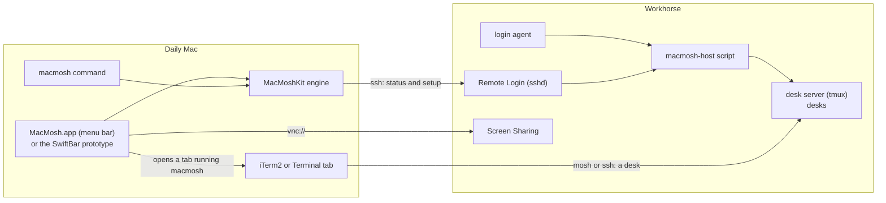

# MacMosh v1 design

Status: draft for Shariq's approval. Date: 2026-11-18. Repo: `shariqh/macmosh` (private until approved).

## 1. The short version

MacMosh is a menu-bar app for the Mac you sit at. It sets up a spare Mac as a **workhorse** (a Mac that stays on and runs your work), shows whether the workhorse is ready, and gives you buttons for the things that took commands before: open a terminal that survives a dropped connection, share the screen, restart, and get back in after a restart.

It packages what Shariq and an agent built by hand over two days (dev-setup #45), so someone with one or two spare Macs can do it in minutes.

What gets built, in order:

1. **Checks on the real Macs** for the facts no document settles (section 9).
2. **The engine and a command** (`macmosh`), written in Swift, plus one small script that lives on the workhorse.
3. **A prototype menu** using SwiftBar, a free menu-bar tool, so Shariq can try the buttons for a few days.
4. **The native app**, built on the same engine.
5. **A signed download and a Homebrew install.**

Nothing in MacMosh ever types, stores or sees a password. Where a password is needed, MacMosh opens a terminal tab or Apple's Screen Sharing window and you type it there.

## 2. Words used

| Word | Meaning |
|---|---|
| **Workhorse** | The spare Mac that stays on. |
| **Daily Mac** | The Mac you sit at. MacMosh runs here. |
| **Desk** | One named terminal session on the workhorse that keeps running when you disconnect. Usually one desk per project. Each desk shows as one terminal tab. |
| **mosh** | A replacement for the ssh terminal connection that survives Wi-Fi drops and a closed lid. |
| **tmux** | The program on the workhorse that keeps each desk alive while nobody is connected. |
| **Tailscale** | A private network between your own devices, so the daily Mac can reach the workhorse from anywhere. |
| **Home address** | The workhorse's address on your home network (for example `192.168.1.84`). With the usual Tailscale app, it is the only address that works before someone logs in. |
| **FileVault** | macOS disk encryption. After a restart the disk stays locked until someone types the Mac's password. |
| **Remote Login** | The macOS switch that turns on ssh. |
| **Screen Sharing** | The macOS switch, and the built-in app, for seeing and controlling another Mac's screen. |
| **Login agent** | A small job macOS starts each time you log in (a LaunchAgent). |
| **Keychain** | Where macOS keeps saved logins. Tools such as `gh` and Claude Code read their sign-ins from it. |

## 3. Why

- Setting up the workhorse by hand took two days and left a cheat sheet of commands to remember. Shariq: "We had to do A LOT and now I have a lot of steps I have to remember."
- He wants buttons, and something other people can use: "a way to use 'buttons' to manage everything so we never have to use these commands, and also we can distribute to others (probably as open source)."
- It is not an AI tool. "What we've set up doesn't have to lend to AI at all, right? Just accessing any Mac as a workhorse."
- A blog post and a YouTube video about building it will follow, so `docs/build-log.md` is kept from the first step.

Existing tools cover parts of the job (checked 2026-11-18 [29]):

| Tool | What it does | What it leaves out |
|---|---|---|
| VibeTunnel | Puts a Mac's terminals in a browser | Preparing the Mac, restart recovery |
| SwitchBored | A menu bar listing machines, with one-click SSH, tmux and VNC | mosh, preparing the workhorse, restart recovery |

Nothing found prepares the workhorse and gets you back in after a restart. That is the gap MacMosh fills.

## 4. Goals, non-goals, anti-goals

### Goals for v1

1. **Add a Mac.** A guided setup pairs the daily Mac with a workhorse and checks everything, with a fix or an instruction for each failed check.
2. **Prepare the workhorse.** Desks that keep sign-ins working, a Mac that stays awake on power, and a recorded home address.
3. **Status in the menu bar.** Ready, waiting for login, locked after a restart, or unreachable, with the reason.
4. **Buttons.** Open a desk, make a new desk, share the screen, restart.
5. **Restart recovery at home, out of the box.** Unlock the disk and log in from the daily Mac. Doing this from away is an optional add-on.
6. **A "keep running with the lid closed" setting**, marked experimental until tested.
7. **A prototype first**, as a SwiftBar menu, then the native app.
8. **An install people can trust:** signed and notarized by Apple, with a Homebrew command.
9. **A build log** good enough to write the blog post and the video from.

### Non-goals for v1

- Managing many Macs at once (bulk actions, fleets). The app handles a short list, one or two.
- A phone app.
- AI features. Agent Inbox or Claude Code add-ons can come later.
- Linux or Windows, on either side.
- A terminal of its own. MacMosh opens tabs in iTerm2 or Apple's Terminal.
- File transfer and port forwarding.
- Setting up Tailscale or a relay for you. MacMosh checks and explains; you make the changes.
- The Mac App Store. Its sandbox gets in the way of an app that runs `ssh`, mosh and Homebrew tools.
- Automatic updates inside the app. v1 updates through Homebrew or a new download.

### Anti-goals: failures even if it works

- **Handling a password.** FileVault, login and `sudo` passwords are typed by you into ssh, `sudo` or Screen Sharing, never into MacMosh.
- **Exposing the workhorse.** No port forwarded on the router, no public tunnel, no new listening service. The ways in stay ssh and Screen Sharing, over Tailscale or the home network.
- **Changing security settings quietly.** MacMosh never changes FileVault, Remote Login, Screen Sharing or the firewall. It changes power settings only after showing you the exact command, and you type the password.
- **Breaking what you have.** It never edits `~/.ssh/config`, `~/.ssh/known_hosts`, your shell files or `~/.tmux.conf`, and it never touches tmux sessions it didn't create.
- **Phoning home.** No telemetry, no account, no cloud service.
- **Leaving a mess.** Everything it installs on a workhorse can be listed and removed with one button.
- **Trademark trouble.** "Mac" is never shown more prominently than "Mosh" (same size, colour and typeface), no Apple logo or drawing of Apple hardware appears in the icon or the docs, and the name is never a pun on an Apple name [25].

## 5. What v1 looks like

### 5.1 The menu

```
◉  (menu-bar icon: its badge shows the state of the workhorse that most needs you)

MacBook Pro · Ready
   Desks
      oris              2 windows
      agent-inbox       1 window
      New desk…
   Share screen
   Restart…
   Sign-ins working · Awake on power · Lid-closed mode off · On power, 82%
────────────
Add a Mac…
Settings…
Quit MacMosh
```

The same workhorse in its other states:

```
MacBook Pro · Waiting for login          MacBook Pro · Locked after a restart
   Log in…  (opens Screen Sharing)          Unlock disk…  (you type the Mac's password)

MacBook Pro · Can't reach it
   Last seen 14:02. Tailscale is off on this Mac.      ← the most likely reason, in plain words
```

The icon shows state by shape as well as colour, so it reads in a monochrome menu bar.

### 5.2 The states

| State | What it means | How MacMosh knows | What you can do |
|---|---|---|---|
| **Ready** | Logged in, desks available, sign-ins working | ssh works, someone is logged in at the Mac, the desk server is running and can read the keychain | Open desks, share screen, restart |
| **Ready, sign-ins off** | Desks work, but tools that keep logins in the keychain look signed out | As above, but the keychain check fails. "Sign-ins working" means only this: desks can use the keychain | "Fix…" restarts the desk server from the login session |
| **Waiting for login** | The Mac is on and unlocked, but nobody has logged in | ssh works with your key at the home address, and no one is logged in at the screen | Log in with Screen Sharing |
| **Locked** | Restarted, disk still locked | The home address answers on the ssh port but refuses your key (only passwords work before unlock [11]) | Unlock disk |
| **Can't verify it** | Something answers at the workhorse's address with a different key | ssh reports a host-key mismatch | Stop. Don't type a password. Check or unlock at the Mac |
| **Can't reach it** | Off, asleep, no network, or locked while you are away | Nothing answers | Read the likely reason |

MacMosh works out the state itself each time it checks. It never assumes what comes after an unlock, because Apple's documents don't say (section 8.3).

### 5.3 Add a Mac, step by step

Part A happens at the workhorse, by hand, once. The app shows these steps with a picture of each switch:

1. Turn on **Remote Login**: System Settings > General > Sharing [13].
2. Turn on **Screen Sharing** in the same place. It has to be switched on here: the command-line way stopped working in macOS 12.1 [14].
3. Optional, for reaching it from anywhere: install **Tailscale** and sign in.
4. Note the user name and the computer name the Sharing pane shows. This is what you give the app as the main address if the workhorse isn't in your Tailscale list. You never type the home address: the app reads it from the workhorse.

Part B happens on the daily Mac, in the app:

1. **Choose the workhorse.** Pick it from the list of your Tailscale devices, or type an address.
2. **Check it's the right Mac.** The app shows the workhorse's key fingerprint and the one command to compare it at the workhorse.
3. **Pair.** A terminal tab opens and asks for the workhorse's password once. This installs your ssh key there. If you have no ssh key, the app creates one first.
4. **Prepare.** The app runs the checks in section 7.5 and fixes what it can. Anything that needs the Mac's password opens a terminal tab with the command already typed.
5. **Make the first desk** and open it.
6. Recommended: **practise a restart** now, so you know recovery works before you need it.

If a step fails, the app says what it tried, what came back, and the one thing to do next.

### 5.4 Opening a desk: which connection do I use?

| Mode | What you get | When the Wi-Fi drops or the lid closes | Needs |
|---|---|---|---|
| **Mosh** (the default) | One terminal tab per desk | The tab picks up by itself when the network returns | mosh on both Macs |
| **Tabs** (optional) | Every tmux window as a real iTerm2 tab | The tabs close. Your work keeps running, and reconnecting brings the tabs back | iTerm2 |
| **Plain ssh** (fallback) | One terminal tab per desk | The tab ends. Your work keeps running | Nothing extra |

Shariq chose mosh as the default on 2026-11-18: "mosh should be the default so we can provide the most reliability." Tabs mode can't run over mosh: iTerm2's author says tmux integration "can't accept random dropouts" and mosh drops output by design, and the matching mosh issue is still open [5].

In Tabs mode, `macmosh connect` itself keeps trying: when ssh drops, it reconnects in the same tab every few seconds until the workhorse answers, and iTerm2 rebuilds the tabs (section 9, item 4 tests this). In Plain ssh mode it does not retry.

Inside a desk, tmux gives you several windows (for example two agents in one project). The app lists a desk's windows and can add one. Scrolling back happens in tmux, with the mouse wheel, because mosh carries only the visible screen.

### 5.5 After a restart: which button do I use?

| Situation | What you press | What happens |
|---|---|---|
| You want to restart it | **Restart…** | A terminal tab runs the restart that skips the disk unlock (`fdesetup authrestart` [11]). You type the Mac's password. The Mac comes back to the login window. |
| It restarted on its own (crash, power cut, update) | **Unlock disk…** | A terminal tab connects to the home address. You type the Mac's password. The disk unlocks and the connection closes, as Apple describes [11]. |
| It is at the login window | **Log in…** | Screen Sharing opens at the home address. You log in as if you were at the Mac. |
| You have logged in | Nothing | Tailscale, the desk server and your startup desks come up by themselves. The state turns to Ready. |

All of this works on the home network with no extra hardware. From away, the home address is out of reach unless you set up the add-on in section 7.9.

Restart recovery over ssh needs a workhorse with Apple silicon and macOS 26 or later [10]. On an older or Intel Mac the app says so, and you unlock at the Mac.

### 5.6 Lid closed: which option do I use?

| Option | Cost | State of knowledge |
|---|---|---|
| Leave the lid open | Free | Works. The Mac never sleeps on power once prepared. |
| **"Keep running with the lid closed" switch** | Free | Experimental. It sets a hidden macOS power setting that Apple doesn't document [15]. Most reports say it works on Apple silicon; one says it doesn't [16]. We test it on the MacBook Pro before promising it. |
| A dummy display plug | About $10 | Imitates an external display, which is what Apple's own lid-closed use needs, along with power [17]. Apple says nothing about dummy plugs, and we have not tested one. |

The switch warns that the Mac must stay plugged in (the setting also blocks sleep on battery, so a closed Mac would run until the battery is empty [16]) and that a closed Mac runs hotter.

## 6. Approaches considered

1. **One engine, two faces (chosen).** A Swift library holds all the logic. A `macmosh` command sits on top of it. The SwiftBar prototype and then the native app are thin faces over the same library. The workhorse gets one small shell script and a login agent, installed over ssh. No app runs on the workhorse.
   - For: nothing is written twice, the logic has tests from day one, and the prototype exercises the real engine.
   - Against: the first clickable prototype takes a little longer than a shell script would.
2. **A throwaway shell prototype, then a separate native app.** The quickest first demo.
   - Against: every behaviour gets written and debugged twice, and what the prototype proves about quoting and parsing doesn't carry over to Swift.
3. **An app on both Macs.** A second copy runs on the workhorse, reports status and makes changes there with Apple's own password prompts.
   - For: nicer pairing, and a native prompt for power settings.
   - Against: twice the interface, a new service listening on the workhorse or a channel to poll, and more for a user to trust on the machine that holds their work. It can come later: the engine already runs each check either locally or over ssh.

Ruled out earlier, in the brainstorm: a cross-platform app (heavier, less native in the menu bar), and a SwiftBar plugin as the final product (every user would have to install SwiftBar first).

## 7. How it's built

### 7.1 The pieces



| Piece | What it is | Where it runs |
|---|---|---|
| **MacMoshKit** | A Swift package with no interface: the list of workhorses, the status checks, the setup checklist, the command lines, the terminal launchers | Daily Mac |
| **`macmosh`** | A command built on MacMoshKit. The menu calls it, tests drive it, and every terminal tab MacMosh opens runs one of its subcommands | Daily Mac |
| **SwiftBar plugin** | The prototype menu: a few lines of shell that print what `macmosh swiftbar` outputs [9] | Daily Mac |
| **MacMosh.app** | The native menu-bar app (SwiftUI `MenuBarExtra`, no Dock icon [21]) | Daily Mac |
| **`macmosh-host`** | One readable shell script. It starts the desk server, reports status, and attaches to desks | Workhorse |
| **Login agent** | Runs `macmosh-host start` each time someone logs in | Workhorse |

### 7.2 Every terminal tab runs `macmosh`

When the menu opens a terminal tab, the tab runs a `macmosh` subcommand, never a long ssh or mosh line built by the menu. The subcommand prints one or two plain sentences about what is happening, then hands over to ssh or mosh.

| Subcommand | What it does in the tab |
|---|---|
| `macmosh connect <workhorse> <desk>` | Names the tab after the desk, then starts mosh (or ssh, or Tabs mode) into the desk |
| `macmosh pair <user@address>` | Shows the key fingerprint, then installs your ssh key (you type the password once) |
| `macmosh unlock <workhorse>` | Connects to the home address so you can type the password that unlocks the disk |
| `macmosh restart <workhorse>` | Lists the desks that will close, then runs `sudo fdesetup authrestart` over ssh |
| `macmosh power <workhorse> …` | Shows the exact `pmset` command, then runs it with `sudo` over ssh |

This keeps the quoting, the paths and the error messages in tested Swift code, and it gives the prototype and the app the same behaviour. If a command fails, the tab stays open with the reason and waits for a key.

Other subcommands are not interactive: `status`, `desks`, `add`, `prepare`, `swiftbar`, each with `--json` where a program reads the output.

### 7.3 Desks and the desk server

- A desk is a tmux session. All of MacMosh's desks live in **one tmux server of their own**, on a socket named `macmosh` (`tmux -L macmosh` [3]). Your own tmux sessions on the default socket are never touched.
- **Only the login agent starts that server.** A tmux server started from the login session can read the keychain; one started from an ssh connection can't. This was the largest gotcha of the hand-built setup, and it is why `gh` and Claude Code looked signed out over ssh [30]. A separate socket means an ssh user who types `tmux` can never start the wrong kind of server for the desks.
- `macmosh-host attach <desk>` never starts the server itself. If the server is down it asks macOS to run the login agent again (section 9, item 1 tests that this works over ssh), and if nobody is logged in it says so and stops.
- **The check for sign-ins** is `security show-keychain-info` on the login keychain, run inside the desk server. In a session that can use the keychain it prints the keychain's settings; over plain ssh it prints "User interaction is not allowed." It reads no secret. Verified on both Macs on 2026-11-18.
- **Friendly defaults.** The desk server starts with mouse scrolling on and a long scrollback, because mosh itself has no scrollback [1]. Your own `~/.tmux.conf` is loaded afterwards, so your settings win.
- **Desk definitions live on the workhorse**, one line per desk: name, folder, an optional startup command, and whether to reopen it after a restart. They survive restarts and work from any daily Mac.
- **After a restart**, the login agent recreates the desks marked "reopen" and types each one's startup command into a normal shell. If the program later quits, the desk stays open at a prompt.
- **A desk can keep a command running**: the script restarts it when it exits, with a pause between tries. This replaces the hand-written `rc-servers` loop from the hand-built setup. It is the last v1 item and the first to cut.
- **New desk** asks for a name and a folder. The app lists the folders inside a "projects folder" you choose once per workhorse (for example `~/Development`), so most new desks are two clicks.
- Desk names use letters, digits, `-` and `_`.

### 7.4 Checking status

- One ssh call per check: `macmosh-host status`. It reports the script's version, the macOS version and chip, who is logged in at the screen, whether the desk server is up, the sign-in check, FileVault's status, the power settings that matter, power source and battery, the current home address, and each desk with its windows.
- The app checks every 30 seconds while the workhorse is reachable, less often while it is not, and at once when you open the menu.
- The order of a check: the main address first (the Tailscale name), then the home address. The result maps to the states in 5.2.
- Tailscale itself is asked only for hints: is Tailscale running on this Mac, and does it think the workhorse is online? The Tailscale command needs `TAILSCALE_BE_CLI=1` when an app runs it, and its `Online` field means "connected to Tailscale's servers", not "reachable" [22].
- **The reason shown under "Can't reach it"** is the first of these that applies: Tailscale is off on the daily Mac; the daily Mac has no network; another VPN is running on the daily Mac; Tailscale says the workhorse is offline, and you are away from home (it may have restarted: the home address is out of reach from here); nothing answers at either address (it is off, asleep or disconnected).
- **Notifications** when the state changes: locked after a restart, waiting for login, back to ready, and "the workhorse is on battery".
- Nothing runs on the workhorse between checks. There is no MacMosh daemon.

### 7.5 The setup checklist

Each check has one of four kinds of fix: **auto** (MacMosh does it, after telling you), **password tab** (a terminal tab with the command typed; you type the password), **at the workhorse** (a switch only you can flip), or **info** (nothing to fix).

On the daily Mac:

| Check | Fix |
|---|---|
| mosh is installed | Auto: `brew install mosh`. If Homebrew is missing: instructions |
| A terminal is chosen (iTerm2 if installed, otherwise Terminal) | Info |
| An ssh key exists | Auto: create an `ed25519` key |
| MacMosh may open terminal tabs | macOS asks once per terminal app (Automation permission [6][21]) |
| MacMosh may reach the home network | macOS asks once (Local Network permission, macOS 15 and later [20]) |
| Tailscale is connected | Info, with a link. Optional |

On the workhorse:

| Check | Fix |
|---|---|
| Remote Login is on | At the workhorse |
| Screen Sharing is on | At the workhorse |
| Your ssh key is accepted | Password tab: `macmosh pair` |
| macOS version and chip | Info. Decides whether restart recovery over ssh is offered |
| Homebrew, mosh and tmux are installed | Auto for mosh and tmux. Homebrew's own installer runs in a password tab |
| `macmosh-host` and the login agent are installed and current | Auto. The files are copied over ssh into the user's home folder; running it again is safe, and the version line in the script decides whether to replace it |
| The desk server is running and sign-ins work | Auto. If it can't be started over ssh: log out and in once |
| The Mac stays awake on power (`pmset -c sleep 0`) and wakes for network access [15] | Password tab |
| It restarts after a power cut (desktop Macs: `pmset autorestart 1` [15]) | Password tab |
| FileVault's status | Info. MacMosh never changes it |
| The home address is recorded | Auto, refreshed on every status check |
| The macOS firewall | Info. If it is on, mosh may be blocked; the app says so and links to the steps (section 9, item 8) |
| Desks can open protected folders (Full Disk Access for tmux) | At the workhorse. Optional |

The checklist can be run again at any time from Settings.

### 7.6 Addresses and host keys

- Each workhorse has a **main address** (what you chose in Add a Mac, normally its Tailscale name) and a **home address** (its home-network IP, read from the status report and kept up to date).
- MacMosh keeps the workhorse's ssh host key in its own file and checks **both** addresses against that one key, with strict checking on. If the key doesn't match, ssh refuses, and the app tells you to stop and unlock at the Mac. This matters most at the unlock step, where you type the disk password.
- MacMosh uses the system `ssh` and your normal ssh keys and settings. It adds options on the command line and leaves `~/.ssh/config` and `~/.ssh/known_hosts` alone.
- A reserved address on the router makes the home address stable across restarts. The app explains how, and that the Mac's "Private Wi-Fi Address" setting must be Fixed or Off for a reservation to hold [27]. This is advice, not a requirement: in most homes the address survives a restart anyway.
- The home address can only be refreshed while the workhorse is up. If the router hands out a different address during a restart, the last known one stops answering. MacMosh then tries the workhorse's local network name (`name.local`), which it also records. Whether that name answers before the disk is unlocked is not known (section 9, item 6). If neither answers, the state is "Can't reach it", the hint says the address may have changed, and the fix is to unlock at the Mac and reserve the address.
- If the key offered at the workhorse's address ever differs from the pinned one, including at the locked screen, the state is "Can't verify it" and no unlock button is offered. One report says the key can differ before the unlock; it did not on the MacBook Pro (section 8.3). Section 9, item 6 settles it. If Apple's locked screen turns out to use a second key, the design changes to pin that key during "practise a restart", at the Mac, never by trusting it over the network.

### 7.7 Opening terminal tabs

- **iTerm2:** AppleScript, `create tab with default profile command "…"`. It works today, but iTerm2's docs say AppleScript "is no longer receiving improvements" [6]. iTerm2's URL scheme always shows a confirm dialog and its Python API is off by default [7], so neither is a better fit.
- **Terminal:** AppleScript, `do script` [8].
- Both sit behind one small interface, so a launcher can be replaced without touching the rest.
- If you deny the Automation permission, the app falls back to opening a small `.command` file with the terminal, and shows how to grant the permission.

### 7.8 Restart recovery

The flow is section 5.5. The rules behind it:

- **Unlock** uses password sign-in at the home address, the only thing that works before the disk is unlocked [11]. The tab says, before the prompt: you are typing into ssh, MacMosh can't see it, and the connection will close by itself when the unlock works.
- **Log in** opens `vnc://` at the home address in Apple's Screen Sharing app.
- **Restart** uses `sudo fdesetup authrestart` when the Mac supports it (`fdesetup supportsauthrestart`), and tells you first which desks will close.
- **Practise a restart** (from Add a Mac or Settings) does a full restart, so the unlock step is exercised too.
- FileVault stays whatever the user set. Apple disables automatic login while FileVault is on [12], so a restart always needs someone to log in.

### 7.9 The optional add-on: unlock from anywhere

Before login, the workhorse's own Tailscale isn't running: Tailscale's recommended Mac app doesn't run before login [22]. Reaching the home address from away needs another always-on device at home that passes traffic along (a Tailscale "subnet router").

v1 does not set this up. It ships:

- **A guide** (`docs/unlock-from-anywhere.md`) with numbered steps: pick an always-on device (Tailscale documents Macs, Apple TVs and Linux boxes as subnet routers [22]), advertise the workhorse's home address as a route, approve the route, and allow it in the access rules [22].
- **A light** in the app: "home address reachable from here: yes or no", tested the same way at home and away. Macs accept Tailscale routes by default [22], so once the relay exists the buttons in 5.5 work from anywhere without changes.

### 7.10 Lid closed

- The switch runs `sudo pmset -a disablesleep 1` (off: `0`) in a password tab and then re-reads the setting.
- It is offered only for laptop workhorses, and it is labelled experimental until the test in section 9 passes.
- If the test fails, the switch is removed and the app only explains the dummy-plug option.
- The app links to a MacMosh guide (`docs/lid-closed.md`). It never links to a shop: Amazon's Associates rules say a member may not use an affiliate link, "or otherwise link to an Amazon Site, on or in connection with" a desktop app [26]. An affiliate link, if Shariq wants one, lives on his own site next to a clear disclosure [26], and the guide may link to that page.

### 7.11 What MacMosh puts on a workhorse

Everything is in the user's home folder. Nothing needs root, and nothing listens on the network.

| File | Purpose |
|---|---|
| `~/.macmosh/macmosh-host` | The script |
| `~/.macmosh/tmux.conf` | The two friendly defaults, then your own tmux settings |
| `~/.macmosh/desks.tsv` | Desk definitions |
| `~/.macmosh/host.log` | What the script did, with times |
| `~/Library/LaunchAgents/io.github.shariqh.macmosh.host.plist` | The login agent |
| One line in `~/.ssh/authorized_keys` | Your key, added by `ssh-copy-id` during pairing |

"Remove MacMosh from this workhorse" deletes the first five, offers to remove the key, and lists any power setting it changed so you can put it back. Desks that are open keep running until you close them.

### 7.12 What the daily Mac needs

| Thing | Version | Why |
|---|---|---|
| macOS | 15 or later | Homebrew's supported floor, which is where mosh comes from [23]. Built and tested on macOS 27 |
| Homebrew with mosh | mosh 1.4.0, the current release [1] | The default connection |
| iTerm2 or Terminal | Any current version | Where desks open |
| Tailscale | Optional | Reaching the workhorse from anywhere |

The workhorse needs macOS 15 or later on Apple silicon for the Homebrew tools [23]. Restart recovery over ssh also needs macOS 26 or later [10]. A workhorse on macOS 15 can still be added and used: the app hides the unlock button and says to unlock at the Mac after a restart. Intel Macs may work but are not tested.

## 8. Facts this rests on

Each fact is marked: **Vendor** (the vendor's own current documentation), **Seen** (observed on Shariq's Macs), or **Reports** (other people's write-ups, not vendor docs). Checked 2026-11-18.

### 8.1 The terminal stack

- **Vendor.** mosh 1.4.0 (October 2022) is still the latest release; the project has commits from 2026 [1]. It uses UDP ports 60000 to 61000 by default, needs a UTF-8 locale on both ends, and "connections stay up across sleeps and changes in the client's IP address" [1].
- **Vendor.** mosh syncs only the visible screen, so it has no scrollback of its own; its FAQ points to tmux [1].
- **Vendor.** A mosh server whose client never returns waits forever unless `MOSH_SERVER_NETWORK_TMOUT` is set; the manual suggests a week [2]. MacMosh sets one week, so abandoned connections clean themselves up. The desk itself is not affected.
- **Vendor.** tmux 3.8 (September 2026) is current. `new-session -A` attaches if the session exists, `-L` runs an independent server on a named socket, a server exits when its last session ends unless `exit-empty` is off, and a `=` prefix matches a session name exactly [3].
- **Vendor.** iTerm2's tmux integration is started with `tmux -CC` and documented for ssh [4]. It does not work over mosh; issue 5924 was closed as unsupported and mosh issue 1078 is still open [5].
- **Vendor.** iTerm2's current stable release is 3.7.8 (released 2026-11-18). Its AppleScript commands still ship but are frozen [6].
- **Vendor.** SwiftBar 2.1.1 (August 2026) is maintained and reads plugins from a folder; a plugin is a script whose output becomes the menu [9]. xbar, the older tool, has had no release since 2021.
- **Seen.** mosh into tmux on the workhorse survived the Air sleeping for five minutes and Wi-Fi being switched off and on (2026-11-16/17) [30].
- **Seen.** A command run straight over ssh on a Mac gets a bare `PATH` without Homebrew, so mosh must be told where its server is (`--server`) [30].

### 8.2 Sign-ins and the login session

- **Vendor.** macOS gives a GUI login and an ssh login separate sessions with separate security contexts, and a login agent runs in the GUI session by default [18]. The note is an old, archived one; the two **Seen** lines below confirm the behaviour today.
- **Seen.** Over plain ssh, `gh` and Claude Code look signed out (error -25308, "User interaction is not allowed"). In a tmux server started by a login agent they are signed in, even when the window is opened over ssh [30].
- **Seen.** The login agent in the hand-built setup uses `RunAtLoad` and `LimitLoadToSessionType: Aqua`, and the tmux server it starts keeps running after the agent's script ends [30].
- **Vendor.** Programs under a tmux server started by a login agent do not get a terminal app's Full Disk Access; macOS decides by the "responsible" program, which is not the terminal [19]. **Seen:** reading `~/Desktop` from such a desk raised a privacy prompt on the workhorse's screen [30].

### 8.3 FileVault and restarts

- **Vendor.** "On a Mac with Apple silicon and with macOS 26 or later, FileVault can be unlocked over ssh after a restart if Remote Login is turned on and a network connection is available." [10]
- **Vendor.** Before the unlock, only password sign-in works, because ssh's settings and `authorized_keys` are on the locked volume. After the unlock, "macOS will disconnect SSH briefly while it completes mounting the data volume," and then ssh is fully available [11].
- **Vendor.** `fdesetup authrestart` "restarts the system, bypassing the initial unlock" [11]. "When FileVault is turned on, automatic login is disabled." [12]
- **Not documented.** Apple doesn't say where the Mac ends up after an ssh unlock or an authrestart. **Seen** on the MacBook Pro (macOS 27.3 beta, 2026-11-16/17): it stops at the login window; the unlock worked over Wi-Fi; ssh showed no host-key warning; and Screen Sharing could log in at the login window [30].
- **Reports** conflict on Wi-Fi before the unlock (some say Ethernet only, one says Wi-Fi works from macOS 26.5), and one says the host key can differ before the unlock. MacMosh therefore works out the state by checking, and treats a key mismatch as a reason to stop.
- **Seen.** Until someone logs in, Tailscale is not running and the Mac is off the tailnet [30].

### 8.4 Sharing switches

- **Vendor.** Remote Login and Screen Sharing are under System Settings > General > Sharing [13].
- **Vendor.** "In macOS 12.1 or later, Screen Sharing can't be enabled by the kickstart command-line tool," and `systemsetup -setremotelogin` needs Full Disk Access [14]. So both switches are flipped by hand.

### 8.5 Staying awake

- **Vendor.** `pmset` settings: `sleep` (0 disables), `womp` ("Wake for network access"), `autorestart` ("automatic restart on power loss"); `-c` applies to wall power, `-a` to all; changing any needs root [15].
- **Vendor, by absence.** `disablesleep` is not in the `pmset` manual on macOS 27.3, although the program accepts it [15].
- **Reports.** Four of five write-ups say `pmset -a disablesleep 1` keeps an Apple-silicon MacBook running with the lid closed and no display, on macOS 26; one says it no longer does. They disagree on whether the screen stays lit and whether the setting survives a restart [16].
- **Vendor.** `caffeinate -s` only applies on AC power, and its manual says nothing about the lid [15].
- **Vendor.** Apple's lid-closed use needs an external display: "After you connect a display to your MacBook Pro, you can close the lid and continue to use it with connected accessories." For that case Apple also says to "make sure that the Mac is connected to power" and using an external keyboard and mouse [17]. Apple says nothing about dummy plugs.

### 8.6 The app's own permissions

- **Vendor.** `MenuBarExtra` needs macOS 13 or later [21].
- **Vendor.** Sending Apple events to another app needs a usage message and, under the hardened runtime, the Apple Events entitlement; macOS asks the user once per target app [21].
- **Vendor.** From macOS 15, an app needs the Local Network permission to connect to an address on the local network, and a helper it starts (such as `ssh`) counts as the app. Addresses reached through a VPN such as Tailscale don't count as local. A command in a terminal tab is covered by the terminal, not by MacMosh: tools run from Apple's Terminal are allowed automatically [20].

### 8.7 Tailscale

- **Vendor.** Of the three Mac variants, only the open-source `tailscaled` runs before login; the recommended Standalone app and the App Store app do not [22].
- **Vendor.** Macs accept subnet routes by default; Linux does not [22].
- **Vendor.** A route needs approval and an access rule; with two routers on one route, the one that joined the tailnet first is used and the other takes over if it goes offline [22].
- **Vendor.** Tailscale's own ssh server is not available in the Standalone Mac app, so MacMosh uses the Mac's Remote Login [22].
- **Vendor.** "In most cases, you can't use Tailscale alongside other VPNs without a workaround." [22] **Seen:** a VPN client's background service broke mosh's reconnects on every Wi-Fi change [30]. The app's "can't reach it" hints mention other VPNs.

## 9. To test on the real Macs first

These are the things no document settles. Each needs Shariq's go-ahead, and several need him to type a password or flip a switch. They are grouped so he is needed for two short sittings.

**Sitting 1, from the Air (about 45 minutes, no restart):**

| # | Question | Pass looks like |
|---|---|---|
| 1 | Can a login agent be installed and started on the workhorse over ssh, and does the desk server it starts pass the sign-in check? | `security show-keychain-info` succeeds inside the new server |
| 2 | Which way of opening a tab works best in iTerm2 3.7 and in Terminal, and what do the permission prompts look like? | A tab opens, runs `macmosh connect`, and is named after the desk |
| 3 | Does mosh accept the pinned-key options through `--ssh`, and the one-week timeout through `--server`? | A desk opens with both in place |
| 4 | Does Tabs mode reconnect by itself with a retry loop? | Wi-Fi off and on, and the iTerm2 tabs come back |
| 5 | What does macOS ask when the menu first reaches the home address? | One Local Network prompt, and status works after Allow |

**Sitting 2, a restart and the lid (about 45 minutes):**

| # | Question | Pass looks like |
|---|---|---|
| 6 | What does each check see at the FileVault screen, at the login window, and after login? Is the host key the same at all three? Does the `.local` name answer at the FileVault screen? | The three states in 5.2 can be told apart, and the key matches |
| 7 | Does `sudo pmset -a disablesleep 1` keep the MacBook Pro reachable with the lid closed, on power, with no display? Does the screen stay lit, how hot does it get in 15 minutes, and does the setting survive a restart? | The desk stays reachable for 15 minutes with the lid closed |

**Later, when there is something to test with:**

| # | Question |
|---|---|
| 8 | With the macOS firewall on, is mosh blocked, and do `socketfilterfw --add` and `--unblockapp` fix it? The firewall is off on both Macs today, and turning it on is Shariq's call. |
| 9 | Does a dummy display plug keep the MacBook Pro awake with the lid closed? Needs the plug. |

Results go in the build log. A failed test changes the design before code depends on it.

## 10. Security and privacy

- **Transport:** the system's OpenSSH, and mosh, over Tailscale or the home network. MacMosh adds no network service on either Mac.
- **Sign-in:** your ssh key for everything routine. Passwords only where macOS requires one, typed by you into ssh, `sudo` or Screen Sharing.
- **Host identity:** one pinned key per workhorse, checked on both addresses, strict checking always on.
- **Root:** MacMosh never runs as root on either Mac. The only root commands are the `pmset` and `fdesetup authrestart` lines you run yourself in a password tab.
- **Stored on the daily Mac:** the list of workhorses (names, addresses, user names, settings) and their host keys, in `~/Library/Application Support/MacMosh/`. No secrets.
- **Network calls the app makes:** ssh to your workhorses, and the local `tailscale` command. Nothing else. No update check in v1.
- **Open source:** the script that runs on the workhorse is plain shell, so anyone can read what it does.

## 11. Distribution, naming and legal

- **Licence:** MIT.
- **Signing:** a Developer ID certificate, the hardened runtime, notarization and stapling, which is what Apple requires for an app that opens without a warning [24]. Without it, macOS 15 and later make the user go to System Settings > Privacy & Security > Open Anyway [24]. A Developer ID certificate is already in the keychain on the MacBook Pro (question 1 in section 15). The Apple Developer Program costs $99 a year, and Apple waives the fee only for nonprofits, schools and governments [24].
- **Releases** are built, signed and notarized on Shariq's Mac by a script, so the certificate never leaves it. CI only builds and runs tests.
- **Downloads:** a GitHub release.
- **Homebrew:** a cask in Shariq's own tap (`brew install --cask shariqh/tap/macmosh`). A personal tap has no popularity threshold; the main cask repository asks for 90 forks, 90 watchers or 225 stars when the author submits their own app [23]. Since Homebrew 6.0, a third-party tap has to be trusted before Homebrew will load it (`brew trust`), so the README gives the exact commands, checked at release time [23]. The cask depends on the mosh formula [23].
- **Other people's software:** MacMosh runs mosh (GPL-3) and tmux (ISC) as separate programs that Homebrew installs. It doesn't include them.
- **The name:** MacMosh. Apple allows "Mac" joined to another word for a Mac-compatible product, provided "Mac" is not more prominent than the rest "in size, color, or typeface" [25]. The name is never a pun on an Apple name: Apple bars any "variation, phonetic equivalent, foreign language equivalent, takeoff, or abbreviation," and gives "Jackintosh" as an example [25].
- **Credit lines** in the README and the app's About box: "Mac and macOS are trademarks of Apple Inc., registered in the U.S. and other countries and regions." [25] Also: MacMosh is an independent project, not affiliated with Apple or with the mosh project.
- **"Mosh" in the name** says what MacMosh is built on. mosh is someone else's open-source project; if its maintainers ever object, the name gets another look.
- **Icon:** no Apple logo and no drawing of a Mac [25].
- **Affiliate links:** never in the app (section 7.10).
- **Bundle identifier:** `io.github.shariqh.macmosh`. It stays the same whichever certificate signs the app.

## 12. Build order

Each phase ends with something Shariq tries on his own Macs. The implementation plan breaks these into PR-sized tasks.

| Phase | What | Ends with |
|---|---|---|
| 0 | The tests in section 9, sittings 1 and 2 | Results in the build log; the design updated if a test failed |
| 1 | MacMoshKit, the `macmosh` command and `macmosh-host`, with tests | `macmosh status` and `macmosh connect` working from the Air |
| 2 | The SwiftBar prototype: status and every button | Shariq uses it in place of `rmosh` and the cheat sheet for a few days, then says what to change |
| 3 | The native app: menu, Add a Mac, Settings, notifications | The prototype is retired |
| 4 | Signing, notarization, the release script, the Homebrew tap, the README and guides | A fresh install from the README works on the Air |
| 5 | Launch material from the build log | An outline for the post and the video |

v1 is done when Shariq runs his day from the native app, has recovered from a real restart using only its buttons, and a fresh setup following only the README works.

## 13. Decisions

### Shariq's decisions

| Decision | When |
|---|---|
| A separate open-source project, not an Agent Inbox add-on, and not AI-specific | 2026-11-17 |
| v1 is for one person with one or two spare Macs | 2026-11-17 |
| A menu-bar icon is a must | 2026-11-17 |
| Restart recovery works at home out of the box; from away is optional | 2026-11-17 |
| A native Mac app, with a SwiftBar-style prototype first | 2026-11-17 |
| A lid-closed setting, tested with `pmset` first; a dummy plug offered, with an affiliate link | 2026-11-17 |
| The name MacMosh, MIT licence, repo `shariqh/macmosh` | 2026-11-18 |
| mosh is the default connection | 2026-11-18 |

### Calls the agent made, for Shariq to check

1. **The app runs only on the daily Mac.** The workhorse gets a script and a login agent, not an app (section 6).
2. **The prototype uses the real engine**, written in Swift, not a throwaway script (section 6).
3. **Desks get their own tmux server** on a separate socket, so nothing can start it the wrong way and your own tmux is untouched (section 7.3).
4. **Every terminal tab runs a `macmosh` subcommand** (section 7.2).
5. **Both iTerm2 and Apple's Terminal are supported**, so a new user needs nothing beyond mosh.
6. **Tailscale is recommended, not required.** At home, MacMosh works with a home-network address alone.
7. **The word "desk"** for a persistent terminal session, carried over from the hand-built setup's notes.
8. **Startup desks and keep-running commands** are in v1, as the generic form of "services that restart themselves". Keep-running is the first thing to cut.
9. **A "practise a restart" step** in setup.
10. **Notifications** when the workhorse's state changes or it goes on battery.
11. **No automatic updates and no telemetry** in v1.
12. **The app never links to a shop.** The affiliate link lives on Shariq's own site (section 7.10).
13. **Releases are signed on Shariq's Mac**, not in CI.
14. **macOS 15 is the minimum** on both Macs.
15. **The relay for unlocking from away is a guide and a status light**, not something the app sets up.

## 14. Left to the builder

- The Swift package layout, the Xcode project, and whether the CLI uses `swift-argument-parser`.
- The exact output format of `macmosh-host status` (it must carry a version number, so the app can tell an old script from a new one).
- The exact file layout under `~/.macmosh/` and the login agent's plist keys, starting from the proven ones in 8.2.
- How ssh connections are reused between status checks.
- The check interval and back-off while a workhorse is unreachable.
- The icon and the menu's wording, within the trademark rules in section 11.
- How "focus the tab that already has this desk" works, if it can be done cleanly; otherwise a second click opens a second tab.
- The typing-prediction default for mosh (`adaptive` is mosh's own default; the hand-built helper used `experimental`).

## 15. Questions for Shariq

1. **Signing.** The only Developer ID certificate on the MacBook Pro belongs to a company account, not to you personally. Sign MacMosh with it, or with a personal Developer ID (a separate $99 a year [24])?
2. **Two test sittings on your Macs** (section 9): about 45 minutes each, the second with a restart of the MacBook Pro and the lid-closed test. OK to plan them as the first tasks?
3. **The affiliate link.** Amazon's rules keep it out of the app. Are you happy for it to live on your blog or video page instead, and do you have (or want) an Amazon Associates account?
4. **The v1 list** in section 4 and the calls in section 13: anything to cut or add?

## 16. Sources

Checked 2026-11-18. "Local" means read on the MacBook Pro (macOS 27.3).

1. mosh: local `man mosh` (1.4.0); https://mosh.org/ ; https://github.com/mobile-shell/mosh/releases
2. mosh server timeouts: local `man mosh-server` (1.4.0)
3. tmux: local `man tmux` (3.8); https://github.com/tmux/tmux/releases
4. iTerm2 tmux integration: https://iterm2.com/documentation-tmux-integration.html
5. tmux integration over mosh: https://gitlab.com/gnachman/iterm2/-/issues/5924 ; https://github.com/mobile-shell/mosh/issues/1078
6. iTerm2 scripting: https://iterm2.com/documentation-scripting.html ; iTerm2's scripting dictionary (local, 3.6.11); releases: https://iterm2.com/downloads.html
7. iTerm2 URL scheme and Python API: https://iterm2.com/documentation-one-page.html ; https://iterm2.com/python-api-auth.html
8. Terminal: its scripting dictionary (local, macOS 27.3)
9. SwiftBar: https://github.com/swiftbar/SwiftBar (README and releases); xbar: https://github.com/matryer/xbar
10. Apple, Intro to FileVault: https://support.apple.com/guide/deployment/intro-to-filevault-dep82064ec40/web
11. Local `man fdesetup` (macOS 27.3), sections "REMOTE UNLOCKING VIA SSH" and `authrestart`
12. Apple, login window and automatic login: https://support.apple.com/guide/mac-help/a-login-window-start-mac-mchlp1158/mac
13. Apple, Remote Login: https://support.apple.com/guide/mac-help/allow-a-remote-computer-to-access-your-mac-mchlp1066/mac ; Screen Sharing: https://support.apple.com/guide/mac-help/turn-mac-screen-sharing-on-or-off-mh11848/mac
14. Apple Remote Desktop, kickstart: https://support.apple.com/guide/remote-desktop/enable-remote-management-apd8b1c65bd/mac ; local `man systemsetup`
15. Local `man pmset` and `man caffeinate` (macOS 27.3)
16. Lid-closed reports: https://helmlet.app/en/blog/keep-macbook-awake-lid-closed ; https://github.com/bravely/dotfiles/issues/24 ; https://slack.green/en/blog/pmset-disablesleep ; https://www.macworld.com/article/673295/how-to-use-macbook-with-lid-closed-stop-closed-mac-sleeping.html ; https://pasqualepillitteri.it/en/news/779/disable-laptop-sleep-lid-close-ai-agents
17. Apple, external displays and a closed lid: https://support.apple.com/guide/macbook-pro/apd8cdd74f57/mac ; https://support.apple.com/en-us/102501 ; https://support.apple.com/en-us/117373
18. Local `man launchd.plist` and `man launchctl`; Apple TN2083, Daemons and Agents: https://developer.apple.com/library/archive/technotes/tn2083/_index.html
19. Apple DTS on the "responsible" program for privacy permissions: https://developer.apple.com/forums/thread/756510
20. Apple TN3179, Understanding local network privacy: https://developer.apple.com/documentation/technotes/tn3179-understanding-local-network-privacy
21. Apple: https://developer.apple.com/documentation/swiftui/menubarextra ; https://developer.apple.com/documentation/servicemanagement/smappservice ; https://developer.apple.com/documentation/bundleresources/entitlements/com.apple.security.automation.apple-events
22. Tailscale: https://tailscale.com/kb/1065/macos-variants ; https://tailscale.com/kb/1080/cli ; https://tailscale.com/kb/1019/subnets ; https://tailscale.com/docs/features/route-selection ; https://tailscale.com/kb/1193/tailscale-ssh ; https://tailscale.com/kb/1105/other-vpns ; status fields: https://github.com/tailscale/tailscale/blob/main/ipn/ipnstate/ipnstate.go
23. Homebrew: https://docs.brew.sh/Package-Acceptance-Policy ; https://docs.brew.sh/Acceptable-Casks ; https://docs.brew.sh/Taps ; https://docs.brew.sh/Cask-Cookbook ; https://docs.brew.sh/Installation ; https://brew.sh/2026/06/11/homebrew-6.0.0/ ; local `brew trust --help` (Homebrew 7.0.14)
24. Apple: https://developer.apple.com/programs/ ; https://developer.apple.com/developer-id/ ; https://developer.apple.com/documentation/security/notarizing-macos-software-before-distribution ; https://developer.apple.com/news/?id=saqachfa ; https://developer.apple.com/help/account/membership/fee-waivers/
25. Apple trademark guidelines: https://www.apple.com/legal/intellectual-property/guidelinesfor3rdparties.html ; trademark list: https://www.apple.com/legal/intellectual-property/trademark/appletmlist.html
26. Amazon Associates Program Policies: https://affiliate-program.amazon.com/help/operating/policies ; Operating Agreement: https://affiliate-program.amazon.com/help/operating/agreement ; FTC endorsement guidance: https://www.ftc.gov/business-guidance/resources/ftcs-endorsement-guides-what-people-are-asking
27. Apple, Private Wi-Fi Address: https://support.apple.com/en-us/102509
28. Sparkle (not used in v1): https://sparkle-project.org/
29. Prior art: https://github.com/amantus-ai/vibetunnel ; https://github.com/jtolchard/SwitchBored
30. The hand-built setup: the design, plan and build log for dev-setup #45 (2026-11-16/17), a private repo; and read-only checks on both Macs on 2026-11-18, recorded in `docs/build-log.md`
