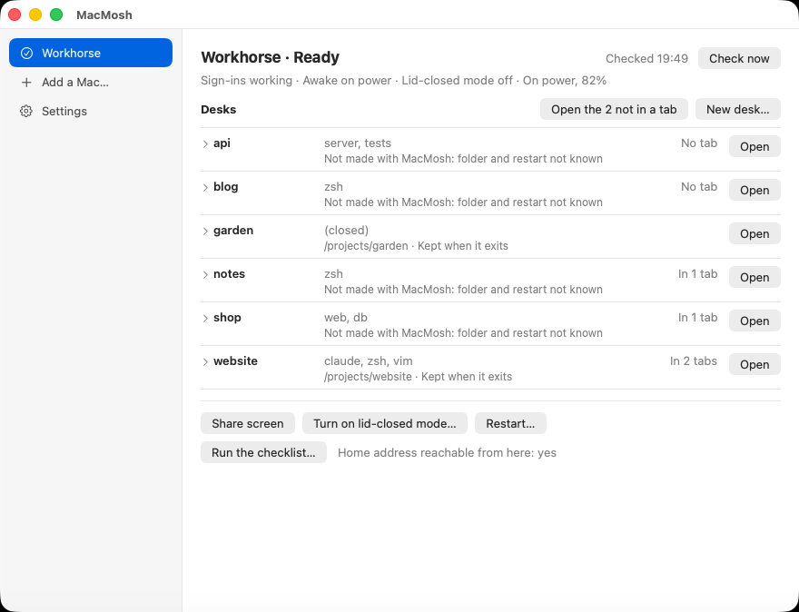
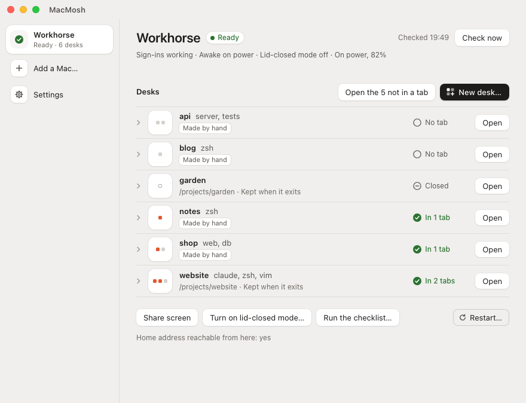
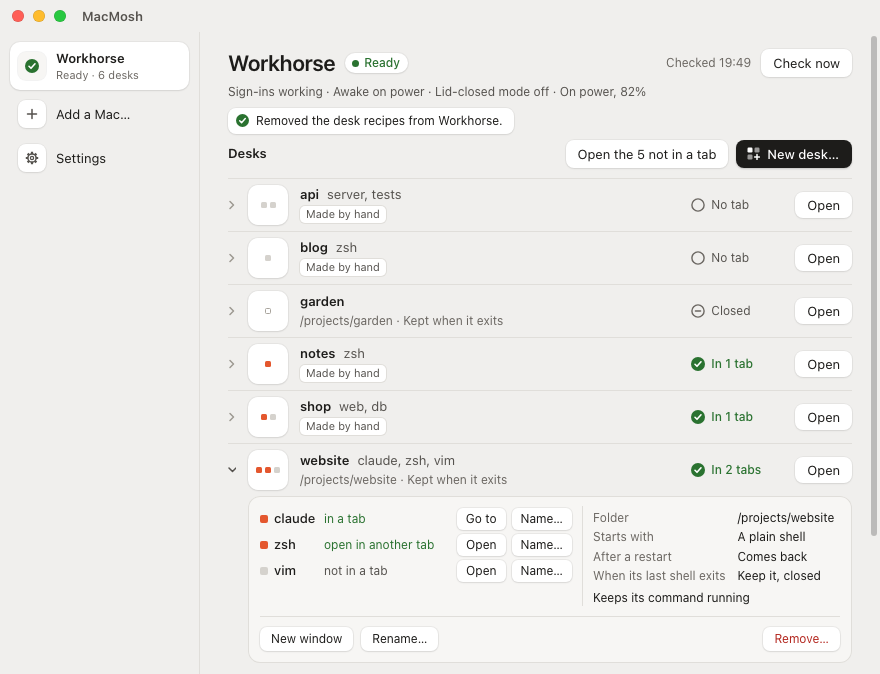
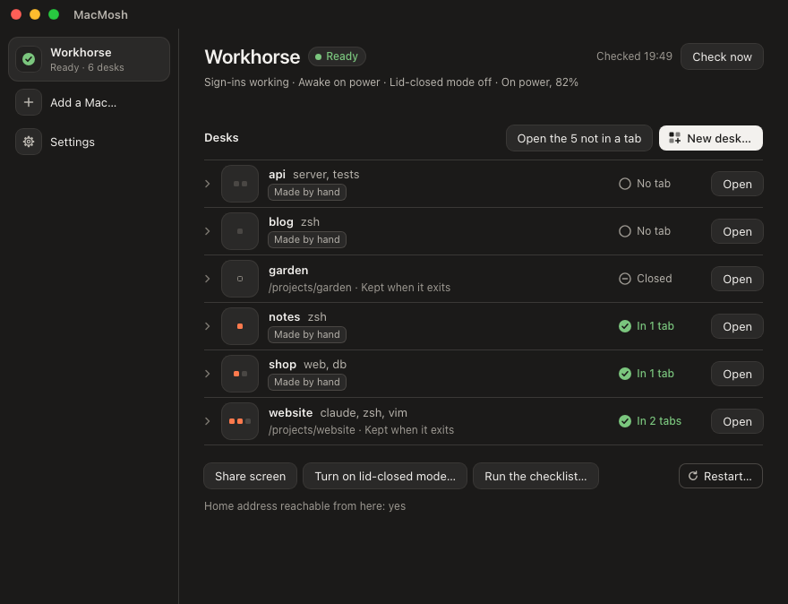
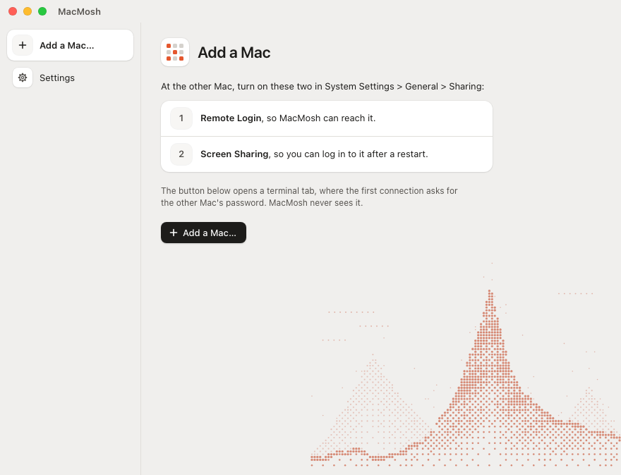
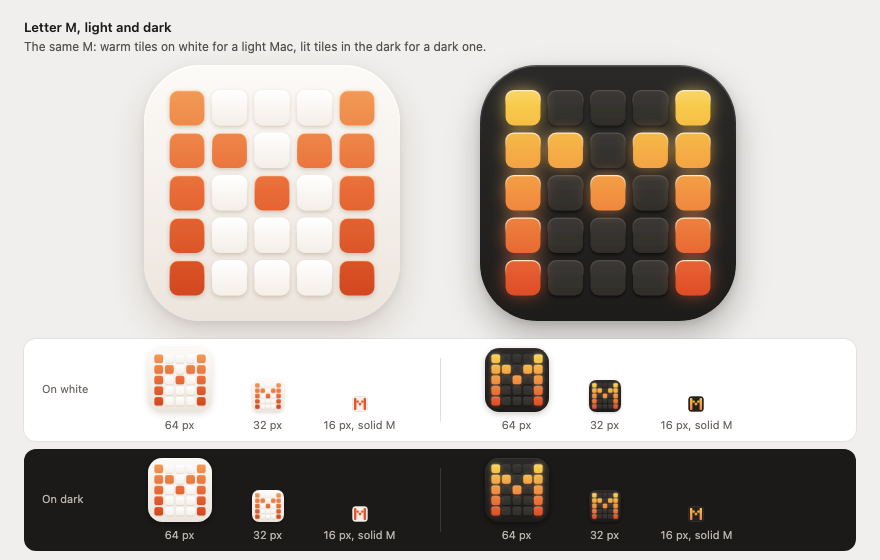
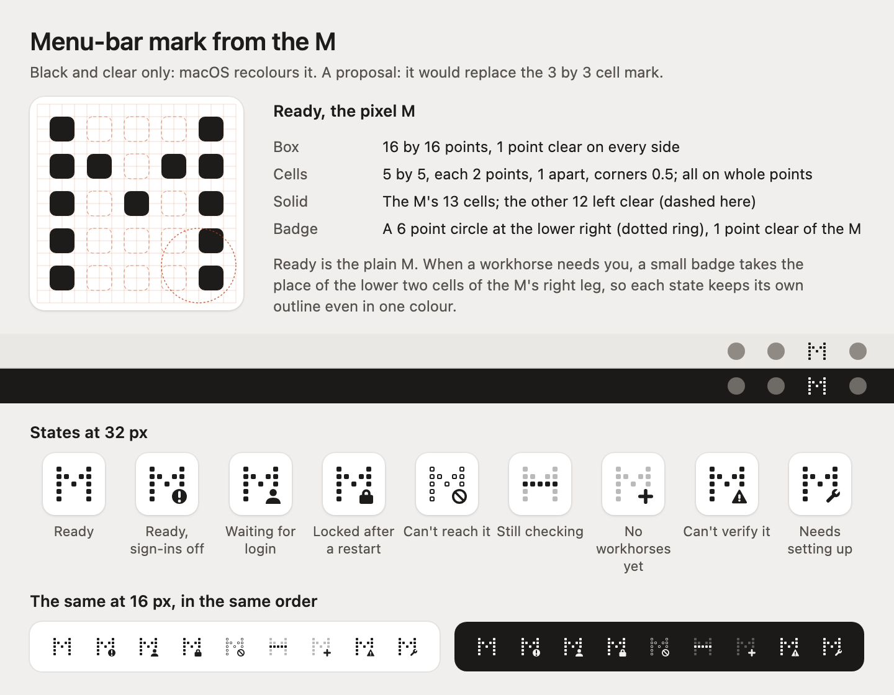
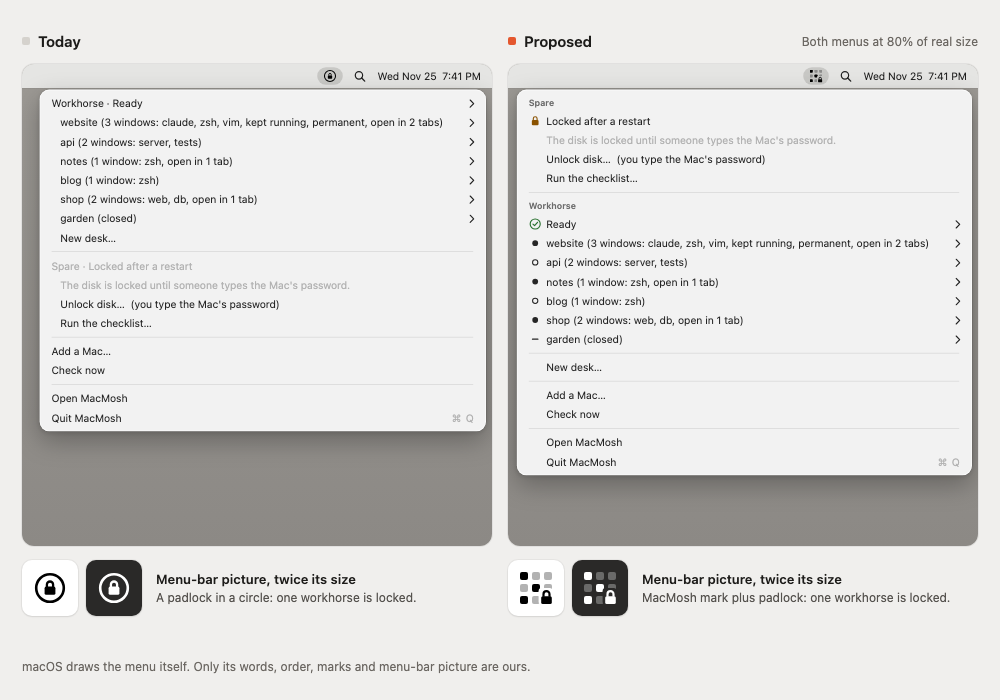

# The look of MacMosh: soft tiles, the M icon, and one pass over the window's words

Status: a proposal for the owner to approve. Nothing here is built until he does, and each step after that is rolled out to his daily Mac only with his go-ahead. Written: 2026-11-25. Issues: #34 (Task 31: icon, About box and wording), with the open wording questions of #156, #160 and #166.

This document adds to the v1 design (`docs/superpowers/specs/2026-11-18-macmosh-v1-design.md`, "the v1 design") and the main-window design (`docs/superpowers/specs/2026-11-23-main-window-design.md`, "the window design"). It changes no behaviour. Section 3 names the two sentences of the window design it amends. The pictures are mockups (drawings made to look like the app), not the built app.

## 0. For the owner: what changes, what you approve, what you can still change

### What changes on your screen

- **The MacMosh window turns warm and soft.** The page sits on a warm light grey; buttons, Macs and desks sit on small white tiles with a faint shadow. In dark mode the same layout turns charcoal. Today's window is first, then the new one in light, with a desk opened, and in dark:

  
  
  
  

- **Each desk says its state at a glance.** A green tick with "In 2 tabs", a hollow circle with "No tab", or a circle with a dash and "Closed". A small tile in front of the name shows one cell per window, lit orange when that window is in a tab.
- **One black button per page** is the main thing to do (New desk…). Risky buttons (Remove…, Forget) are red words, set apart.
- **The result of a click** ("Removed the desk recipes from Workhorse.") shows with a tick in a fixed place, so the list never jumps.
- **Add a Mac** gets numbered steps and a mountain drawn in dots:

  

- **MacMosh gets an icon:** the letter M drawn by lit tiles, warm on white for light mode and lit on charcoal for dark mode. It shows in Finder, in the About section and on the Remove confirmation, where macOS 15 shows a blank icon today.

  

- **Proposed, not yet decided:** the picture in the menu bar becomes a small M made of cells, with a badge per state (section 9), and later the menu's order and marks (section 10).
- **A few words change** in the window (section 7). Nothing the menu says changes in this pass.

### What you approve by approving this document

1. Look B, "soft tiles", for the main window on macOS 15 and 26, in light and dark, with the colours of section 5.
2. A state shown on every desk row, which changes one sentence of the window design (section 3).
3. The M icon in light and dark, shipped as section 8 says, with two new keys in `App/Info.plist`, and an About section at the end of Settings.
4. The words table in section 7: every row as recommended, unless you change a row.
5. The order of work in section 14: eight small pull requests, each tried by you before the next rollout.

### What you can still change

- **Any row of the words table**, now or when its step's pull request shows it.
- **The menu-bar picture:** the M mark (recommended) or the earlier 3 by 3 cell mark (section 9). Step 6 waits for your choice.
- **The menu's content** (section 10) and **the marketing kit** (section 11) are later steps. Each comes back to you for a yes, and nothing is ever posted without asking.

## 1. Why, and what the owner chose

On 2026-11-25 the owner wrote: "if nothing is really going on then we should do a UI/UX pass." He sent three reference pictures: user-interface parts he likes (a soft grey panel; rows with a rounded icon tile, a title and a grey line, and a state or one action on the right; a black New button; dotted art), marketing cards shaped like stamps with woodblock landscapes, and an app icon made of soft warm tiles.

Two audits of today's app (the window and the menu) found these problems first: a desk's state is spread over three grey words, so with four to nine desks every row has to be read; every button looks the same, Remove… as harmless as New window; almost every word is grey; things are said twice (the folder on the row and again in the details); a result line pushes the list down; long names wrap; and the app has no icon, so macOS 15 shows a blank one on the Remove confirmation.

He was shown mockups and chose:

- the window, at 15:27: **"Look B: soft tiles"** (the other choices were "Look A: stock macOS, tidied" and "A's window with B's desk tiles");
- the icon, at 15:26: **"option 4 and then adopt the color from 2 for dark mode but keep them M"**. Option 4 is the letter M drawn by lit tiles; option 2 was a night version: a charcoal ground, dark tiles, warm lit tiles.

Still open with him: the menu-bar picture (section 9), the words (section 7) and the menu changes (section 10).

## 2. Scope, non-goals and anti-goals

**In this design:** the main window in look B on macOS 15 and 26, in light and dark; the app icon (the M, light and dark) and an About section; the picture in the menu bar; one pass over the window's words, settling the leftover wording choices of issues #156, #160 and #166.

**Later steps, each needing the owner's yes when it comes:** the menu's content (order, a clickable headline, section titles, marks on desk lines); a marketing kit (stamp cards, a README picture), prepared and never posted without asking.

**Out:** new features or behaviour; restyling how macOS draws the menu; custom fonts in the app; custom radio groups and text fields; Liquid Glass effects of our own (Liquid Glass is macOS 26's see-through material); a Dock icon; the window design's optional steps 7 and 8.

**Anti-goals, failures even if it looks good:**

- A window that stops behaving like a Mac window: keyboard, the focus ring, VoiceOver, Increase Contrast.
- A state shown by colour alone.
- Text under 4.5:1 contrast against its background.
- Anything that breaks what CI clicks and reads (section 13).
- Trademark trouble: "Mac" never more prominent than "Mosh"; no Apple logo or hardware; the system font never used in marketing pictures.
- Copying the reference pictures.
- A page that jumps or blanks.
- Any third-party library or app.

## 3. Constraints that bind

**The allowed controls.** The window design (section 7.2) allows "Button, Text, TextField, Toggle, radio-group or segmented `Picker`, and `List`. **Not allowed** until the menu-tracking signal can be told apart: pop-up pickers, `contextMenu`, SwiftUI `Menu` and `.toolbar`". The reason, in the same design: "because the menu-tracking signal can't yet tell the menu-bar menu from a menu in the window, the window must not contain one". CI fails when a click or key press in the window logs `menu opened` or `menu tracking`. Layout views (stacks, `Grid`, backgrounds, rounded rectangles) and custom button styles are not controls. `ProgressView`, `Form` and `DisclosureGroup` are not on the list and are not used.

**What CI needs.** CI's pictures job (the GitHub job that drives the debug app on macOS 15 and 26 and photographs it) finds elements by **accessibility identifier**, a fixed name such as `desk.website.open` that the app attaches to each element, and clicks the element's centre. So:

- every identifier listed in `WindowMarks`, `FormMarks` and `SettingsMarks` stays on the element a click lands on, and no element grows to cover another's centre;
- a desk row stays one button (role AXButton) whose spoken label starts "name, window names, " (today `recipes, build logs, ~/Development/recipes`);
- the static texts CI reads keep their words ("Starts with", "Desks before the restart", "This removes the desk website", "Name a window of", "Name for window"), and the window's title stays "MacMosh";
- the radio groups stay real radio buttons and "Same name as the desk" a real checkbox, because the CI tool reads their role and value.

**One wording for words the menu and the window share.** `WorkhorseBlock` and `ButtonRules` feed both, and `ButtonRulesTests` checks that "For every sample state, the buttons the menu and the board share have the same titles and actions". The menu's stored copies (`Tests/MacMoshKitTests/Fixtures/menu/*.txt`) hold the same words, with the note "Never re-recorded: a change here is a change to the menu."

**Size.** The window's default size stays 880 by 680 points ("the CI runners' 1024 by 768 screen, with room for the foot under one open detail strip", `MacMoshApp.swift`) and its minimum 700 by 440 (`MainWindow.swift`).

**Native only, macOS 15 at least.** The owner's rule: "i don't want third party dependency can we not make a native menu bar item instead" (2026-11-19). SwiftUI and AppKit only. The minimum stays macOS 15.0 (`Package.swift`, `App/Info.plist`, `AppBundleTests`), so anything that exists only on macOS 26 needs a macOS 15 path.

**No tests for views.** The app target has no test target and "Tests that draw the views" are a non-goal of the window design. Views stay thin; every number and word lives in MacMoshKit under test, and CI's pictures are the check of the drawing. Nothing checks dark appearance today: no code, script or test mentions `colorScheme`, `preferredColorScheme`, `darkAqua` or appearance, and every CI picture is light.

**The icon needs the owner's yes.** The window design says "No change to `LSUIElement`, the entitlements or the plist." An icon needs two keys in `App/Info.plist` and `AppBundleTests` checks that file's keys. This design is the ask; approving it (item 3 of section 0) is the yes.

**One sentence of the window design changes.** Section 7.1 A says: "The usual case is left unsaid, so rows stay short." Look B shows a state on every row, the usual "In 1 tab" included, and the choice the owner picked showed that. So, once this is approved, that sentence reads: "Every row shows its state in a cell on the right (amended 2026-11-25, look design); the second line still leaves the usual case unsaid." The second line keeps the rule: "Kept when it exits" and "Doesn't come back after a restart" still appear only when they apply.

## 4. Approaches considered

### The window

| | Look A: stock macOS, tidied | Look B: soft tiles | A's window with B's tiles |
|---|---|---|---|
| What it is | The system's controls and colours, with a state cell, one prominent button, red Remove, fixed result slot | Our own warm ground, white tiles, a black primary button, cells per window | A's system look with B's tiles only on desk rows |
| For | Least code; follows every system change for free | Answers the owner's references; one look on 15 and 26; reads at a glance | Smaller step |
| Against | Looks different on 15 and 26 (bordered white buttons on 15, filled grey on 26); little of what he liked | Own colours to prove in light, dark and Increase Contrast; three button styles to build | Two looks in one window |

**He picked B** ("Look B: soft tiles"). The cost is real: colours of our own must pass contrast tests in every appearance (section 5), and the sidebar loses the system's selection drawing (section 6.2).

### The icon

Five ideas were drawn: **lit windows**, **night shift** (charcoal ground, dark tiles, warm lit tiles), **prompt**, **letter M** (the M drawn by lit tiles) and **warm desk**. He picked the M, with the night shift colours for dark mode.

### The picture in the menu bar

Two marks: the **3 by 3 cell mark** drawn first, and the **M mark** drawn after the icon was chosen. Recommended (agent's call): the M mark, so the menu bar and the icon are one picture. Open with the owner.

## 5. The look, "Ember"

### 5.1 Tokens

A **token** is a named colour or size the views use instead of a raw value, so light, dark and Increase Contrast are each one table. Values are from the mockups' source. Where the mockups have none, the value is marked "proposed" and step 1's contrast test decides it.

| Token | Used for | Light | Dark | Increased contrast |
|---|---|---|---|---|
| ink | Names, headings, body text | #1D1C1A | #F3F1EE | as light / dark |
| ink-2 | Window names, summary line, second-rank words | #55524E | #B9B5AE | ink |
| ink-3 | "Checked 19:49", second lines, hints, chevrons | #6B6762 | #9D9992 | ink-2 |
| ground | The page and the sidebar | #F0EFED | #1B1A19 | as light / dark |
| surface | Tiles, secondary buttons, the chosen Mac's card | #FFFFFF | #2A2928 | as light / dark |
| surface-2 | Opened details, small sidebar tiles | #F7F6F4 | #222120 | as light / dark |
| hairline | Row lines, borders of tiles in dark | #E0DEDA | #3A3836 | ink-3 |
| ember | Lit cells and art; never small text | #E4572E | #FF7A4D | as light / dark |
| ember-text | Warm words, if any | #B93F12 | #FF7A4D (proposed) | builder computes |
| glow | The top of the dark icon's lit tiles | #F7C948 | #F7C948 | not text |
| clay | Unlit cells; the dotted art | cells #D5D2CD, outline of a closed cell #A9A49D, art #D4846F | cells #4A4744, outline #8A867F, art proposed | not text |
| green | Ready, "In 1 tab", "Saved." tick | #2A7230 | #7BC67E | builder computes |
| amber | States that need the person | proposed #8A5300 | proposed #F0B44C | builder computes |
| red | Remove…, Forget, refusals | #B3261E | proposed #FF8A7A | builder computes |
| primary button | One per page | background ink, words #FFFFFF | background ink, words #1B1A19 | as light / dark |

Sizes: tiles have a corner radius of 10 points at 40 points (desk tiles), 8 at 28 (sidebar tiles and buttons) and 12 for panels; in light a tile has a shadow of 1 point down, 2 points of blur, black at 8 per cent, plus a 1-point ring of black at 4 per cent; in dark no shadow, only a 1-point ring in hairline. A cell is 6 by 6 points, 3 apart, corners 1.5. A desk row is 52 points high; the sidebar is 200 points wide.

The increased-contrast column is the agent's call: text greys step up to the next darker token (lighter in dark), hairlines become ink-3, and every text and background pair reaches 7:1. The builder computes the exact values in step 1 and tests them; any mockup value whose pair falls short of 4.5:1 in light or dark is moved until it passes, and the pull request says which.

Apple's rules this follows: "Avoid relying solely on color to differentiate between objects, indicate interactivity, or communicate essential information." [1]; "Make sure all your app's colors work well in light, dark, and increased contrast contexts." and "If you define a custom color, make sure to supply light and dark variants, and an increased contrast option for each variant that provides a significantly higher amount of visual differentiation." [1]; "At a minimum, make sure the contrast ratio between colors is no lower than 4.5:1. For custom foreground and background colors, strive for a contrast ratio of 7:1, especially in small text." [2]; and "If your app doesn't provide this minimum contrast by default, ensure it at least provides a higher contrast color scheme when the system setting Increase Contrast is turned on." [3]. Apple also says "Avoid offering an app-specific appearance setting." [2], so MacMosh follows the system and has no switch of its own.

### 5.2 Type

The system font only, at Mac sizes: 13 points for body text and names, 11 to 12 for second lines, tags and the sidebar's second line, 20 to 22 semibold for a page title, 13 semibold for headings. No other typeface. Apple: "SF Pro is the system font in macOS." and "don't embed system fonts in your app or game." [4]. Apple's Mac text styles include "Title 1 | Regular | 22", "Body | Regular | 13", "Callout | Regular | 12" and "Subheadline | Regular | 11" [4]. Today's caption-size help text (10 points) moves up to 11 or 12.

### 5.3 Where the values live

- **In MacMoshKit, a new `Look` folder** (`Sources/MacMoshKit/Look/`): each token as plain numbers (red, green, blue) for light, dark and both increased-contrast versions; the sizes; and a contrast function using the usual relative-luminance formula of WCAG 2 (its text was not re-read for this design, so the builder quotes it with its source in the pull request). Tests there prove every text and background pair the views use reaches 4.5:1 in light and dark, and 7:1 with increased contrast.
- **In the app target**, one small file turns each token into a colour that follows the appearance, without an asset catalog (Apple's compiled file of colours and pictures, which the script-built app does not have). AppKit documents a colour that "Creates a dynamic catalog color with a provider that's used to resolve the exact color value, calculated on first use." and "When methods on a color need color component values, AppKit calls the provider with NSAppearance.currentDrawingAppearance." [5]; SwiftUI's `Color(nsColor:)` "Creates a color from an AppKit color." and "The new color preserves the adaptability of the original." [5]. The provider picks the value with the appearance's `bestMatch(from:)`; AppKit returns its high-contrast dark appearance "when the user enables the Increase Contrast option in the Accessibility system preferences." [6]. Apple prefers an asset catalog for this ("When you need a custom color, add a Color Set asset to your app's asset catalog in Xcode" [2]); the provider is the documented route without one.

## 6. Components

Each part says how it looks, what it is built from, its accessibility and what CI needs.

### 6.1 Ground and title bar

The page and the sidebar sit on the ground colour, with a hairline between them. The title bar stays the system's, titled "MacMosh"; CI finds the window by that title and clicks the title bar 12 points below the window's top. A scroll view keeps its system background hidden so the ground shows; Apple: "On macOS 15.0 and later, the visibility of the scroll background helps achieve the seamless window/titlebar appearance for scroll views that fill the window's content view" [12].

### 6.2 Sidebar

A column of buttons on the ground, not the system's selectable list (`List` with the sidebar style, used today), because the system draws its selection differently on macOS 15 (a grey highlight) and 26 (solid blue with white words), and it cannot be restyled reliably. Each Mac is a row: a 28-point tile with its state symbol, its name, and a second line in ink-3: "Ready · 6 desks" when Ready, or the state's name otherwise (agent's call). The chosen row is a surface card with the tile shadow and carries the selected trait for VoiceOver (the exact modifier is left to the builder; not checked in Apple's pages for this design). Then **Add a Mac…** with a plus tile, and **Settings** with a gear tile. The identifiers stay `sidebar.<id>`, `sidebar.addMac` and `sidebar.settings`.

What is lost: the system's sidebar material (on macOS 26 the see-through sidebar) and moving between Macs with the arrow keys. What replaces it: every row is a button that Tab reaches, with the focus ring, and the selected trait says which page is shown. Apple's guidance for this choice: "Reduce your use of custom backgrounds in controls and navigation elements." [10], which our plain two-view split (not a `NavigationSplitView`, as today) keeps out of the system's navigation views; and "Avoid putting critical information or actions at the bottom of a sidebar." [11], which holds: Settings stays the third line, under Add a Mac….

### 6.3 Header

The Mac's name as the page title (22 points), then a **state pill**: a white capsule with a dot and the state's word ("Ready"), in the state's colour: green for Ready, amber for a state that needs the person (Locked after a restart, Waiting for login, Ready with sign-ins off, any "not set up" state), red for Can't reach it and Can't verify it, ink-3 while still checking (agent's call). The word is always there, so colour is never alone. On the right, "Checked 19:49" and **Check now**; while a check runs, "Checking…" takes the place of the time without moving the button. Under it, the summary line in ink-2. Under that, a **result slot** of fixed height: empty, or the last result as a small tile with a tick ("Removed the desk recipes from Workhorse."), or a warning mark and red words for a result that failed. It never moves the list. Identifiers `page.headline` and `page.result` stay; the headline's text keeps its words.

### 6.4 Buttons

Three custom button styles. Apple documents the type: `ButtonStyle` is "A type that applies standard interaction behavior and a custom appearance to all buttons within a view hierarchy.", and its configuration's `isPressed` is "A Boolean that indicates whether the user is currently pressing the button." [7].

- **Primary**: ink background, words white in light and near-black (#1B1A19) in dark. One per page: **New desk…**, **Make desk**, **Add a Mac…**.
- **Secondary**: a surface tile with the tile shadow, words in ink. Everything else, including Open and Go to.
- **Destructive**: red words, no fill or a surface tile with red words, and set apart from other buttons: **Remove…**, **Forget**, **Remove MacMosh from this workhorse…**.

Each style has a visible keyboard focus ring, a pressed look and a disabled look, and every title stays as today. Whether a custom `ButtonStyle` keeps the system's focus ring on macOS 15 and 26 was not checked; if it does not, the style draws one in the system's keyboard focus colour ("Keyboard focus indicator color" in Apple's list of Mac colours [1]). The system's confirmation dialog for Remove keeps its own buttons.

Checkboxes and radio groups stay the system's. Apple documents `PickerStyle` as "A type that specifies the appearance and interaction of all pickers within a view hierarchy." but lists no method to implement, only built-in styles [8], so a custom picker style is not documented. Text fields stay the system's too.

### 6.5 Desk row

From left to right: a chevron (ink-3), a 40-point tile with cells, the name in ink semibold with the window names beside it in ink-2, a second line, the state cell, then **Open** or **Go to** as today.

- **Second line**: the folder and "Kept when it exits" or "Doesn't come back after a restart" when they apply, in ink-3, or the tag "Made by hand" for a desk with no saved definition (section 7). It is cut with "…" when too long, with the whole line as its help tag.
- **State cell**, 92 points wide: a filled green circle with a tick and "In 2 tabs" in green; a hollow circle and "No tab" in ink-2; a circle with a dash and "Closed" in ink-2; "Updating…", "Renaming…" or "Naming…" in ink-2 while an action runs. Identifier `desk.<name>.status` stays on it.
- **Cells** (agent's call): one cell per window, lit (ember) when that window is in a tab, unlit (clay) when not; one hollow cell for a closed desk. Up to six cells in two rows of three; with more than six windows, five cells and a small plus. Cells are decoration: the state cell's words say the same thing, and the tile is hidden from VoiceOver.
- **Accessibility**: the row stays one button (`desk.<name>`, role AXButton) whose label starts with the name and the window names; the second line and then the state words come after them. Open or Go to keep their own identifiers and help tags (the menu's full words).
- **Names never wrap**: the name keeps its full width up to 200 points and is cut with "…" beyond, with the whole name as its help tag. This fixes "website-redesign" wrapping today.

### 6.6 The opened details

An inset panel in surface-2 under the row, corners 12, a hairline ring. Left: one line per window, with its cell, its name, its state words in green or ink-3 ("in a tab", "open in another tab", "not in a tab"), and the small Go to or Open and **Name…** buttons. Right, beside a hairline: the facts as a two-column list (Starts with, After a restart, When its last shell exits, and "Keeps its command running" when set). Under a hairline: **New window** and **Rename…** on the left, **Remove…** alone on the right in red. The folder is not repeated when the row already shows it (the audit's "said twice"). The panel keeps `.accessibilityElement(children: .contain)` so every button keeps its own identifier, and each window line stays a static text of its own.

### 6.7 The Ended group, the greyed list and two state pages

- **Ended**: the heading "Ended", then per desk a row in the same parts: a tile with one hollow cell, the name, "ended about 19:51", the folder and command on one cut line, then **Start again** (secondary), **Start again and keep it** (secondary) and **Forget** (destructive words, apart). The line under the buttons stays where it is.
- **Under a state that is not Ready**: the header shows the state pill and the hint; the state's own buttons (Unlock disk…, Log in…) use the secondary style, and the greyed list "Desks before the restart (checked 19:50)" sits in a surface-2 panel in ink-3.
- **The Locked page** is that page; the password note moves under the Unlock button only if the menu's words change (section 7 keeps them).
- **The unreadable-settings page**: a heading, the sentence of today, and the next step, in the same parts; the heading's and next step's words are new and come to the owner in step 2's pull request. Identifier `page.listProblem` stays on the sentence.

### 6.8 Forms

New desk, Rename and Name a window stay the system's sheets, with our three button styles (Make desk, Rename and Name are primary) and the system's fields, checkboxes and radio groups. Labels sit level with their field's first line (`firstTextBaseline`, as First window does today). When **Make desk** is off, one line in ink-3 beside it says why ("Choose a folder first."; agent's call, words for the owner in section 7). Help lines move from 10-point captions to 11 points in ink-3; refusals stay red words under their field, with their identifiers.

### 6.9 Settings

One soft panel (surface, corners 12) per Mac and one for This Mac, each with its name as the panel's heading. "Saved." gets a small green tick before it. **Run the checklist…** stays secondary; **Remove MacMosh from this workhorse…** goes last in its panel, on its own line, in red words, with one grey line under it (section 7). Then an **About** section at the end of the page: the M icon, "MacMosh" and the version, the licence, and the two credit lines the v1 design fixes, word for word: "Mac and macOS are trademarks of Apple Inc., registered in the U.S. and other countries and regions." and "MacMosh is an independent project, not affiliated with Apple or with the mosh project." No new window and no menu item for About. The words live in MacMoshKit with a test that they are exact.

### 6.10 Add a Mac

The title "Add a Mac" with a 40-point tile holding a small M (the mockup still shows the 3 by 3 cells; the build uses the M); the first line; the two settings as a numbered card (two rows, a number tile each, the setting's name in semibold); the closing paragraph in ink-2; the primary **Add a Mac…** button (`page.addMac`). The words are today's (`AddMacPage.standard`). The **dotted mountain** sits at the lower right as decoration, hidden from VoiceOver, and never behind text: when the window is too small for both, the art is clipped first.

The art is drawn in SwiftUI from a table of dots (about 1,500 dots on a 5-point grid, three strengths of clay). A small script in `scripts/` writes that table into a generated Swift file, the way `scripts/embed-host-script.sh` writes the host script into `HostScriptSource.swift`, with a `--check` mode that `scripts/check.sh` runs. The dots are tinted by the clay token, so they work in dark. No image file. Whether the script's input is a committed copy of the mockup's dot picture or a formula is left to the builder.

### 6.11 Motion

None of our own: no animation is added. Reduce Motion needs nothing beyond what the system does.

## 7. Words

The owner approves this table by approving the design, and may change any row. "Agent" means the agent's call; "issue" means the issue proposed it and the agent recommends it.

| Where | Today | Proposed | Whose call |
|---|---|---|---|
| Second line of a desk with no saved definition | "Not made with MacMosh: folder and restart not known" | The tag **"Made by hand"**; today's sentence becomes its help tag | Agent (the window audit's idea) |
| A closed permanent desk | "(closed)" in the window-names column | **"Closed"** in the state cell, with a dash-circle | Agent |
| Sidebar, under a Mac's name | (nothing) | **"Ready · 6 desks"** ("1 desk"); the state's name when not Ready | Agent |
| A window's line in the opened details | "claude (in a tab)", "zsh (open in another tab)", "vim" | "claude" then **"in a tab"**; "zsh" then **"open in another tab"**; "vim" then **"not in a tab"** | Agent |
| Beside a Make desk that is off | (nothing) | **"Choose a folder first."** | Agent |
| #160 item 1, Settings. "'Remove MacMosh from this workhorse…' looks like the checklist button beside it." | Beside Run the checklist…, same look | Apart, last, red words, with the grey line **"Opens a terminal tab that lists what goes and asks first."** | Issue |
| #160 item 2. Tabs "can be chosen while this Mac opens tabs in Terminal, and nothing says Mosh is used instead." | (nothing) | Under Connection, only in that case: **"This Mac opens tabs in Terminal, so Mosh is used instead."** | Issue |
| #160 item 3. "Nothing says that changes save themselves." | (nothing) | Under the Settings heading: **"Each change is saved as you make it."** (shorter than the issue's example, which went on "a choice when you click it, a field when you press Return or leave it.") | Agent |
| #160 item 4. "A key file's path is full, starting with /, or starts with ~." is hard to read; "Change both together." | Settings: "A key file's path is full, starting with /, or starts with ~."; New desk: "A path is full, starting with /, or starts with ~." | Both: **"Type a full path, starting with / or with ~."** | Agent |
| #166, "The words": the form, the terminal and the name sheet use two sets of words | Form: "First window", "Same name as the desk", "Left empty, the window is named after the program running in it."; terminal: "Name for its first window (Enter for website, - to name it after its program):"; sheet: "Use its program's name" | Keep the form's words. Terminal: **"First window's name (Enter: same name as the desk, website; -: named after the program running in it):"**. Sheet button: **"Name it after the program running in it"** | Agent |
| #166, "The one-line command": "Should the one-line command default to the desk's name too?" | `macmosh desk new` with name and folder and no `--window-name` sends nothing about the window | **Yes**: it names the first window after the desk, as the form does; `--window-name -` leaves it to the program | Agent |
| #156 item 2, "Nothing says what 'keep it' means before the click" | (nothing) | Beside **Start again and keep it**, a grey line: **"Kept: the desk stays, closed, when its last shell exits."** | Agent |

The "Choose a folder first." and #166 terminal rows change words outside the window's views; each lives in MacMoshKit (`NewDeskForm.Words`, `DeskFlow.firstWindowQuestion`, `WindowNameForm.Words`) and its tests change with it. The #166 "yes" changes what `macmosh desk new` does with a workhorse script 0.12.0 or newer and is noted in the command's help.

**Words the menu shares with the window do not change in this pass:** button titles (Run the checklist…, Restart…, "Unlock disk…  (you type the Mac's password)", Share screen, Fix…), state names, headlines and hints. They come from `WorkhorseBlock` and `ButtonRules`, which feed both faces, and the menu's stored copies and history tests exist to prove the menu did not change (section 10 says what a change there costs). They belong with the menu step, if the owner wants one. The window's per-window lines are drawn from the same facts the menu uses (a new function beside `DeskWindows` in MacMoshKit), and the menu's own lines keep their words.

## 8. The icon

### 8.1 The picture

- **Light**: a rounded square of warm white, lighter at the top (#FCFAF7 to #ECE5DD), holding a 5 by 5 grid of soft tiles. Thirteen tiles are ember and draw the M: column 0 and column 4 in full, plus row 1 column 1, row 1 column 3 and row 2 column 2 (rows and columns counted from 0 at the top left). Their colour runs from #F29A55 at the top to #D2481F at the bottom. The other twelve are frosted warm white (#FFFFFF to #F4EEE7).
- **Dark**: a charcoal square (#2A2928 to #1D1C1A) with dark tiles (#3B3835 to #2F2D2A); the M's tiles are lit, glow yellow at the top (#FAD566, #F7C948) through #F29343 to ember (#E4572E) at the bottom.
- **At 16 pixels**: a solid M with no gaps (light: #E2552C on #F3EEE8; dark: lit cells on #24221F), because tiles would blur.

The pictures are drawn by a small script in the repository, so they can be regenerated (agent's call): a Swift script using CoreGraphics (Apple's drawing library, part of macOS), in `scripts/`, that writes the layer pictures into the icon document. No drawing app and no third-party tool. The pictures it writes are committed; nothing compares their bytes.

Apple's icon guidance that binds: "Don't use replicas of Apple hardware products. Apple products are copyrighted and can't be reproduced in your app icons." [13]; "Include text only when it's essential to your experience or brand." with "Although displaying a mnemonic like the first letter of your app's name can help people recognize your app or game, avoid including nonessential words" [13]; and, because macOS 26 adds its own highlights ("An icon with fine visual features might look busy when rendered with system-provided shadows and highlights" [13]), "Let the system handle blurring and other visual effects. ... there's no need to include specular highlights, drop shadows between layers, beveled edges, blurs, glows, and other effects." [13]. So the layers are drawn flat (agent's call), and the glow of the dark M, which the mockup draws, is kept only if the trial in 8.3 shows it survives the system's rendering. No Apple logo, no hardware, and "MacMosh" is never written on the icon.

### 8.2 How it ships

- An **Icon Composer document**, `AppIcon.icon`: a folder holding `icon.json` and the layer pictures. Icon Composer is Apple's app for layered icons; Apple says: "Use Icon Composer to create a single multilayer file that you can add to your Xcode project to represent your Liquid Glass app icon everywhere your app icon appears" [14]. The document has a default and a dark appearance. The Mac row of Apple's table lists "Default, dark, clear light, clear dark, tinted light, tinted dark" [13]; clear and tinted are left to the system, which "automatically generates variants you don't provide." [13].
- `scripts/build-app.sh` compiles it with `xcrun actool` (Apple's asset compiler, part of Xcode [23]) into `Assets.car` and `AppIcon.icns`, makes `Contents/Resources` (the script makes no such folder today), copies both in, and sets the two Info.plist keys actool reports, `CFBundleIconFile` and `CFBundleIconName`, both `AppIcon`. Signing comes after, as today, so `codesign --verify --deep --strict` still covers them. If actool is missing, the script stops with a clear message rather than building an app without an icon (agent's call). `AppBundleTests` learns the two keys. The loose `AppIcon.icns` always ships too: Xcode 26's release notes list "Fixed: Icon Composer icons added to macOS app targets do not display in Finder, Spotlight or Dock when deployed to older versions of macOS. (154784104)" [15], which says older macOS needs more than `Assets.car`.

What was tried, on 2026-11-25 in a scratch folder on a Mac with macOS 27.3 and Xcode 27.2, not in the repository and not on CI:

- An asset catalog with dark Mac images ("luminosity dark"): actool warned "The app icon set "AppIcon" has 10 unassigned children." and dropped the dark ones. Not a route.
- An Icon Composer document with a dark fill, and one with two layers swapped by appearance: actool exited 0 with no warning and produced `Assets.car` with three icon stacks, "NSAppearanceNameAqua", "NSAppearanceNameDarkAqua" and "ISAppearanceTintable", the dark one holding different content, plus a light `AppIcon.icns`. A third shape (an image-name key per appearance) compiled with no warning but kept only the light picture.
- Command used: `xcrun actool AppIcon.icon --compile <out> --platform macosx --minimum-deployment-target 15.0 --app-icon AppIcon --output-partial-info-plist <out>/partial.plist --target-device mac`, plus `--standalone-icon-behavior all` for every size in the `.icns`.

### 8.3 What is proven and what is not

Proven: the tool, run in a scratch folder, produced light, dark and tintable stacks from a hand-written document. Not proven:

- **What macOS 15 shows.** No Apple statement was found. The loose `AppIcon.icns` is the light picture, so the likely result is the light M in light and dark, but that is inference.
- **Which places on macOS 26 and 27 switch to the dark M.** Apple names Finder in a fixed bug: "Fixed: Finder does not display Dark Mode app icons or tinted folder colors when the Folder Color setting in System Settings > Appearance is set to Automatic." [16]. Nothing was found about the About section, alerts or the Dock for a dark icon. A community post, not Apple, says that on macOS 26 "Icons without dark assets are displayed in their original light version." [24].
- **The format.** No Apple page describing `icon.json` was found; the working shape was found by trial and from key names inside Apple's tools. The dark stack was never rendered to a picture, only read from `Assets.car`'s description.
- **The runners' Xcode**: which Xcode CI's runners use was not checked; actool must understand `.icon` documents there.

So the icon step is not merged until CI's macOS 15 and 26 runners have built the app and shown the icon in a picture, in light and in dark (for example the About section and the Remove confirmation). **The fallback**, if the layered file fails anywhere: a plain `.icns` of the light M on every version (made with `iconutil`, whose page says it "converts iconset folders to deployment-ready, high-resolution icns files" [22]), and the dark M only inside the app (the About section draws it from the same cells).

## 9. The picture in the menu bar

Apple: "Both interface icons and symbols use black and clear colors to define their shapes; the system can apply other colors to the black areas in each image so it looks good on both dark and light menu bars, and when your menu bar extra is selected. The menu bar's height is 24 pt." [18]. So the mark is black and clear only; a **template image** is such a picture, which macOS recolours ("Images you mark as template images should consist of only black and clear colors." [19]).

**Recommended (agent's call; open with the owner): the M mark.** A 16 by 16 point box, 1 point clear on every side; 5 by 5 cells of 2 points with 1 point between, corners 0.5, all on whole points; the M's thirteen cells solid, the other twelve clear. Ready is the plain M. Each other state swaps the lower right (the M's right leg's lower two cells) for a 6-point badge, or changes the M's outline, so every state differs in shape even in one colour, as the v1 plan asks ("menu-bar images that differ in shape for each state").

| State (today's name) | Today's symbol | The M mark |
|---|---|---|
| Ready | `checkmark.circle` | The plain M |
| Ready, sign-ins off | `exclamationmark.circle` | Badge: an exclamation mark in a circle |
| Waiting for login | `person.crop.circle.badge.questionmark` | Badge: a person |
| Locked after a restart | `lock.circle` | Badge: a padlock |
| Can't verify it | `exclamationmark.triangle` | Badge: a warning triangle |
| Can't reach it | `wifi.slash` | Hollow cells, and a no-entry badge |
| Every "not set up" case | `wrench.and.screwdriver` | Badge: a wrench |
| Still checking, or waiting for the desk server | `ellipsis.circle` | Faint cells with the middle row solid |
| No workhorses yet | `plus.circle` | Faint cells, and a plus badge |

**The log keeps today's symbol names.** The model goes on naming each state by today's symbol name; CI's `menu refreshed: symbol=plus.circle workhorses=0 lines=2` (`ci.yml`), the driver's `symbol=lock.circle` and the stored menus read them. Only the label's drawing changes: it maps the name to the drawn mark.

**Drawn in code** as a template image: an AppKit picture drawn from the cell table, marked as a template, wrapped in SwiftUI's `Image(nsImage:)`, which "Creates a SwiftUI image from an AppKit image instance." [19], inside today's `MenuBarExtra(isInserted:)` label [20]. **Unproven:** Apple does not say whether the template flag survives inside a `MenuBarExtra` label, and it was not tested. So this step too is tried on CI's runners, in a light and a dark menu bar, before it merges; if the flag does not survive, SwiftUI's template rendering mode is the next try ("Template mode renders all nontransparent pixels as the foreground color" [19]).

**Open with the owner: the M mark or the 3 by 3 cell mark.** The menu picture in section 10 still shows the cell mark.

## 10. The menu, a later step

**What macOS draws, and what is ours.** With `MenuBarExtra` in its default style, macOS draws the menu's background, corners, width, row height, typeface, the highlight under the pointer, the submenu chevron, the grey colour of a line that does nothing, and the colour of the menu-bar picture. MacMosh decides every word and the order of lines, which lines are text, buttons or submenus, the dividers, the indent and the menu-bar picture. A visual pass cannot give the menu tiles, colours or a black button; Apple says "Display a menu — not a popover — when people click your menu bar extra." [18].

**Proposed content changes, each with its cost:**

| Change | Why | Cost |
|---|---|---|
| The workhorse that needs you first | Today a locked second Mac is line 10 of 17, under the healthy one | Order changes in the stored copies; `MenuRowsTests` lists rows in order |
| A clickable headline with a state mark | A line that does nothing is drawn grey, so "Locked after a restart" is the faintest text in the menu | A line becomes a button; the stored copies and `everyCaseOffersTheSameActionsAsInStep1` change |
| Section titles with each Mac's name | A trial showed "A `Section` header is a small grey caption that is never highlighted" | New lines in every stored copy; line counts CI checks may change |
| A mark in front of each desk line (in a tab, no tab, closed) | Rows differ today only by their last words | Every desk line in the stored copies |

Every change edits `every-sample-menu.txt` and `windows-menu.txt` on purpose, and the two history tests (`everyGatedOffMenuIsMainsCopyWithTheSummaryOneFactPerLine` and `onlyTheReadyBlocksChangedSinceStep1`) fail and must be rewritten or retired, because they exist to prove the menu did not change. CI's menu driver finds rows by their three-space indent and their words, so it changes with them.

**Marks in front of lines are not promised.** Apple's menu guidance says "provide icons for all menu items in a group, or none of them" [21], and the macOS 27 release notes say: "In macOS 27.0, menu bar and context menus present a reduced set of menu item images, similar to the behavior prior to macOS 26.0. By default, `NSMenu` hides all menu item symbol images — non-symbol images remain visible." [17]. Whether a SwiftUI `Label` with an image shows in this menu on macOS 15 and 26 was not checked either. So marks are tried on macOS 15, 26 and 27 before they are promised, and this step waits for that trial and the owner's yes.

## 11. Marketing kit, a later step

Stamp-shaped cards and a README picture, kept as source files in the repository (for example `docs/marketing/`), with a **provenance file** for any museum picture: the museum, the object page, the licence wording and the date it was read. The Cleveland Museum of Art says: "Images, data, software, and documentation offered with Creative Commons Zero can be used in any application." and "Works designated as Creative Commons (CC0) do not require attribution or citation." [26]. Its record for Katsushika Hokusai's "South Wind, Clear Sky" ("Red Fuji"), from Thirty-Six Views of Mount Fuji, early 1830s, accession 1930.189, reads "Public Domain. You can copy, modify, and distribute this work, all without asking permission." [26], and the museum says "Image downloads are only available for CC0 artworks." [26]. The museum's own data is reported to list it as CC0; the reading quoted here covers the object page and the policy, not that data record, so the provenance file quotes the record itself when the card is made. Citing the museum "does not imply endorsement by the CMA" [26], and a CC0 mark covers the museum's rights, not anyone else's; whether that is safe in every country would need a lawyer.

The cards use a typeface with an open licence, chosen when the kit is made, never the system font (Apple's trademark page: "You may not imitate the distinctive Apple packaging, web site design, logos, or typefaces." [25]). No Apple logo, no drawing of Apple hardware, no pun on an Apple name, and "Mac" never more prominent than "Mosh" [25]. **Nothing is posted without asking**, as the plan requires: "a release, the Homebrew tap and any post are each asked of" the owner first.

## 12. Accessibility and the system's settings

| Setting | What MacMosh does | Apple |
|---|---|---|
| Dark appearance | Every token has a dark value; CI pictures both | `colorScheme`: "The color scheme of this environment." [9] |
| Increase Contrast | The increased-contrast column; tested to 7:1 | `colorSchemeContrast`: "The value that you read depends entirely on user settings, and you can't change it." [9] |
| Differentiate Without Color | Already met: every state is a symbol plus words | "If this is true, UI should not convey information using color alone and instead should use shapes or glyphs to convey information." [9] |
| Reduce Transparency | Nothing of ours is see-through; every tile is opaque | "If this property's value is true, UI (mainly window) backgrounds should not be semi-transparent; they should be opaque." [9] |
| Reduce Motion | Nothing to do: no motion of our own | "If this property's value is true, UI should avoid large animations" [9] |
| Keyboard | Tab reaches every button; the focus ring shows; Return and Escape work in sheets as today; the editing keys of `WindowKeysMonitor` are unchanged | (the system's) |
| VoiceOver | Rows keep their labels; cells, tiles and art are hidden; the chosen Mac carries the selected trait | (the system's) |

Whether Tab stops at buttons may depend on a system keyboard setting; that was not checked for this design, so the step that adds the Tab check (section 14, step 1) finds out and sets it on the runner.

## 13. Tests and pictures

**Unit tests in MacMoshKit:** every token pair the views use reaches 4.5:1 in light and dark and 7:1 with increased contrast; every new or changed word of section 7 is pinned; the About lines are exact; the dot table matches its generator (`--check`); the per-window state words match the menu's facts.

**CI's pictures job** takes each window scenario in light and in dark on macOS 15 and 26, with the runner's appearance set by the job before the app starts (how is left to the builder). The window part runs about 16 minutes per version today and the job's limit is 36 minutes, so dark runs as a second job per version, not inside the first (agent's call). Every existing check stays. One new check: Tab moves keyboard focus across a page's buttons, read through the accessibility tree. Nothing compares pixels; a person reads the pictures.

**What a restyle would break, and how each is kept:**

| Would break | Kept by |
|---|---|
| A click landing on the wrong element, because an identifier moved or a row grew over its button | Identifiers stay on the clicked element; rows and buttons stay separate elements |
| The row's role (AXButton) and its label "name, window names, " | The row stays one `Button`; state words go after the names |
| Window lines read as static texts starting "claude (in a tab)" | The driver's check changes on purpose to read "claude" and "in a tab" as two texts (section 7) |
| Radio buttons read by role and title; the checkbox read by value | They stay the system's controls |
| Words pinned by tests and the driver (for example "A path is full, starting with /, or starts with ~.") | Each change of section 7 edits its test and the driver line in the same pull request |
| The window found by its title; the title-bar click | The system's title bar and the title "MacMosh" stay |
| Buttons pushed off a 1024 by 768 screen | Default 880 by 680 and minimum 700 by 440 stay |
| Log lines: `window opened`, `symbol=…`, no `menu opened` on a click | No menu, pop-up or toolbar is added; symbol names stay in the model |

## 14. Steps

Each step is one issue and one pull request, tests first, with a build-log entry. After each, the owner tries it, and it reaches his daily Mac only with his go-ahead.

1. **Tokens and the workhorse page.** `Look` in MacMoshKit with its tests; the colour file in the app; the three button styles; the workhorse page's header (pill, result slot), rows, tiles, state cell and foot; the dark picture job and the Tab check. *He tries:* opening MacMosh in light and dark, reading his desks' states, Tab through the page.
2. **Details, Ended and the other states.** The opened details panel, the Ended group, the greyed list, the Locked page and the unreadable-settings page. *He tries:* opening a desk's details, ending a throwaway desk and starting it again.
3. **Sidebar and Add a Mac.** The sidebar of buttons with "Ready · 6 desks", the Add a Mac page and the dot-table script with its `--check`. *He tries:* moving between Macs with the mouse and with Tab.
4. **Forms and Settings, with the words of section 7.** The sheets with the button styles and aligned labels, the Make desk reason, the Settings panels, and every word of section 7, including the terminal's first-window question and `macmosh desk new`. *He tries:* making a desk, renaming one, changing a setting and reading the new lines.
5. **The icon and the About section.** The drawing script, `AppIcon.icon`, the build-script and Info.plist changes, `AppBundleTests`, the About section, and the trial on CI's runners (section 8.3). *He tries:* finding MacMosh in Finder in light and dark, and reading About.
6. **The picture in the menu bar**, after his choice of mark, with its trial in a light and a dark menu bar. *He tries:* the menu bar in light and dark, and locking or sleeping the workhorse to see a badge.
7. **The menu's content**, only after the marks' trial on macOS 15, 26 and 27 and his yes.
8. **The marketing kit**, only after his yes; nothing posted.

**What may run at the same time.** Step 1 comes first. Steps 2, 3 and 4 each start after step 1 merges; they touch different view files (`WorkhorsePageView.swift`; `MainWindow.swift`'s sidebar and a new Add a Mac view; `DeskForms.swift` and `SettingsPageView.swift`) and may run together, rebasing only for the words in `WindowPage.swift`. Step 5's icon part touches only the build script, `App/`, a new script and `AppBundleTests`, so it may run beside steps 1 to 4; its About section is a view of its own whose one line in the Settings page lands after step 4. Step 6 touches `MacMoshApp.swift`'s label and a new drawing file, so it may run beside steps 1 to 4, after step 5 if it reuses step 5's table of the M's cells. Step 7 touches the menu model and its stored copies and runs alone. Step 8 touches only its own folder. Steps that share a file never run at the same time.

## 15. Left to the builder, and what stays unproven until tried

**Left to the builder:** exact spacing within the sizes of section 5; the modifier for the selected trait; how the dark run sets the runner's appearance; whether the dot table's input is the mockup's dots or a formula; the final value of every token marked "proposed" or "builder computes", within the contrast tests; the dark value of the art's clay.

**Unproven until tried:**

| Unknown | Settled by |
|---|---|
| Whether a custom `ButtonStyle` keeps the focus ring on macOS 15 and 26 | Step 1's pictures and Tab check |
| Whether Tab reaches buttons on the runners without a system setting | Step 1 |
| What macOS 15 shows for the layered icon; where macOS 26 and 27 show the dark one | Step 5's trial on the runners, then the owner's Macs |
| Whether the dark icon's glow survives the system's rendering | Step 5's trial |
| Which Xcode the runners use, and whether its actool reads `.icon` | Step 5 |
| Whether the template flag survives inside the `MenuBarExtra` label | Step 6's trial |
| Whether marks before menu lines show on macOS 15, 26 and 27 | Step 7's trial |
| Whether the proposed token values pass contrast | Step 1's tests |

## 16. Sources

Apple's pages were read on 2026-11-25 through the data endpoint behind each page (`https://developer.apple.com/tutorials/data/...`); the addresses below are the pages' reading addresses.

1. Apple, Human Interface Guidelines (HIG), Color: https://developer.apple.com/design/human-interface-guidelines/color
2. HIG, Dark Mode: https://developer.apple.com/design/human-interface-guidelines/dark-mode
3. HIG, Accessibility: https://developer.apple.com/design/human-interface-guidelines/accessibility
4. HIG, Typography: https://developer.apple.com/design/human-interface-guidelines/typography
5. NSColor `init(name:dynamicProvider:)`: https://developer.apple.com/documentation/appkit/nscolor/init(name:dynamicprovider:) ; `Color(nsColor:)`: https://developer.apple.com/documentation/swiftui/color/init(nscolor:)
6. NSAppearance `accessibilityHighContrastDarkAqua`: https://developer.apple.com/documentation/appkit/nsappearance/name-swift.struct/accessibilityhighcontrastdarkaqua ; `bestMatch(from:)`: https://developer.apple.com/documentation/appkit/nsappearance/bestmatch(from:)
7. `ButtonStyle`: https://developer.apple.com/documentation/swiftui/buttonstyle ; `isPressed`: https://developer.apple.com/documentation/swiftui/buttonstyleconfiguration/ispressed ; `buttonStyle(_:)`: https://developer.apple.com/documentation/swiftui/view/buttonstyle(_:)
8. `PickerStyle`: https://developer.apple.com/documentation/swiftui/pickerstyle
9. Environment values: https://developer.apple.com/documentation/swiftui/environmentvalues/colorscheme ; https://developer.apple.com/documentation/swiftui/environmentvalues/colorschemecontrast ; https://developer.apple.com/documentation/swiftui/environmentvalues/accessibilitydifferentiatewithoutcolor ; https://developer.apple.com/documentation/swiftui/environmentvalues/accessibilityreducetransparency ; https://developer.apple.com/documentation/swiftui/environmentvalues/accessibilityreducemotion
10. Adopting Liquid Glass: https://developer.apple.com/documentation/technologyoverviews/adopting-liquid-glass ; HIG, Materials: https://developer.apple.com/design/human-interface-guidelines/materials
11. HIG, Sidebars: https://developer.apple.com/design/human-interface-guidelines/sidebars
12. `scrollContentBackground(_:)`: https://developer.apple.com/documentation/swiftui/view/scrollcontentbackground(_:)
13. HIG, App icons: https://developer.apple.com/design/human-interface-guidelines/app-icons
14. Creating your app icon using Icon Composer: https://developer.apple.com/documentation/xcode/creating-your-app-icon-using-icon-composer ; Icon Composer: https://developer.apple.com/icon-composer/
15. Xcode 26 release notes: https://developer.apple.com/documentation/xcode-release-notes/xcode-26-release-notes
16. macOS 26 release notes: https://developer.apple.com/documentation/macos-release-notes/macos-26-release-notes
17. macOS 27 release notes: https://developer.apple.com/documentation/macos-release-notes/macos-27-release-notes
18. HIG, The menu bar: https://developer.apple.com/design/human-interface-guidelines/the-menu-bar
19. NSImage `isTemplate`: https://developer.apple.com/documentation/appkit/nsimage/istemplate ; `Image(nsImage:)`: https://developer.apple.com/documentation/swiftui/image/init(nsimage:) ; `Image.renderingMode(_:)`: https://developer.apple.com/documentation/swiftui/image/renderingmode(_:)
20. MenuBarExtra `init(isInserted:content:label:)`: https://developer.apple.com/documentation/swiftui/menubarextra/init(isinserted:content:label:)
21. HIG, Menus: https://developer.apple.com/design/human-interface-guidelines/menus
22. iconutil (archive page, updated 2012-09-19): https://developer.apple.com/library/archive/documentation/GraphicsAnimation/Conceptual/HighResolutionOSX/Optimizing/Optimizing.html ; `CFBundleIconFile`: https://developer.apple.com/documentation/bundleresources/information-property-list/cfbundleiconfile ; `CFBundleIconName`: https://developer.apple.com/documentation/bundleresources/information-property-list/cfbundleiconname
23. actool's manual page (local, Xcode 27.2: "actool - compiles, prints, updates, and verifies asset catalogs."; dated 2018, it does not mention `.icon`), and the trial of 2026-11-25 described in section 8.2.
24. Community post, not Apple: Apple developer forums, "macOS 26 Beta Dark Mode Icons Fallback Removed": https://developer.apple.com/forums/thread/797463
25. Apple, Guidelines for Using Apple Trademarks and Copyrights: https://www.apple.com/legal/intellectual-property/guidelinesfor3rdparties.html
26. Cleveland Museum of Art, Open Access: https://www.clevelandart.org/open-access ; object page for 1930.189: https://clevelandart.org/art/1930.189
27. Repository: the v1 design (sections 4 and 11, the credit lines); the v1 plan (`docs/superpowers/plans/2026-11-19-macmosh-v1.md`, Global Constraints and Task 31); the window design (sections 4, 5, 7.1 A, 7.2, 9); the menu spec (`docs/superpowers/specs/2026-11-23-menu-submenus-design.md`); issues #34, #156, #160, #166.
28. Code read: `Sources/MacMoshApp/MacMoshApp.swift`, `Sources/MacMoshApp/Window/` (`MainWindow.swift`, `WorkhorsePageView.swift`, `DeskForms.swift`, `SettingsPageView.swift`), `Sources/MacMoshKit/Board/WindowPage.swift`, `scripts/build-app.sh`, `scripts/embed-host-script.sh`, `App/Info.plist`, and the CI scripts as the audits cite them (`scripts/ci/drive-window.sh`, `windowtool.swift`, `drive-menu.sh`, `.github/workflows/menu-pictures.yml`, `ci.yml`).
